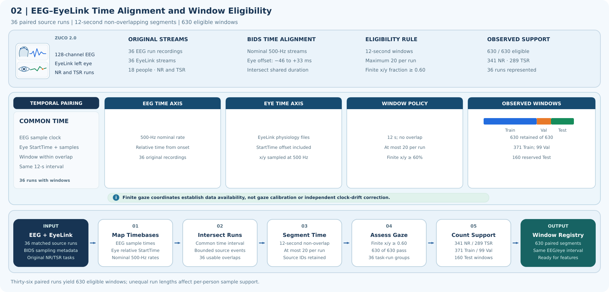
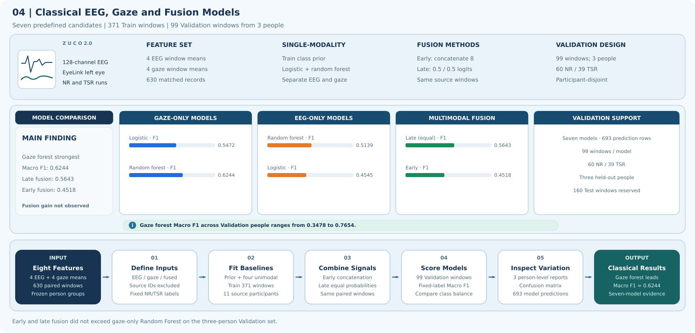
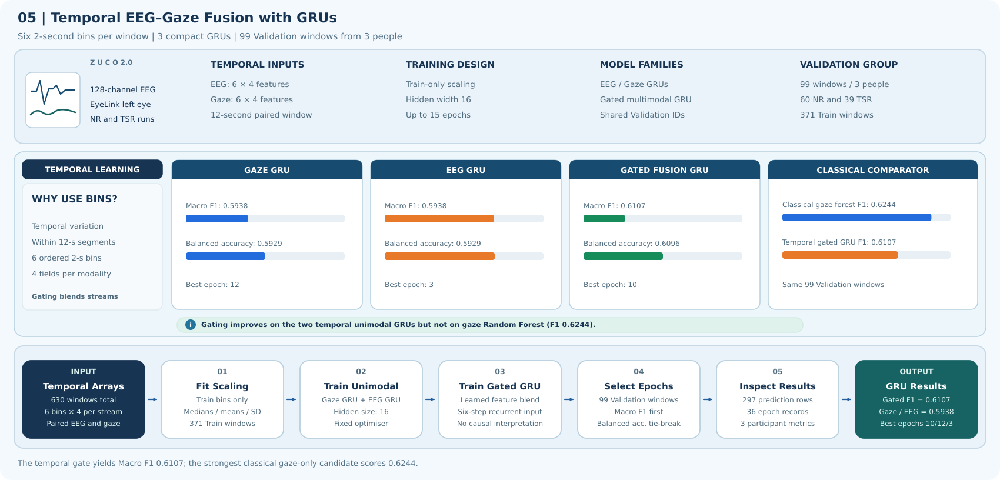

# EEG–Eye-Tracking Multimodal Research

A six-notebook research workflow investigating whether EEG and eye movements provide complementary information for distinguishing original ZuCo 2.0 **Normal Reading (NR)** from **Task-Specific Reading (TSR)** conditions. **Stages 01–05 have now executed and been published for the expanded 18-person cohort**: 36 original NR/TSR runs, 630 matched eligible 12-second windows, paired EEG/gaze features, seven classical/simple-fusion models and three GRUs. Participant-disjoint roles remain **11 Train / 3 Validation / 4 reserved Test people** (**371/99/160 windows**). **Gaze Random Forest** leads the recorded ten candidate pooled Validation Macro F1 scores (**0.6244**), ahead of **Gated Fusion GRU (0.6107)**; the formal ten-model development selection and sensitivity analysis are **pending Notebook 06**. No held-out Test scoring or independently established EEG–EyeLink drift correction is reported.

**Expanded evidence:** Stage 01 retrieved **36/36** source packages from 18 people; Stage 02 retained **630** eligible paired EEG–gaze windows; Stage 03 saved **630** matched feature rows and separate **630×6×4** temporal arrays with no extraction exclusions. Stage 04 saved **693** predictions across seven classical/simple-fusion candidates and **21** model/person Validation metric rows. Stage 05 saved **297** three-GRU predictions, **nine** person/model metric rows, **36** epoch records, Train-derived scaling and three selected checkpoints. The leading temporal Gated Fusion GRU has Validation Macro F1 **0.6107**; EEG and Gaze GRUs each have **0.5938**. The original `gaze_valid_fraction` feature is constant in Train, and independent timing drift and gaze calibration are unverified.


*Figure 1. Five executed and published stages in the expanded 18-person experiment, with ten current Validation model scores available; the Stage-06 saved model-selection decision and fixed-feature sensitivity remain unexecuted. Test is reserved.*

## 1. Dataset and Experimental Protocol

The source is **ZuCo 2.0**, NEMAR dataset [`nm000279`, release `v1.0.0`](https://www.nemar.org/dataset/nm000279). The current source cohort contains **18 paired-file-eligible participants** with **36 original NR/TSR Run-1 recordings**, split at participant level into **11 Train, 3 Validation and 4 reserved Test people**, retaining all six previously assessed pilot assignments. EEG/eye sidecars report nominal **500-Hz sampling**, **128 EEG channels**, and relative eye `StartTime` offsets between **−0.046 and +0.033 s**. Stage 02 used this source registry to produce **630 eligible paired windows**. Independent clock drift and calibration validity remain unverified.

Source acquisition reads only selected BIDS participants and NR/TSR Run-1 records through the public NEMAR source gateway. To select a different currently supported cohort size, change **`MAX_PARTICIPANTS`** in Notebook 01; the participant-role helper retains the original six-person assignments. `RUNS_PER_TASK=1` is an approved scientific setting, **not** a routine population-size control. The full original archive is not required in advance, and raw EEG/eye physiology is not committed to GitHub.

The initial design uses **one run per task per eligible person**, 12-second non-overlapping paired windows, six two-second feature bins per window, and a seeded **participant-disjoint** Train/Validation/Test split. Run and task labels are verified from BIDS metadata and are never inferred from EEG amplitudes or gaze patterns. Source eligibility rules and scientific boundaries are described in [Research Methods and Evidence](RESEARCH_METHODS_AND_EVIDENCE.md).

**Important limitations:** identical nominal EEG and gaze sample rates do not prove independent-clock synchronisation. The current mapping uses BIDS `StartTime` and sample frequencies, with drift unverified unless independent markers become available. NR versus TSR differs in instructions and possibly text/stimulus content; performance cannot automatically be attributed to cognitive processing or multimodal complementarity.

## 2. Experimental Programme

**Execution status:** **Notebooks 01–05 have executed and are published** for 18 people and 630 paired feature windows. The current classical and temporal candidates have **990 model/window Validation predictions on the same 99 windows from three people**. Gaze Random Forest leads the pooled candidate scores (**Macro F1 0.6244**); Gated Fusion GRU is the best temporal model (**0.6107**). The current **Notebook 06 is prepared but not yet executed** on the expanded cohort. The historical six-person pilot completed a separate development workflow (reference commit `8f2e206`), and its gaze-logistic leader **0.8862** must not be used in the current model choice.

**Current files and provenance:** There are now **40 compatible expanded outputs** in `output/`: seven `01_*`, five `02_*`, seven `03_*`, twelve `04_*` and **nine `05_*`** files. No current `06_*` output has been generated or committed. Current Gated Fusion GRU metrics and the classical scores refer to **the same three independent Validation people**; the four reserved Test people and 160 windows remain unscored. Historical pilot files are available only through Git history.

| Stage | Notebook | Scientific role | Intended named outputs |
| --- | --- | --- | --- |
| 01 | [ZuCo Source Audit and Protocol](code/notebooks/01_zuco_source_audit_and_protocol.ipynb) | **Expanded source stage complete:** 18 participants, 36/36 source packages, 11/3/4 pilot-preserving participant roles, no Test scoring | Seven reconciled current `01_*` files: manifest, assignments, eligibility, download/sidecar evidence, protocol and source overview |
| 02 | [EEG–Gaze Alignment and Quality](code/notebooks/02_eeg_gaze_alignment_and_quality.ipynb) | **Executed, published:** 36 source runs, 630/630 finite-coordinate-eligible windows; 371/99/160 window split, drift unverified | Five committed `02_*` artefacts, including per-person/task QA |
| 03 | [Preprocessing, Features and Neurophysiology](code/notebooks/03_preprocessing_features_and_neurophysiology.ipynb) | **Executed, published:** 630/630 matched feature rows, eight finite mean features, two 630×6×4 arrays, zero exclusions, one Train-constant gaze feature | Seven committed `03_*` artefacts: feature CSV, NPZ, exclusion/quality tables and two figures |
| 04 | [Unimodal Baselines and Classical Fusion](code/notebooks/04_unimodal_baselines_and_classical_fusion.ipynb) | **Executed, published:** seven fixed models on 371 Train windows, compared on 99 Validation windows from three people; **Gaze Random Forest Macro F1 0.6244**, no Test scoring | Twelve `04_*` files: six fitted models, 693 predictions, seven pooled rows, 21 per-person rows, late-fusion weights and two plots |
| 05 | [Temporal and Advanced Fusion](code/notebooks/05_temporal_and_advanced_fusion.ipynb) | **Executed, published:** three GRUs on 371 Train / 99 Validation windows; gated GRU leads temporal models (**Macro F1 0.6107**); no Test scoring | Nine `05_*` files: three checkpoints, scaler, 297 predictions, three pooled metrics, nine person/model rows, 36 epoch records and plot |
| 06 | [Validation Selection and Robustness](code/notebooks/06_robustness_and_final_evaluation.ipynb) | **Prepared, not executed for 18 people:** reconcile ten candidates on identical 99 Validation IDs, save the prespecified choice, person-level comparison and fixed-model masking; Test disabled | Four expected development-only `06_*` files: selection, Validation person metrics, sensitivity and figure |

Each stage has an editable five-band scientific SVG in [`images/`](images/). The [Stage-01 source](images/01_zuco_source_audit_and_protocol.svg), [Stage-02 alignment](images/02_eeg_gaze_alignment_and_quality.svg), [Stage-03 features](images/03_preprocessing_features_and_neurophysiology.svg), [Stage-04 classical results](images/04_unimodal_baselines_and_classical_fusion.svg) and [Stage-05 temporal results](images/05_temporal_and_advanced_fusion.svg) depict recorded **18-person evidence**. The [study overview](images/study_overview.svg) separates these five complete stages from the [prospective Stage-06 Validation decision](images/06_robustness_and_final_evaluation.svg). All figures distinguish observed results from unresolved Test, drift and causal limitations.

## 3. Main Results

*Stages **01–05** below refer to the executed **18-person expanded study**. The earlier six-person pilot's outcomes are historical and cannot establish current rankings. Notebook 06 has not yet saved an expanded ten-model development selection or feature-masking result; Test remains withheld.*

**Executed expanded source audit (Notebook 01):** All **18 indexed participants** had complete original BIDS filename sets for one NR and one TSR Run-1 recording. The **36/36 packages** totalled **3,373.4 MB (3.14 GiB)**. Source sidecars report **128 EEG channels**, nominal **500 Hz** for EEG and EyeLink, and eye-start offsets from **−0.046 to +0.033 seconds**. The frozen partition has **11 Train, 3 Validation and 4 reserved Test people**; six previously assessed pilot roles remain unchanged. The CSV/JSON provenance and identities agree. Source presence does not establish final usable EEG–gaze windows, independent clock-drift verification or model performance.

The relevant comparison is whether a fusion model improves over the strongest **EEG-only or gaze-only** comparator on *identical*, participant-disjoint examples. A negative or mixed fusion result is scientifically informative. Primary model selection is based on Validation only and must **not** be revised using future Test scores.

**Recorded expanded alignment and window audit (Notebook 02 execution, files pending):** The saved Colab notebook processed **36 original EEG–EyeLink run pairs from 18 people**, generated **630 distinct 12-second windows**, and recorded **630/630 passing** the `eye_valid_fraction ≥ 0.60` finite x/y rule. The mean and minimum finite-coordinate fractions were **1.000 across all 36 person/task groups**. `sub-YAK / NR` contributed **one window** because its EEG source lasts approximately **15.196 seconds**; many other runs reached the predefined **20-window cap**. The grouping and original tasks are:

| Partition | NR windows | TSR windows | Total windows | Independent people |
| --- | ---: | ---: | ---: | ---: |
| Train | 201 | 170 | **371** | 11 |
| Validation | 60 | 39 | **99** | 3 |
| Test (reserved) | 80 | 80 | **160** | 4 |
| **Overall** | **341** | **289** | **630** | **18** |

These figures are now supported by **five committed 18-person Stage-02 files**, including the 630-window registry, per-run alignment evidence, per-person/task QA and the saved figure. The finite x/y criterion is not independent eye-calibration or drift verification. All 36 original person/task groups produced at least one eligible window.



*Figure 2. Executed Stage-02 evidence: 18 participants, 630 eligible windows and BIDS-relative alignment limits. No independent inter-device drift validation is claimed.*

**Executed Stage-03 feature extraction (Notebook 03):** All **630** paired Stage-02 windows were processed, preserving **371 Train, 99 Validation and 160 reserved Test** rows from **11/3/4 people**. The saved `03_features.csv` contains **four EEG and four gaze window-mean fields**, all finite; the original source metadata and all 630 unique window IDs match Stage 02. Two temporal arrays have shape **(630, 6, 4)** per modality, as printed by the executed notebook. All **36 participant/task groups** remain represented, and no extraction failure was reported. The eight-row Train-derived quality table identifies **`gaze_valid_fraction` as constant (1.000)**, whereas the other seven mean predictors vary on Train. These are feature-availability findings, not model results or calibration validation.

The exploratory fixation-locked raw EEG plot has a large uncorrected baseline offset (approximately **−10,100 µV**). It is **not a validated fixation-related potential or filtered EEG feature plot** and must not support physiological conclusions.

**Executed classical and simple-fusion Validation comparison (Notebook 04).** All seven predefined candidates were fitted using **371 Train windows from 11 people** (except fixed equal-weight late fusion, which mixes two trained models) and evaluated on the **same 99 Validation windows from three people** (**60 NR / 39 TSR**). The saved **693 model/window predictions** agree with the seven metric rows and the **21 descriptive person/model records**. The best classical candidate is **Gaze Random Forest**, not the previously favoured pilot gaze logistic model:

| Candidate | Validation Macro F1 | Balanced Accuracy | Accuracy |
| --- | ---: | ---: | ---: |
| **Gaze Random Forest** | **0.6244** | **0.6231** | **0.6465** |
| Equal-weight late fusion | 0.5643 | 0.5641 | 0.5859 |
| Gaze logistic regression | 0.5472 | 0.5474 | 0.5657 |
| EEG random forest | 0.5139 | 0.5282 | 0.5152 |
| EEG logistic regression | 0.4545 | 0.4737 | 0.4545 |
| Early-fusion logistic regression | 0.4518 | 0.4603 | 0.4545 |
| Class prior | 0.3774 | 0.5000 | 0.6061 |

The gaze-forest confusion matrix contains **44/60 NR** and **20/39 TSR** correctly classified windows. Its per-person Validation Macro F1 is **0.7654** (`sub-YDR`, 31 windows), **0.6306** (`sub-YRH`, 38) and **0.3478** (`sub-YTL`, 30). This variation cautions against interpreting the pooled-window score as population-level generalisation. Neither early nor fixed late EEG–gaze fusion exceeded the strongest unimodal candidate **on this Validation set**; no general fusion-harm or causal conclusion follows.



*Figure 3. Executed expanded seven-candidate Validation comparison, with three held-out participants and no Test scoring. Scores come from saved source-matched Validation predictions.*

**Executed temporal and gated-fusion Validation comparison (Notebook 05).** All three GRUs used **371 Train windows from 11 people** and the same **99 Validation windows from three people** as the classical candidates. The saved `05_validation_predictions.csv` contains **297 model/window rows** and `05_validation_person_metrics.csv` contains nine person/model records. Training histories cover **36 epochs** across the three selected checkpoints.

| Temporal candidate | Best epoch | Macro F1 | Balanced Accuracy | Accuracy |
| --- | ---: | ---: | ---: | ---: |
| **Gated Fusion GRU** | **10** | **0.6107** | **0.6096** | **0.6465** |
| Gaze GRU | 12 | 0.5938 | 0.5929 | 0.6263 |
| EEG GRU | 3 | 0.5938 | 0.5929 | 0.6263 |

Gated Fusion GRU correctly classified **47/60 NR** and **17/39 TSR** windows. Its per-person Macro F1 varies from **0.3922** (`sub-YDR`) to **0.6042** (`sub-YRH`) and **0.4000** (`sub-YTL`). Gaze GRU and EEG GRU share the **same pooled metrics but not identical individual predictions**. The leading classical Gaze Random Forest score (**0.6244**) remains **0.0137** above gated GRU on the same pooled Validation set, but neither model has an externally validated performance estimate.



*Figure 4. Observed compact-GRU Validation comparison across the same three independent participants, with no Test inference. Gating is not a physiological or causal explanation.*

**Next development stage:** All ten prespecified candidate metrics now exist for the current Validation cohort, but the saved, rule-based **Stage-06 model selection and fixed early-fusion masking sensitivity are not yet executed**. The initial six-person pilot's Stage-06 decision and masking scores remain separate [historical evidence](https://github.com/RezaSaadatyar/Eye-Tracking-Neurocognitive-Intelligence/tree/8f2e2064272955782400c5fb5ce15dca76640d13/eeg_eye_tracking_fusion/output).

**Final-evaluation status:** The expanded study has completed **classical and temporal development Validation only**. No final-Test predictions, metrics or uncertainty estimates exist for the **160 reserved Test windows from four people**. `RUN_FINAL_TEST=False` remains the required development setting.

## 4. Running and Reviewing the Study

**Next execution: Notebook 06.** The active **40 Stage-01–05 output files** have been published on the same 18-person, 630-window experiment. Open the latest [Notebook 06](code/notebooks/06_robustness_and_final_evaluation.ipynb) using a fresh Colab Runtime. Its Setup remains the **approved short repository checkout** and shared `setup_colab("eeg_eye_tracking_fusion")` helper. No extra checkout manager, model reconfiguration or Test scoring is required.

Stage 06 reconciles **693 classical + 297 GRU = 990 saved Validation prediction rows**, representing **ten candidates on the same 99 windows from three independent people**. It verifies Stage-03 feature identities, Train-fitted temporal scaling, checkpoints and saved probabilities, then applies the frozen **Macro F1 → Balanced Accuracy → predefined priority** selection. It also writes **30 descriptive candidate/person rows** and tests the unchanged early-fusion logistic model under three predefined Validation input conditions.

**Keep `RUN_FINAL_TEST=False`.** This is a development-mode comparison and **must not create `06_test_*` files**. After successful execution, review, commit and reconcile the expected **four `06_*` outputs** before describing an executed ten-model decision or masking sensitivity. A separate scientific review would be required before any final-Test execution.

The raw data path is not persistent between Colab sessions. Stage 02/03 source retrieval is intentionally limited to the selected runs rather than the full 18-GB release. GPU use is optional for the compact temporal models; free Colab resource availability is not guaranteed. The original source's attribution and use conditions remain applicable.

## 5. Files and Saved Outputs

**Current expanded output set:** Seven files belong to Stage 01, five to Stage 02, seven to Stage 03, twelve to Stage 04 and **nine to Stage 05** (**40 current outputs**). Stage 05 includes `05_validation_person_metrics.csv` (nine records), `05_training_history.csv` (36), three saved GRU checkpoints and Train-derived scaling. The four expected Stage-06 development files are **not yet present**.

```text
eeg_eye_tracking_fusion/
├── README.md
├── RESEARCH_METHODS_AND_EVIDENCE.md
├── requirements.txt
├── code/
│   ├── notebooks/              # Six ordered Colab notebooks
│   └── src/                    # Source, alignment, features and model helpers
├── images/                     # Overview and six role-based SVG figures
├── output/                     # Stage-01–06 development evidence files
└── data/                       # Source cache is external to Git by design
```

Notebook outputs in [`output/`](output/) are owned by their stages. The active directory contains **40 compatible 18-person Stage-01–05 outputs**, comprising **7/5/7/12/9** files by stage. **No current `06_*` outputs** are published; historical six-person development scores are accessible via Git history only. The 990 saved model/window predictions are **Validation records**, not final held-out Test scores.

## 6. Interpretation and Scope

This project studies original reading-task labels from paired EEG and eye movements. A classifier may exploit task instructions, source texts, session conditions, eye movements and other nuisance differences; high task discrimination **does not directly demonstrate language comprehension, neurocognitive state, clinical validity or causal EEG contributions**.

Temporal EEG features derive from a fixed 16-channel subset without anatomical localisation claims. The published exploratory raw fixation-locked trace has a large uncorrected offset and does not substitute for a referenced/filtered, artefact-controlled ERP/FRP analysis. Participant-disjoint validation controls person overlap, **not cross-session or stimulus confounding**. Independent timing drift and external generalisation remain unverified unless explicitly assessed.

**Data and attribution:** [ZuCo 2.0 (Hollenstein et al., LREC 2020)](https://aclanthology.org/2020.lrec-1.18/), [NEMAR release nm000279](https://doi.org/10.82901/nemar.nm000279), licence reported in the BIDS metadata as CC BY 4.0. Code and methodological outputs in this repository are separate from the original source recordings.
