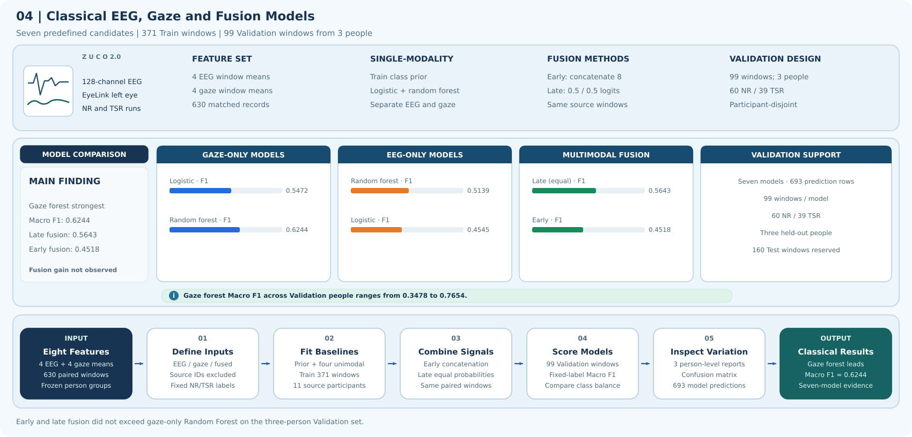
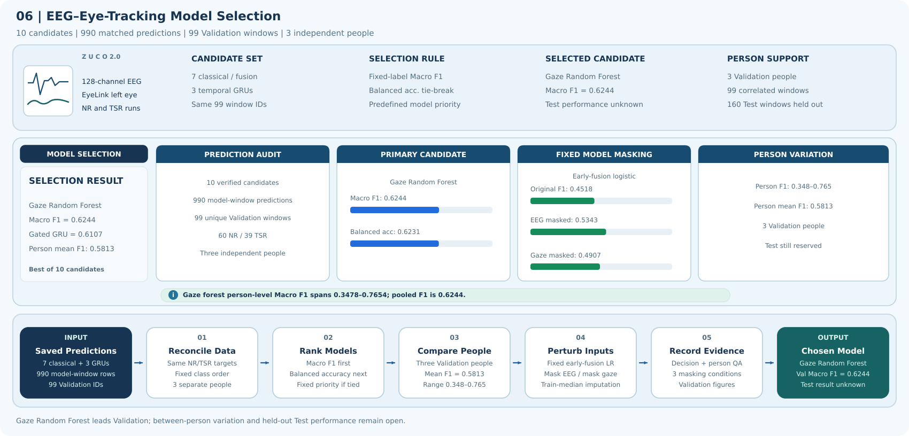

# EEG–Eye-Tracking Multimodal Research: Research Methods and Evidence

**Current status:** The expanded **18-person ZuCo 2.0 Stages 01–06 have executed and been published in development-only mode**. Eighteen people contributed **36 original NR/TSR Run-1 recordings**, yielding **630 paired 12-second EEG/gaze windows** and 630 matched feature rows. Frozen independent-person roles comprise **11 Train / 3 Validation / 4 reserved Test people**, with **371/99/160 windows**. Stage 04 evaluated seven classical/simple-fusion candidates (693 Validation predictions); Stage 05 three GRUs (297 predictions). Stage 06 reconciled **all 990 model/window records on the same 99 Validation windows**, applied the fixed Macro F1/then Balanced Accuracy/then candidate-priority rule, and **selected Gaze Random Forest** (pooled Validation Macro F1 **0.6244**, Balanced Accuracy **0.6231**, Accuracy **0.6465**). It also published **30 descriptive model/person records** and three fixed early-fusion masking conditions. All **44 stage-owned `01_*`–`06_*` outputs** are committed. **Final Test remains unscored**, and independent EEG–EyeLink drift, gaze calibration and external generalisation remain unverified.

## 1. Research Objective and Scope

**Research question:** For paired EEG and gaze windows obtained from ZuCo 2.0, can multimodal predictors distinguish documented reading-task conditions more effectively than gaze-only and EEG-only models under unseen-participant evaluation?

The primary supervised target is **NR versus TSR** (source task protocol). It is not direct comprehension prediction, cognition measurement or a clinical endpoint. We explicitly test whether fusion adds value over each individual modality on the *same eligible windows*, avoiding an automatic assumption that an additional modality improves classification. Advanced fusion is exploratory given the small number of independent people.

The study extends existing eye-tracking infrastructure with EEG reading, source-specific co-registration and grouped inference. No features, labels or results from GazeBase are transferred into this analysis.

## 2. Data Sources, Cohort and Target Definitions

### Sources and access

Source: [ZuCo 2.0](https://www.nemar.org/dataset/nm000279), BIDS version 1.9.0, NEMAR release `nm000279` **v1.0.0**. The source's BIDS description attributes the dataset to Hollenstein, Tröndle, Zhang and Langer (2020), with reported **CC-BY-4.0** terms. The release lists 18 people and nominally 128-channel EEG (EGI) and EyeLink 1000 left-eye data at 500 Hz. Some *per-run* EEG sidecars use different manufacturer/reference strings from general task metadata; preprocessing must follow the run actually read, and the acquisition reference cannot be inferred from the source-level summary.

The repository does not bundle original EEG/eye source signals. The source helper retrieves named files from the public NEMAR `data.nemar.org/nm000279/v1.0.0/` gateway, using the [BIDS file index](https://github.com/nemarDatasets/nm000279). Each run requires BrainVision `.eeg`, `.vhdr`, `.vmrk`, EEG JSON, channels/events tables and EyeLink `physio.tsv.gz` with its JSON sidecar. The **current expanded source manifest** contains **all 18 listed participants**, with **one NR and one TSR Run-1 recording per person**. The **earlier six-person pilot** included `sub-YAC`, `sub-YAG`, `sub-YAK`, `sub-YDG`, `sub-YDR` and `sub-YFR`; its roles remain locked in the expanded protocol. Raw source data must be reacquired or accessed through a valid local cache after Colab Runtime changes.

### Cohort and analytical units

The original person is the **independent partition and uncertainty unit**. Each person may contribute paired NR/TSR runs, each run supplies non-overlapping **12-second temporal windows**, and each window supplies **six two-second bins**. Prediction rows are windows, not independent participants; windows from the same person never cross Train/Validation/Test roles.

The **historical pilot** used seeded participant-disjoint partitioning to assign **3 Train / 1 Validation / 2 reserved Test people**; its saved Stage-02 run generated **95 Train / 31 Validation / 80 reserved Test** windows. The **current expanded Stage-01 protocol** uses `expanded_cohort_roles` with `seed=17`, allocating **11 Train / 3 Validation / 4 reserved Test people** and explicitly preserving the original pilot assignments. `01_source_manifest.csv`, `01_split_assignments.csv`, `01_source_eligibility.csv` and `01_protocol.json` reconcile on **18 unique person identities and 36 original NR/TSR Run-1 records**. The expanded cohort has **not yet been screened for adequate overlap or eligible 12-second EEG–gaze windows**.

### Inputs and targets

**Task** is read from the BIDS filename/metadata (`nr` / `tsr`), mapped to class indices 0/1. Person ID, run ID, source file name and split role are **provenance/grouping fields**, never predictors. Candidate predictors include gaze coordinates, pupil and vendor fixation events, and EEG bandpower/RMS features within the same valid time window. Source text content is not used as a predictor in the implemented benchmark. Text, task/run duration and other stimulus differences could still confound this classification; a text-only baseline would require an independently specified compatible mapping.

## 3. Data Preparation and Representations

**Recorded expanded Stage-01 source evidence:** The newly uploaded files list **18 of 18 source participants** with complete NR and TSR Run-1 filename sets, selecting **36 distinct original task runs** with **36/36 source packages recorded present** (eight BIDS files per run). Total recorded retrieval was **3,373.4 MB (approximately 3.14 GiB)**. Every source sidecar reports **128 EEG channels**, nominal **500-Hz** EEG and eye sampling and gaze `StartTime` offsets in **[−0.046, +0.033] seconds**. The smallest observed package remains `sub-YAK / NR` (~**3.95 MB**). The current 18-person Stage-02 quality evidence confirms its EEG duration at approximately **15.196 s** and **one eligible window**.

**Recorded source/role provenance (resolved):** The latest Notebook-01 execution used `expanded_cohort_roles` and saved the required protocol fields: `selected_people=18`, `eligible_source_pool=18`, `role_policy=pilot_roles_locked_full_pool_seeded_expansion`, the explicit six-person `pilot_role_lock`, and split counts **11/3/4**. Original pilot Test participants `sub-YAC` and `sub-YAG` remain Test; `sub-YDR` remains Validation; and `sub-YAK`, `sub-YDG`, `sub-YFR` remain Train. The new reserved Test includes `sub-YMD` and `sub-YRP`, selected before any expanded model fitting. The saved manifest, roles and eligibility agree. A stale split from an earlier execution is **superseded**, not a remaining scientific defect in the current Stage-01 evidence.

Stage 02 uses lazy BrainVision EEG loading and the compressed EyeLink table for each selected run. EEG sample times and EyeLink `StartTime + sample_index / gaze_sampling_frequency` define the **BIDS-relative common-timebase assumption**. For each run, the window builder checks plausible original event onset bounds and derives non-overlapping **12-second windows** from their common time interval, capped at **20 windows per Run 1**. The finite-eye criterion is **at least 60% rows with finite gaze x/y coordinates**; it is *not* a calibrated eye-tracking quality metric. No shared-raw-trigger drift fit or independent clock-correction estimate is implemented; every Run-level report sets `drift_verified=False`.

**Executed and published Stage-02 evidence:** All **36 original NR/TSR Run-1 pairs** yielded non-empty BIDS-relative EEG–EyeLink overlap and at least one eligible **12-second window** per participant/task. The five committed Stage-02 files contain **630/630 eligible windows** (341 NR, 289 TSR): **371 Train** (201 NR, 170 TSR; 11 people), **99 Validation** (60 NR, 39 TSR; three people), and **160 reserved Test** (80 NR, 80 TSR; four people). All 630 window IDs are unique; person roles, Run 1 and tasks match Stage 01. The **36 person/task quality groups** have mean and minimum finite gaze x/y coverage **1.000** under the narrow eligibility criterion. `sub-YAK / NR` contributes **one window** from a ~15.196-s EEG recording. Several runs reach the fixed **20-window cap**, so pooled-window inference weights participants/tasks unequally.

**Alignment limitation:** `drift_verified=False` is recorded in all 36 run-level reports. The source synchronisation assumption relies on BIDS `StartTime` and nominal sample frequencies; finite x/y coordinates are **not** independent evidence of valid gaze calibration, blink/pupil quality, EEG artefact rejection or clock-drift correction. All five current Stage-02 outputs have now been published and reconciled with Stage 01.

**Executed and published Stage-03 feature evidence:** All **630** Stage-02 eligible paired windows were processed and retained, with **371 Train, 99 Validation and 160 reserved Test** feature rows from **11/3/4 participants**. The `03_features.csv` preserves the exact 630 source window IDs, participants, task labels, original Run IDs, split roles and time bounds from Stage 02. Four EEG window-mean fields and four gaze window-mean fields have **zero non-finite values**; the extraction-exclusion CSV contains no data rows, and the 36 person/task support groups sum to 630. Executed Notebook 03 printed **two aligned temporal array shapes of (630, 6, 4)**, one per modality; the current compressed NPZ has been committed. The eight-row `03_feature_quality.csv` reports **371 Train windows per feature**, with `gaze_valid_fraction` **constant on Train** (standard deviation 0.000), whereas the other seven predictors vary. This is a feature-quality and provenance check, **not** a model result or independent evidence of eye calibration.

Stage 03 reads 16 actual EEG channels (`E1` onwards when available, for compact analysis). Per-window channel centring acts as a reference and a 1–40 Hz Butterworth filter is applied to the loaded EEG window. For each two-second bin, Welch spectra yield channel-mean theta (4–8 Hz), alpha (8–13 Hz), beta (13–30 Hz) log bandpower and EEG RMS (µV). Eye features are finite-coordinate fraction, median pixel speed, median pupil size and fraction of time overlapping vendor fixation events. These eight features are separate modality groups and each paired window is represented both as a mean-feature vector and as six time bins per modality. All units and missingness are preserved; Train-only scaling/imputation belongs to modelling stages. When temporal models load the saved numeric sequences, they verify each modality's per-window six-bin means against the corresponding feature CSV row before fitting. This checks original-row alignment without enabling unsafe Pickle deserialisation; the source data and feature values are not modified.

A **Train-only**, fixation-locked raw single-channel EEG average is saved as an exploratory visual diagnostic. The recorded plot shows a large **uncorrected voltage offset of approximately −10,100 µV**; its source trace is not the mean-referenced or 1–40 Hz filtered EEG used for the spectral model features. Because overlapping reading fixations, possible ocular artefacts and absent deconvolution/baseline control limit interpretation, it is **not** a validated ERP/FRP effect, cortical localisation or explanation of reading cognition.

## 4. Experimental Design and Evaluation

**Expanded evidence through ten-candidate development selection:** Stages 01–03 reconcile on **18 people, 36 original NR/TSR runs, 630 eligible windows and 630 feature rows**. The seven classical/simple-fusion and three GRU candidates use **371 Train windows (11 people)** and identical **99 Validation windows (three people)**, generating **990 saved model/window predictions**. Stage-06 checks confirmed source ID, task label, participant role, Train-derived temporal scaling, GRU checkpoint metadata and saved prediction/metric consistency. The rule-based development selection is **Gaze Random Forest**; descriptive per-person metrics supplement but do **not** replace the frozen pooled-window selection rule. No Test labels or predictions influenced the selection.

**Scientific rationale:** Previously inspected pilot Validation examples must not be reclassified as unseen Test data. Seed-based re-splitting after changing the participant limit could expose the selected model to people subsequently labelled Test. Source-run and Task coverage, finite EEG/gaze temporal pairing and participant-level class counts are therefore checked before modelling. The new Stage-02 run-task quality table and Stage-03 Train-feature quality table document exclusions and constant or missing measurements, without claiming independently verified clock drift. If a selected run loses both-class coverage, the pipeline stops rather than silently changing its scientific population.

The frozen participant grouping prevents direct same-person overlap between Train, Validation and reserved Test. All **ten** candidates contributed predictions for the same **99 original Validation window IDs** and the recorded **990 model/window rows** reconciled with fixed NR/TSR labels and probability ordering. The Stage-06 development decision is recorded and verified; no Test scoring occurred. This design does **not** remove task/stimulus confounding or make repeated windows within a participant independent.

**Executed cross-family selection policy:** Maximise fixed-label **Validation Macro F1**, then Balanced Accuracy, then predefined candidate priority. The saved `06_model_selection.csv` selects **`gaze_forest`**, Macro F1 **0.624390243902439**, on **three independent Validation participants**, with **`run_mode=development`** and **`test_used_in_selection=False`**. Its closest competitor was Gated Fusion GRU (**0.6107**). The earlier six-person pilot selected Gaze Logistic (0.8862 on one Validation person), a different study condition and not the current model choice.

**Final Test boundary:** All current model-selection results come from **99 Validation windows of three people** after fitting on **371 Train windows**. The **160 Test windows of four other people** remain reserved and unscored. Stage 06 executed with **`RUN_FINAL_TEST=False`** and created no Test predictions, scores, uncertainty estimates or confusion figure. Any future final Test requires a separately authorised scientific decision.

## 5. Methods, Models and Configurations

**Implementation and environment:** All six notebooks use the approved short Colab checkout and `setup_colab("eeg_eye_tracking_fusion")`. The protocol fixes 12-second windows, six two-second bins, seed 17, seven classical/simple-fusion candidates, three GRUs and participant-disjoint partitions. Stages 04–05 fitted and scored models on the specified Train/Validation roles; Stage 06 independently reconciled their saved predictions and preserved the predefined selection rule. The **30 candidate/person Validation metrics** and three masking conditions are descriptive additions, not selection-rule changes. No grouped cross-validation, parameter sweep informed by Test, or independent Test scoring was performed.

| Candidate | Input | Configuration and role |
| --- | --- | --- |
| Class Prior | No physiological predictor | Training class frequency baseline |
| Gaze Logistic / Gaze Forest | Gaze-only mean features | Train-only median imputation; regularised logistic or 150-tree random forest |
| EEG Logistic / EEG Forest | EEG-only spectral/RMS means | Same fixed preprocessing and model families |
| Early Fusion Logistic | Joined EEG+gaze means | Same Train-fitted median/scaler/logistic pipeline |
| Late Equal Fusion | Gaze and EEG logistic probabilities | Fixed `0.5/0.5` mean; no Test-tuned weight |
| Gaze GRU / EEG GRU | Six two-second modality bins | Hidden size 16, dropout 0.2, AdamW, maximal 15 epochs, early stopping on Validation |
| Gated Fusion GRU | Paired EEG and gaze bins | Sigmoid blend of modality embeddings plus compact GRU; gating is not causal attribution |

**Executed expanded temporal recipe:** Train-only medians, means and standard deviations were saved in `05_scaling.npz`. Three GRUs use hidden width **16**, dropout **0.2**, AdamW (learning rate and weight decay **0.001**), batch size **64**, up to **15 epochs**, patience **four**, seed **17**, and Validation-Macro-F1 checkpoint selection with Balanced Accuracy/loss tie-breaks. The two unimodal models have **1,090 parameters each** and gated fusion **2,354**. Observed history: **15 gaze, seven EEG and 14 gated epochs (36 total)**; selected epochs **12/3/10**.

## 6. Results and Comparative Analysis

**Current expanded source-to-feature evidence (Notebooks 01–03):** Eighteen independent people supplied **36 original NR/TSR Run-1 source recordings**. Stage 02 generated **630 BIDS-relative finite-coordinate-eligible 12-second windows**, and Stage 03 extracted **630 matched EEG/gaze feature rows**, with **zero exclusions and no non-finite window means**. The recorded temporal arrays each have shape **(630, 6, 4)**. The frozen partition has **371 Train windows (11 people)**, **99 Validation (three people)** and **160 reserved Test (four people)**. All 630 unique source IDs and participant roles reconcile across the active Stage-02/03 files. The Train-constant `gaze_valid_fraction` feature equals 1.000 and cannot discriminate NR from TSR in this cohort.

**Current expanded Stage-04 classical and simple-fusion Validation comparison.** Seven prespecified candidates were fitted on **371 Train windows from eleven independent people**, with the fixed late-fusion mixture using the already trained EEG/gaze logistic models. The same **99 Validation windows (60 NR / 39 TSR) from three independent people** were scored for each candidate. The **693 saved prediction rows** were reconciled to their original source IDs and fixed NR/TSR class labels, and independently recalculated Accuracy, Macro F1 and Balanced Accuracy agree with the seven saved metrics.

| Current expanded candidate | Validation Macro F1 | Balanced Accuracy | Accuracy |
| --- | ---: | ---: | ---: |
| **Gaze random forest** | **0.6244** | **0.6231** | **0.6465** |
| Equal-weight late fusion | 0.5643 | 0.5641 | 0.5859 |
| Gaze logistic regression | 0.5472 | 0.5474 | 0.5657 |
| EEG random forest | 0.5139 | 0.5282 | 0.5152 |
| EEG logistic regression | 0.4545 | 0.4737 | 0.4545 |
| Early-fusion logistic regression | 0.4518 | 0.4603 | 0.4545 |
| Class prior | 0.3774 | 0.5000 | 0.6061 |

The current best classical candidate, Gaze Random Forest, correctly classified **44/60 NR** and **20/39 TSR** Validation windows. Its person-level Macro F1 values were **0.7654 on sub-YDR** (31 windows), **0.6306 on sub-YRH** (38), and **0.3478 on sub-YTL** (30). The pooled-window leader therefore displays considerable between-person variation. Fixed late fusion was **0.0600** below the strongest unimodal candidate, and early-fusion logistic regression **0.1726** below it, in Macro F1. Neither result demonstrates a general population-level fusion disadvantage. No Test score or cross-family winner has been determined.

*Figure: Current 18-person classical Validation evidence. Values are based on 99 repeated windows from three independent people and should not be treated as 99 independent participants.*

**Historical six-person pilot: classical and simple-fusion Validation comparison (Notebook 04).** This following table is **archived evidence** from 31 Validation windows (20 NR, 11 TSR) of one person and 217 predictions. The current expanded Stage-04 results are documented above.

| Candidate | Validation Macro F1 | Balanced Accuracy | Accuracy |
| --- | ---: | ---: | ---: |
| Gaze logistic regression | **0.8862** | **0.8636** | **0.9032** |
| Equal-weight late fusion | 0.7786 | 0.7682 | 0.8065 |
| Gaze random forest | 0.6601 | 0.6682 | 0.6774 |
| Early-fusion logistic regression | 0.5620 | 0.5909 | 0.7097 |
| EEG random forest | 0.2955 | 0.2955 | 0.3548 |
| Class prior | 0.2619 | 0.5000 | 0.3548 |
| EEG logistic regression | 0.1622 | 0.2727 | 0.1935 |

The highest-scoring classical candidate, gaze logistic regression, correctly predicted **20/20 NR** and **8/11 TSR** windows. Compared with this strongest unimodal comparator, late fusion scored **0.1076 lower** and early fusion **0.3242 lower** in Validation Macro F1. These comparisons are descriptive: repeated windows from one held-out person do not establish a population-level model ranking or independent generalisation. Source text/task differences, unequal run contributions, gaze artefacts and ocular activity in EEG may contribute to task discrimination.

**Executed expanded Stage-05 GRU Validation comparison.** All three compact models were trained on **371 Train windows from 11 people**, then assessed on the same **99 Validation windows (60 NR / 39 TSR) from three people** used in Stage 04. The **297 saved predictions**, three summary metric rows and nine model/person rows were reconciled to original source IDs; recalculated metrics agree with saved values. Epoch history comprises 15 gaze, seven EEG and 14 gated records.

| Current temporal candidate | Selected epoch | Parameters | Macro F1 | Balanced Accuracy | Accuracy |
| --- | ---: | ---: | ---: | ---: | ---: |
| **Gated Fusion GRU** | **10** | 2,354 | **0.6107** | **0.6096** | **0.6465** |
| Gaze GRU | 12 | 1,090 | 0.5938 | 0.5929 | 0.6263 |
| EEG GRU | 3 | 1,090 | 0.5938 | 0.5929 | 0.6263 |

Gated Fusion GRU correctly identifies **47/60 NR** and **17/39 TSR** windows, with person-level Macro F1 **0.3922 / 0.6042 / 0.4000** across `sub-YDR / sub-YRH / sub-YTL`. The two unimodal GRUs share pooled scores but **not individual predictions**. The leading temporal Macro F1 is **0.0137 below** current classical Gaze Random Forest **0.6244**, not an independently validated difference.

*Figure: Executed expanded temporal comparison on three independent Validation people; no Test or independent clock-drift verification.*

**Historical six-person pilot: temporal Validation comparison (Notebook 05).** The following metrics and 93 predictions are **archived six-person pilot evidence on one Validation person**, not current expanded-cohort GRU results.

| Temporal candidate | Best epoch | Parameters | Validation Macro F1 | Balanced Accuracy | Accuracy |
| --- | ---: | ---: | ---: | ---: | ---: |
| EEG GRU | 9 | 1,090 | **0.6890** | **0.6932** | **0.7097** |
| Gaze GRU | 15 | 1,090 | 0.3922 | 0.5000 | 0.6452 |
| Gated EEG–gaze GRU | 15 | 2,354 | 0.2619 | 0.5000 | 0.3548 |

The EEG GRU achieved **15/20 NR** and **7/11 TSR** correct predictions, whereas the gaze GRU classified **all 31** Validation windows as NR and the gated fusion GRU classified **all 31** as TSR. The 43 saved model-epoch records comprise **15 gaze GRU, 13 EEG GRU and 15 gated fusion GRU epochs**. These saved trajectories document training and checkpoint selection, not population-level generalisation.

[Historical pilot Stage-05 learning curves](https://github.com/RezaSaadatyar/Eye-Tracking-Neurocognitive-Intelligence/blob/8f2e2064272955782400c5fb5ce15dca76640d13/eeg_eye_tracking_fusion/output/05_learning_curves.png)

*Figure: Recorded Stage-05 training and Validation trajectories. Validation scores are calculated on 31 repeated windows from one participant, rather than 31 independent participants.*

**Historical pilot comparison across ten candidates:** In the earlier six-person development run, gaze logistic regression had Validation Macro F1 **0.8862**, ahead of EEG GRU (**0.6890**) on the same 31 windows. Early, late and gated-fusion variants did not surpass the strongest unimodal comparator in that single-person Validation set. **These historical rankings do not determine the expanded-cohort winner** and cannot be assumed to generalise across the three current Validation participants.

**Historical pilot evidence and limits:** The earlier six-person experiment's model-score reconciliation involved **310 saved Validation prediction rows** (217 classical and 93 temporal) from one Validation person. These files remain in Git history and were not independently refitted in the present review. The current expanded Stage-06 evaluation is **separately executed and recorded on 18 people**, with ten candidates and 990 Validation prediction rows. The old pilot result must not be reported as current performance.

**Current expanded Stage-06 development-only model selection.** All **ten** candidate metrics and **990 model/window predictions** were reconciled on identical **99 Validation windows from three people**, containing **60 NR** and **39 TSR**. Independent recomputation of fixed-label Accuracy, Macro F1 and Balanced Accuracy matched all ten stored metric rows. The one-record `06_model_selection.csv` saved **Gaze Random Forest** as the primary *development* candidate (Macro F1 **0.6244**, Balanced Accuracy **0.6231**, Accuracy **0.6465**), and recorded no Test use.

| Rank | Current candidate | Pooled Validation Macro F1 | Balanced Accuracy |
| ---: | --- | ---: | ---: |
| 1 | **Gaze Random Forest** | **0.6244** | **0.6231** |
| 2 | Gated Fusion GRU | 0.6107 | 0.6096 |
| 3 | Gaze GRU | 0.5938 | 0.5929 |
| 4 | EEG GRU | 0.5938 | 0.5929 |
| 5 | Equal-weight late fusion | 0.5643 | 0.5641 |
| 6 | Gaze logistic regression | 0.5472 | 0.5474 |
| 7 | EEG random forest | 0.5139 | 0.5282 |
| 8 | EEG logistic regression | 0.4545 | 0.4737 |
| 9 | Early-fusion logistic regression | 0.4518 | 0.4603 |
| 10 | Train class prior | 0.3774 | 0.5000 |

The selected Gaze Random Forest classified **44/60 NR** and **20/39 TSR** windows correctly. Its **three person-level Macro F1 scores** are **0.7654** (`sub-YDR`, 31 windows), **0.6306** (`sub-YRH`, 38) and **0.3478** (`sub-YTL`, 30). Their unweighted mean (**0.5813**) is distinct from the pooled-window Macro F1 (**0.6244**), showing that window-level aggregation and between-person variability must be interpreted separately. The selected model's margin over Gated Fusion GRU (**0.0137** in Macro F1) is small and is not an independently validated population difference.

*Figure: Current expanded ten-candidate development selection and fixed early-fusion input sensitivity, not held-out Test evaluation.*

**Historical six-person Stage-06 selection and confirmation.** The earlier pilot compared ten candidates and selected gaze logistic regression using the predefined Validation-only rule (Macro F1 **0.8862**, Balanced Accuracy **0.8636**, Accuracy **0.9032** on one person). That choice is **not** a selection for the expanded cohort. Historical model-input checks, fixed NR/TSR probabilities and saved checkpoint integrity checks did not establish external validity; final Test scoring remained disabled.

[Historical pilot Stage-06 Validation ranking and sensitivity](https://github.com/RezaSaadatyar/Eye-Tracking-Neurocognitive-Intelligence/blob/8f2e2064272955782400c5fb5ce15dca76640d13/eeg_eye_tracking_fusion/output/06_validation_evidence.png)

*Figure: **Historical six-person pilot** development evidence on one Validation person (31 windows). This historical figure must not be interpreted as the new 18-person decision or sensitivity result.*

## 7. Robustness, Uncertainty and Additional Analyses

**Current expanded Stage-06 Validation sensitivity (executed).** The already fitted Stage-04 early-fusion logistic model was evaluated on the **same 99 Validation windows from three independent people** after setting either the EEG or gaze window-mean feature group to missing values handled by its **Train-fitted median imputer**. Model parameters were fixed, and the prespecified Gaze Random Forest selection was not revised.

| Fixed early-fusion inputs | Validation Macro F1 | Balanced Accuracy | Accuracy |
| --- | ---: | ---: | ---: |
| Original EEG + gaze | 0.4518 | 0.4603 | 0.4545 |
| EEG features masked | **0.5343** | **0.5571** | **0.6263** |
| Gaze features masked | 0.4907 | 0.5385 | 0.4949 |

Both masks increased Macro F1 for this **particular relatively weak fixed early-fusion model**. Because missing features were replaced by Train imputation values, this is a **distribution-shifting input perturbation**, neither a causal modality contribution estimate nor a comparison of separately trained unimodal models. The findings cannot establish a general negative value of EEG or gaze.

**Historical six-person pilot Stage-06 sensitivity (different experiment):** The fixed Stage-04 early-fusion logistic model was scored after replacing EEG features or gaze features with missing values handled by its already fitted Train-median imputer. No model was refitted and the Validation-selected primary candidate was not changed.

| Fixed early-fusion input | Validation Macro F1 | Balanced Accuracy | Accuracy |
| --- | ---: | ---: | ---: |
| Both modalities unchanged | 0.5620 | 0.5909 | 0.7097 |
| EEG group masked | **0.8862** | **0.8636** | **0.9032** |
| Gaze group masked | 0.4833 | 0.5182 | 0.4839 |

These observations concern **31 repeated Validation windows from one person** and indicate sensitivity of a **fixed estimator** to imputation-based feature removal. The equality between the EEG-masked Macro F1 and the independently trained gaze-logistic model's recorded Macro F1 **does not prove identical predictions or causal modality importance**. Neither a robust EEG harm effect nor gaze-specific physiology is established.

**Uncertainty and withheld Test:** The earlier pilot and expanded model stages have **not scored held-out Test**. Four reserved Test participants contribute 160 windows in the expanded experiment. Conditional Test bootstrap in Notebook 06 is not executed in development mode and would require separate authorisation; four independent people would yield imprecise population inference.

Task/stimulus confounding, unequal quality, eye artefacts in EEG, reading-event overlap, timebase assumptions, limited electrode coverage and small independent sample size are material limitations. No cross-session or external validation is implemented in the initial six-notebook programme.

## 8. Current Outputs and Reproducibility

**Current published evidence boundary:** All **44 stage-owned outputs** belong to the compatible expanded **18-person, 630-window** experiment: seven Stage-01, five Stage-02, seven Stage-03, twelve Stage-04, nine Stage-05 and **four Stage-06 files**. Stage 06 adds its saved ten-candidate development selection, **30 person/model Validation metrics**, three fixed input-masking results and a Validation figure. The historical six-person pilot is accessible only through older Git revisions. No Test-scored outputs are published.

**Stage-owned deliverables:** The current study has complete **7/5/7/12/9/4** stage-owned output files (**44 total**) covering source audit, paired windows, features, seven classical and three temporal candidate results, and the recorded ten-model development selection. Stage 06 produced `06_model_selection.csv`, `06_validation_person_metrics.csv`, `06_validation_sensitivity.csv` and `06_validation_evidence.png`. The Test branch was disabled and produced no Test files.

| Artefact | Path | Producing stage and intended use |
| --- | --- | --- |
| **Executed 18-person source audit and frozen roles** | `output/01_source_manifest.csv`, `01_split_assignments.csv`, `01_source_eligibility.csv`, `01_download_inventory.csv`, `01_acquisition_metadata.csv`, `01_protocol.json`, `01_source_overview.png` | **Seven reconciled Stage-01 files:** 18 selected people, 36 NR/TSR source recordings, 36/36 downloaded packages, 3,373.4 MB, 128-channel and 500-Hz acquisition metadata and 11/3/4 pilot-preserving participant roles |
| **Expanded Stage-02 executed alignment and window audit** | `output/02_window_registry.csv`, `02_alignment_quality.csv`, `02_window_summary.csv`, `02_person_task_quality.csv`, `02_alignment_quality.png` | **Five current files:** 630 unique windows, 36 source runs, 18 people, six split/task summaries, 36 per-person/task QA rows and unverified drift |
| **Expanded Stage-03 executed EEG/gaze representations** | `output/03_features.csv`, `03_temporal_sequences.npz`, `03_exclusion_reasons.csv`, `03_modality_quality.csv`, `03_feature_quality.csv`, `03_temporal_example.png`, `03_fixation_locked_diagnostic.png` | **Seven current files:** 630 aligned feature rows, eight finite mean predictors, 630×6×4 modality arrays, 36 person/task groups, zero exclusions, one Train-constant feature and two descriptive figures (raw EEG is not a validated FRP) |
| **Stage-04 expanded classical comparison, executed and published** | `output/04_validation_metrics.csv`, `04_validation_predictions.csv`, `04_validation_person_metrics.csv`, six `04_*.joblib`, `04_late_fusion.json`, `04_validation_comparison.png`, `04_validation_confusion.png` | **12 current files:** seven classical candidates, 693 predictions on 99 Validation windows, 21 model/person rows, Gaze Random Forest Macro F1 **0.6244**, Test unscored |
| **Stage-05 expanded temporal evaluation, executed and published** | `output/05_validation_metrics.csv`, `05_validation_predictions.csv`, `05_validation_person_metrics.csv`, `05_training_history.csv`, `05_scaling.npz`, three `05_*.pt`, `05_learning_curves.png` | **Nine files:** three current GRUs, 297 predictions, nine model/person records, 36 epoch records, gated GRU Macro F1 **0.6107** |
| **Stage-06 expanded development selection and sensitivity, executed** | `output/06_model_selection.csv`, `06_validation_person_metrics.csv`, `06_validation_sensitivity.csv`, `06_validation_evidence.png` | **Four current files:** ten-candidate choice **Gaze Random Forest Macro F1 0.6244**, 30 person/model Validation rows, three fixed masking conditions and a plot; Test disabled |

All six current 18-person notebooks have **executed and been published**, and their editable scientific SVGs have been reconciled with current evidence. The active study holds **44 stage-owned outputs**, ending in the recorded Stage-06 development selection. This completes the approved **Validation-only six-notebook development pipeline**, **not** final-Test evaluation, independent timing verification or external validation. Historical pilot outputs remain preserved in Git history.

## 9. Discussion, Limitations and Future Work

**Current stopping point:** The expanded six-notebook development workflow has completed: 18 participants, 630 paired windows, ten candidates on 99 Validation windows, a saved **Gaze Random Forest** primary development selection, descriptive per-person evidence and fixed-feature masking. No new experiment or final Test run is part of this review. Before any future Test evaluation or scientific extension, define its scope separately and retain the frozen roles, candidate settings and reported development history.

**Current versus historical interpretation:** The expanded cohort's ten-candidate **development** ranking selects **Gaze Random Forest (Macro F1 0.6244)** over **Gated Fusion GRU (0.6107)**. There is **no observed fusion advantage over the best unimodal gaze model** on these three Validation participants. The selected candidate's person-level Macro F1 varies **0.3478–0.7654**, so its pooled-window score should not be claimed as general person-level performance. The separate six-person pilot had selected Gaze Logistic (0.8862 on one person), illustrating the sensitivity of rankings to the study cohort, not a directly comparable measure of progress. Neither experiment establishes causal EEG effects, reading comprehension prediction, clinical utility or external generalisation.

ZuCo NR and TSR differ in task instructions and may also differ in source-text characteristics; a classifier may discriminate task protocol rather than cognition. The new 18-person source, alignment and feature outputs have been reconciled, but **independent EEG–EyeLink clock-drift measurement, eye calibration, ocular artefact rejection and validated FRP/ERP analysis are not established**. The constant `gaze_valid_fraction` predictor does not distinguish source tasks. Repeated windows within participants and unequal original run durations limit naive window-level uncertainty interpretations. Future work may investigate stimulus-matched controls, independent timing markers, broader EEG analysis and external validation under a separately specified design.

**Attribution:** Hollenstein, N., Tröndle, M., Zhang, C., & Langer, N. (2020). *ZuCo 2.0: A Dataset of Physiological Recordings During Natural Reading and Annotation*. LREC 2020; [publication](https://aclanthology.org/2020.lrec-1.18/), [NEMAR dataset DOI](https://doi.org/10.82901/nemar.nm000279). BIDS metadata identify the dataset licence as CC BY 4.0.
