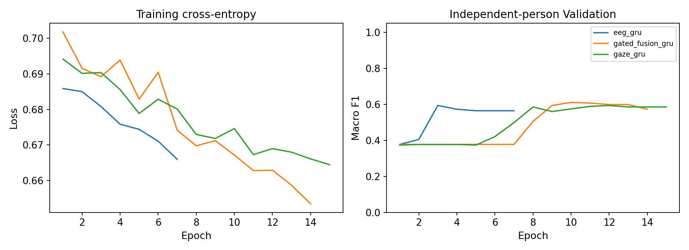
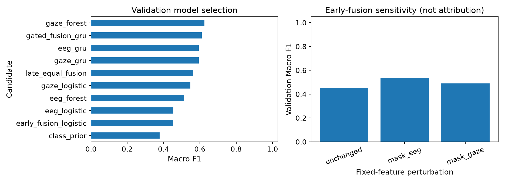

# EEG–Eye-Tracking Multimodal Research: Research Methods and Evidence

**Current status:** The original **six-person pilot** completed all six development notebooks, with **206 paired 12-second windows** and ten Validation candidates; its selected gaze logistic model reached **Macro F1 0.8862 on 31 windows from one person**. This historical development result did not score Test. A subsequent **18-person Notebook-01 source audit** listed all 18 paired-file-eligible participants, downloaded **36/36 NR/TSR Run-1 packages** (**3,373.4 MB**) and recorded consistent nominal EEG/EyeLink acquisition metadata. However, that execution used an obsolete `split_people` function: **five of the six pilot participants changed split roles**, including the previously assessed Validation person `sub-YDR` moving to Test. Therefore the uploaded 18-person participant split is **not an approved final allocation**, and the current Stage-01 files are not compatible with the older Stage-02–06 results. The approved role-preserving source code has been restored, but **must be rerun**; no expanded-cohort aligned windows, extracted features, model results or final Test scores exist.

## 1. Research Objective and Scope

**Research question:** For paired EEG and gaze windows obtained from ZuCo 2.0, can multimodal predictors distinguish documented reading-task conditions more effectively than gaze-only and EEG-only models under unseen-participant evaluation?

The primary supervised target is **NR versus TSR** (source task protocol). It is not direct comprehension prediction, cognition measurement or a clinical endpoint. We explicitly test whether fusion adds value over each individual modality on the *same eligible windows*, avoiding an automatic assumption that an additional modality improves classification. Advanced fusion is exploratory given the small number of independent people.

The study extends existing eye-tracking infrastructure with EEG reading, source-specific co-registration and grouped inference. No features, labels or results from GazeBase are transferred into this analysis.

## 2. Data Sources, Cohort and Target Definitions

### Sources and access

Source: [ZuCo 2.0](https://www.nemar.org/dataset/nm000279), BIDS version 1.9.0, NEMAR release `nm000279` **v1.0.0**. The source's BIDS description attributes the dataset to Hollenstein, Tröndle, Zhang and Langer (2020), with reported **CC-BY-4.0** terms. The release lists 18 people and nominally 128-channel EEG (EGI) and EyeLink 1000 left-eye data at 500 Hz. Some *per-run* EEG sidecars use different manufacturer/reference strings from general task metadata; preprocessing must follow the run actually read, and the acquisition reference cannot be inferred from the source-level summary.

The repository does not bundle original EEG/eye source signals. The source helper uses the public NEMAR `data.nemar.org/nm000279/v1.0.0/` file gateway to retrieve just named BIDS run files; GitHub's [`nemarDatasets/nm000279`](https://github.com/nemarDatasets/nm000279) index provides the actual file listing. Each selected run needs its BrainVision `.eeg` / `.vhdr` / `.vmrk`, EEG JSON, channel table, event table, eye `physio.tsv.gz` and eye JSON. File retrieval is repeated as needed after Colab Runtime resets. The selected source subset contains **sub-YAC, sub-YAG, sub-YAK, sub-YDG, sub-YDR and sub-YFR**, with **one NR and one TSR run per participant**. Enlarging the cohort changes the experiment and requires regeneration of dependent outputs.

### Cohort and analytical units

The original person is the **independent partition and uncertainty unit**. Each person may contribute paired NR/TSR runs, each run supplies non-overlapping **12-second temporal windows**, and each window supplies **six two-second bins**. Prediction rows are windows, not independent participants; windows from the same person never cross Train/Validation/Test roles.

The initial development partition uses a seeded (`seed=17`) random permutation of eligible people, with 20% Test and 20% of the remainder Validation (minimum one each), leaving the rest for Train. The recorded participant split contains **3 Train, 1 Validation and 2 Test people** (6, 2 and 4 original runs respectively). Notebook 02 recorded **95 Train, 31 Validation and 80 reserved Test** windows (101 NR and 105 TSR) with the same participant split. Small development runs must not be used as evidence of reliable generalisation.

### Inputs and targets

**Task** is read from the BIDS filename/metadata (`nr` / `tsr`), mapped to class indices 0/1. Person ID, run ID, source file name and split role are **provenance/grouping fields**, never predictors. Candidate predictors include gaze coordinates, pupil and vendor fixation events, and EEG bandpower/RMS features within the same valid time window. Source text content is not used as a predictor in the implemented benchmark. Text, task/run duration and other stimulus differences could still confound this classification; a text-only baseline would require an independently specified compatible mapping.

## 3. Data Preparation and Representations

**Recorded expanded Stage-01 source evidence:** The newly uploaded files list **18 of 18 source participants** with complete NR and TSR Run-1 filename sets, selecting **36 distinct original task runs** with **36/36 source packages recorded present** (eight BIDS files per run). Total recorded retrieval was **3,373.4 MB (approximately 3.14 GiB)**. Every source sidecar reports **128 EEG channels**, nominal **500-Hz** EEG and eye sampling and gaze `StartTime` offsets in **[−0.046, +0.033] seconds**. The smallest observed package remains `sub-YAK / NR` (~**3.95 MB**). In the earlier *six-person* Stage-02 audit, its EEG lasted about **15.2 s** and yielded only **one eligible window**; the 18-person Stage-02 analysis has not been performed.

**Source/split provenance conflict:** The seven current `01_*` outputs were produced by a stale notebook source revision. The saved `01_split_assignments.csv` reports **11 Train / 3 Validation / 4 Test people**, but **five pilot role assignments disagree** with the approved original six-person roles. The uploaded `01_protocol.json` also lacks the revised keys `selected_people`, `eligible_source_pool`, `role_policy` and `pilot_role_lock`. The 18-person source presence/acquisition numbers can be reported as observations, but the group identities and derived source overview plot **must not be treated as the authorised study partition**. Regenerate these files by rerunning the restored Notebook 01; do not edit the original outputs to simulate an execution.

Stage 02 reads the lazy BrainVision EEG and compressed EyeLink table for each selected run; timebase construction is **EEG-relative sample time** versus **EyeLink `StartTime + sample_number / gaze_sampling_frequency`**. Only common temporal overlap is considered. Fixation/saccade/blink and trigger rows are checked for plausible onset within recording duration, but the independent inter-device clock drift has **not** been established from shared raw triggers; the report explicitly records `drift_verified=False`. Eligible 12-s windows are non-overlapping, limited to 20/run by default, and must have at least 60% finite gaze x/y samples. All **206** constructed windows met the finite-coordinate threshold in the recorded run; none were excluded by this criterion. The registry preserves source IDs and the selected Run's limited temporal support.

**Observed Stage 02 window evidence:** Twelve BIDS EEG/EyeLink run pairs yielded **206 original 12-second windows**, all marked eligible by the finite-x/y rule. The partition includes **95 Train (41 NR, 54 TSR)**, **31 Validation (20 NR, 11 TSR)** and **80 Test (40 NR, 40 TSR)** windows, from **3, 1 and 2 independent participants**, respectively. The shortest source, `sub-YAK / NR`, contributed one window. All recorded finite x/y fractions equal 1.000; **this does not demonstrate usable pupil signal, eye calibration, ocular artefact removal, or independently drift-verified EEG/eye synchrony**. All 12 Run-level `drift_verified` values are `False`.

**Observed Stage 03 feature evidence:** All **206** eligible paired windows were processed successfully, retaining **95 Train, 31 Validation and 80 reserved Test windows** from the original **3/1/2 participants**. No source-window IDs, participant roles or task groups were lost. The saved table has **four EEG and four gaze mean feature columns** with **zero non-finite values** across 206 rows. EEG and gaze temporal arrays are each **206 × 6 × 4**, in matching source-ID order. The exclusion table has no data rows. The `gaze_valid_fraction` feature is **1.000 in every saved row**, meaning it carries no between-window variation here, and should not be mistaken for an independent gaze-quality validation.

Stage 03 reads 16 actual EEG channels (`E1` onwards when available, for compact analysis). Per-window channel centring acts as a reference and a 1–40 Hz Butterworth filter is applied to the loaded EEG window. For each two-second bin, Welch spectra yield channel-mean theta (4–8 Hz), alpha (8–13 Hz), beta (13–30 Hz) log bandpower and EEG RMS (µV). Eye features are finite-coordinate fraction, median pixel speed, median pupil size and fraction of time overlapping vendor fixation events. These eight features are separate modality groups and each paired window is represented both as a mean-feature vector and as six time bins per modality. All units and missingness are preserved; Train-only scaling/imputation belongs to modelling stages. When temporal models load the saved numeric sequences, they verify each modality's per-window six-bin means against the corresponding feature CSV row before fitting. This checks original-row alignment without enabling unsafe Pickle deserialisation; the source data and feature values are not modified.

A **Train-only**, fixation-locked raw single-channel EEG average is saved as an exploratory visual diagnostic. The recorded plot shows a large **uncorrected voltage offset of approximately −10,100 µV**; its source trace is not the mean-referenced or 1–40 Hz filtered EEG used for the spectral model features. Because overlapping reading fixations, possible ocular artefacts and absent deconvolution/baseline control limit interpretation, it is **not** a validated ERP/FRP effect, cortical localisation or explanation of reading cognition.

## 4. Experimental Design and Evaluation

**Expanded-cohort implementation (source audit executed, corrected split still pending):** Notebook 01 provides one cohort-size control, `MAX_PARTICIPANTS = 18` (six to eighteen people in the currently indexed source pool). The uploaded source audit confirms filename-level NR/TSR Run-1 coverage and acquisition-sidecar availability for all 18 people. Its observed fresh random split, however, is not an acceptable continuation of the pilot. The **restored but unexecuted** `expanded_cohort_roles` code instead preserves the prior roles: `sub-YAC` and `sub-YAG` in reserved Test, `sub-YAK`, `sub-YDG` and `sub-YFR` in Train, and `sub-YDR` in Validation. Under the current full-pool allocation the intended totals are **11 Train / 3 Validation / 4 Test**, but **the participant identities must be verified after rerunning Stage 01**. Stage-02 eligibility and Stage-03 usable EEG–gaze features for the additional people remain unverified; no expanded Test result or expanded model-selection result is available.

**Scientific rationale:** Previously inspected pilot Validation examples must not be reclassified as unseen Test data. Seed-based re-splitting after changing the participant limit could expose the selected model to people subsequently labelled Test. Source-run and Task coverage, finite EEG/gaze temporal pairing and participant-level class counts are therefore checked before modelling. The new Stage-02 run-task quality table and Stage-03 Train-feature quality table document exclusions and constant or missing measurements, without claiming independently verified clock drift. If a selected run loses both-class coverage, the pipeline stops rather than silently changing its scientific population.

The fixed participant grouping is the protection against direct same-person overlap. All **ten recorded candidates** used the original Train/Validation roles: seven class-prior, classical unimodal or early/late-fusion baselines and three compact temporal GRU models. The saved Validation prediction tables were checked against the same 31 original window identities and task labels, with probabilities ordered NR then TSR.

**Executed primary selection (before Test):** maximise **fixed-label Validation Macro F1**, then Balanced Accuracy, then fixed candidate priority. Stage 06 applied this prespecified ranking to the ten saved Validation candidates and recorded **`selected_model=gaze_logistic`**, **`validation_macro_f1=0.8861689106487147`**, **`validation_n_people=1`**, **`test_used_in_selection=False`** and **`run_mode=development`** in `06_model_selection.csv`. No Test result contributed to this decision.

**Executed development mode:** Notebook 06 ran with **`RUN_FINAL_TEST=False`** on the initial six-person engineering subset. It saved selection and Validation-only sensitivity evidence, without computing Test metrics, per-person Test results or Test confusion matrices. Its conditional Test branch is retained for a **separately reviewed and authorised** protocol. A cohort expansion or changed candidate set would require a new documented development analysis; modifying the protocol after examining Test outcomes cannot be reported as untouched independent Test evidence.

## 5. Methods, Models and Configurations

**Implementation changes that do not modify the model recipe:** Notebooks 01–06 now use one isolated, revision-checked Colab checkout with automatic Git revision switching disabled during a scientific run. Stages 02–06 consume dynamic participant and window counts from current named outputs, and the Stage-04/05/06 Validation records now include per-person metrics for groupwise inspection. There is no new model family, model tuning, EEG filter setting, window duration, bin size, random seed, or Test scoring in this implementation. The explicit per-person rows report NR/TSR class support and descriptive fixed-label Macro F1; Balanced Accuracy is left undefined if an individual lacks a class. Person-level averages are **secondary descriptive evidence** and do not override the established pooled-window Validation selection rule. No group cross-validation or nested hyperparameter search has been carried out. Their inclusion would require a separate scientific design choice and dependency-aware rerun.

| Candidate | Input | Configuration and role |
| --- | --- | --- |
| Class Prior | No physiological predictor | Training class frequency baseline |
| Gaze Logistic / Gaze Forest | Gaze-only mean features | Train-only median imputation; regularised logistic or 150-tree random forest |
| EEG Logistic / EEG Forest | EEG-only spectral/RMS means | Same fixed preprocessing and model families |
| Early Fusion Logistic | Joined EEG+gaze means | Same Train-fitted median/scaler/logistic pipeline |
| Late Equal Fusion | Gaze and EEG logistic probabilities | Fixed `0.5/0.5` mean; no Test-tuned weight |
| Gaze GRU / EEG GRU | Six two-second modality bins | Hidden size 16, dropout 0.2, AdamW, maximal 15 epochs, early stopping on Validation |
| Gated Fusion GRU | Paired EEG and gaze bins | Sigmoid blend of modality embeddings plus compact GRU; gating is not causal attribution |

The temporal models apply **Train-only** feature-wise medians, means and standard deviations; the saved `05_scaling.npz` supports consistent inference. Each GRU used **six temporal bins**, **hidden width 16**, **dropout 0.2**, **AdamW (learning rate 0.001, weight decay 0.001)**, batch size **64**, up to **15 epochs** and early-stopping patience **four**. Checkpoints were selected by Validation Macro F1, Balanced Accuracy and lower Validation cross-entropy. Common seed **17** is recorded. Stage 05 saved **1,090 parameters** for each unimodal GRU and **2,354** for gated fusion. These compact architectures remain exploratory given the low independent participant count.

## 6. Results and Comparative Analysis

**Recorded original-data preparation:** Notebook 01 audited six participants and twelve original NR/TSR runs. Notebook 02 constructed **206 eligible 12-second windows** using BIDS-relative EEG/EyeLink timing and a finite x/y criterion. Notebook 03 retained all **206 paired feature rows** and two aligned temporal arrays of shape **(206, 6, 4)**, with no extraction exclusions or non-finite window-mean features. Fixed partition support remains **95 Train windows from three people**, **31 Validation windows from one person** and **80 reserved Test windows from two people**.

**Classical and simple-fusion Validation comparison (Notebook 04).** The seven predeclared candidates were fitted using the Train split alone, except the fixed 0.50/0.50 late fusion of the two already fitted logistic model probabilities. All candidate predictions refer to the same **31 Validation windows (20 NR / 11 TSR)** from **one independent participant**. Recalculation from all **217 saved prediction rows** reproduced the recorded Accuracy, fixed-label Macro F1 and Balanced Accuracy values.

| Candidate | Validation Macro F1 | Balanced Accuracy | Accuracy |
| --- | ---: | ---: | ---: |
| Gaze logistic regression | **0.8862** | **0.8636** | **0.9032** |
| Equal-weight late fusion | 0.7786 | 0.7682 | 0.8065 |
| Gaze random forest | 0.6601 | 0.6682 | 0.6774 |
| Early-fusion logistic regression | 0.5620 | 0.5909 | 0.7097 |
| EEG random forest | 0.2955 | 0.2955 | 0.3548 |
| Class prior | 0.2619 | 0.5000 | 0.3548 |
| EEG logistic regression | 0.1622 | 0.2727 | 0.1935 |

The highest-scoring classical candidate, gaze logistic regression, correctly predicted **20/20 NR** and **8/11 TSR** windows. Compared with this strongest unimodal comparator, late fusion scored **0.1076 lower** and early fusion **0.3242 lower** in Validation Macro F1. These comparisons are descriptive: repeated windows from one held-out person do not establish a population-level model ranking or independent generalisation. Source text/task differences, unequal run contributions, gaze artefacts and ocular activity in EEG may contribute to task discrimination.

**Temporal Validation comparison (Notebook 05).** Three predetermined GRU architectures used the same six-bin source windows and the frozen participant roles. The saved **93 prediction rows** (three candidates × 31 Validation windows) have matched original `window_id`, participant, task, split and fixed-label probabilities. Recalculation reproduced all recorded metrics.

| Temporal candidate | Best epoch | Parameters | Validation Macro F1 | Balanced Accuracy | Accuracy |
| --- | ---: | ---: | ---: | ---: | ---: |
| EEG GRU | 9 | 1,090 | **0.6890** | **0.6932** | **0.7097** |
| Gaze GRU | 15 | 1,090 | 0.3922 | 0.5000 | 0.6452 |
| Gated EEG–gaze GRU | 15 | 2,354 | 0.2619 | 0.5000 | 0.3548 |

The EEG GRU achieved **15/20 NR** and **7/11 TSR** correct predictions, whereas the gaze GRU classified **all 31** Validation windows as NR and the gated fusion GRU classified **all 31** as TSR. The 43 saved model-epoch records comprise **15 gaze GRU, 13 EEG GRU and 15 gated fusion GRU epochs**. These saved trajectories document training and checkpoint selection, not population-level generalisation.

*Figure: Recorded Stage-05 training and Validation trajectories. Validation scores are calculated on 31 repeated windows from one participant, rather than 31 independent participants.*

**Across all ten candidates:** The highest recorded Validation Macro F1 remains **gaze logistic regression (0.8862)** from Stage 04; the best temporal candidate, **EEG GRU (0.6890)**, scored approximately **0.1972 lower** on the same windows. Neither classical early/late fusion nor gated temporal fusion improved upon the respective strongest unimodal comparator in this Validation sample. This is an exploratory comparison on a single held-out participant, **not** a definitive model choice or general claim that fusion is harmful.

**Evidence and limits:** The saved Stage-04/05 metrics agree with all **310 saved Validation prediction rows** (217 classical and 93 temporal), with model identity, original window identifiers, fixed NR/TSR labels, valid probability pairs and no Test predictions. This is independent recalculation of **saved predictions**, not independent model fitting or original-data rerunning. The prespecified cross-family selection has now **executed in Notebook 06** and selected **gaze logistic regression**. No Test, clinical or comprehension result is available. Published ZuCo results are not substituted for this study's observations.

**Executed Stage-06 model selection and confirmation.** Using the same ten candidates and 31 Validation source IDs, Notebook 06 checked model-window uniqueness, fixed NR/TSR class indices, saved probability pairs and agreement of recalculated metrics with upstream tables. The executed checks also compared the recorded temporal arrays with Stage-03 means on Train/Validation, verified Stage-05 Train-derived scaling values and checked saved GRU checkpoint metadata and state tensor shapes against current model definitions. This was an integrity review of saved evidence, **not a new training run**. The fixed selection policy recorded **`gaze_logistic`** with **Macro F1 0.8862**, **Balanced Accuracy 0.8636** and **Accuracy 0.9032** on **one Validation participant**, with Test explicitly excluded from selection.

*Figure: Recorded Stage-06 development evidence: all ten candidate Macro F1 values and three fixed-model Validation masking conditions. No held-out Test data are scored or plotted.*

## 7. Robustness, Uncertainty and Additional Analyses

**Executed Stage-06 Validation sensitivity:** The fixed Stage-04 early-fusion logistic model was scored after replacing EEG features or gaze features with missing values handled by its already fitted Train-median imputer. No model was refitted and the Validation-selected primary candidate was not changed.

| Fixed early-fusion input | Validation Macro F1 | Balanced Accuracy | Accuracy |
| --- | ---: | ---: | ---: |
| Both modalities unchanged | 0.5620 | 0.5909 | 0.7097 |
| EEG group masked | **0.8862** | **0.8636** | **0.9032** |
| Gaze group masked | 0.4833 | 0.5182 | 0.4839 |

These observations concern **31 repeated Validation windows from one person** and indicate sensitivity of a **fixed estimator** to imputation-based feature removal. The equality between the EEG-masked Macro F1 and the independently trained gaze-logistic model's recorded Macro F1 **does not prove identical predictions or causal modality importance**. Neither a robust EEG harm effect nor gaze-specific physiology is established.

**Uncertainty and withheld Test:** `RUN_FINAL_TEST=False` meant no person-level Test metrics, bootstrap intervals, Test predictions or Test figures were produced. If a separately authorised future final Test has at least three independent people, the current conditional code provides **500 participant-cluster bootstrap resamples**; the existing two-person reserved Test does not support a credible population-level confidence interval. Repeated windows must not be mistaken for independent subjects.

Task/stimulus confounding, unequal quality, eye artefacts in EEG, reading-event overlap, timebase assumptions, limited electrode coverage and small independent sample size are material limitations. No cross-session or external validation is implemented in the initial six-notebook programme.

## 8. Current Outputs and Reproducibility

**Evidence boundary and mixed current outputs:** The **seven current Stage-01 files** come from the **new 18-person source audit** with an unapproved provisional split. The remaining **32 Stage-02–06 files** come from the previously executed **six-person pilot** (historical reference commit `8f2e206`). There are 39 files, **not 39 compatible observations of one cohort**. Consequently, no model metrics, 206-window count or selected model reported below should be attributed to the 18-person source cohort. The approved role-preserving implementation is in the current Notebook-01 code, but its executed output artefacts have not yet been regenerated.

**New outputs expected only after the expanded rerun:** `02_person_task_quality.csv` (per source person/task usable paired windows), `03_feature_quality.csv` (Train-fittable feature completeness/variance), `04_validation_person_metrics.csv` and `05_validation_person_metrics.csv` (person-level candidate scores), and `06_validation_person_metrics.csv` (all ten model/person comparisons). Every stage still overwrites its own named outputs on rerun, with subsequent stages required to use compatible current upstream data.

| Artefact | Path | Producing stage and intended use |
| --- | --- | --- |
| **Recorded source audit and frozen roles** | `output/01_source_manifest.csv`, `01_split_assignments.csv`, `01_source_eligibility.csv`, `01_download_inventory.csv`, `01_acquisition_metadata.csv`, `01_protocol.json`, `01_source_overview.png` | **Seven Stage-01 files:** original run paths, participant roles, retrieval volumes, sidecar metadata and source figure |
| **Completed BIDS-relative paired-window audit** | `output/02_window_registry.csv`, `02_alignment_quality.csv`, `02_window_summary.csv`, `02_alignment_quality.png` | **Four Stage-02 files:** 206 original window IDs, 12-run timing/eligibility evidence, six group counts and finite-x/y figure; independent drift not verified |
| **Recorded paired EEG and gaze representations** | `output/03_features.csv`, `03_temporal_sequences.npz`, `03_exclusion_reasons.csv`, `03_modality_quality.csv`, `03_temporal_example.png`, `03_fixation_locked_diagnostic.png` | **Six Stage-03 files:** all 206 windows retained, eight finite mean features, matched 6×4 arrays, zero exclusions, descriptive figures (raw EEG trace not a validated FRP) |
| **Executed classical candidate evidence** | `output/04_validation_metrics.csv`, `04_validation_predictions.csv`, `04_*.joblib`, `04_late_fusion.json`, `04_validation_comparison.png`, `04_validation_confusion.png` | **Eleven Stage-04 files:** six Train-fitted estimators, fixed late-fusion rule, seven matched Validation predictions/metrics and two recorded plots |
| **Executed temporal candidate evidence** | `output/05_validation_metrics.csv`, `05_validation_predictions.csv`, `05_training_history.csv`, `05_scaling.npz`, `05_gaze_gru.pt`, `05_eeg_gru.pt`, `05_gated_fusion_gru.pt`, `05_learning_curves.png` | **Eight Stage-05 files:** three Train-fitted GRU checkpoints, scaler, 93 Validation prediction rows, three metric rows, 43 epoch rows and training/Validation figure |
| **Executed Stage-06 development evidence** | `output/06_model_selection.csv`, `06_validation_sensitivity.csv`, `06_validation_evidence.png` | **Three Stage-06 files:** recorded Validation-selected gaze logistic model, three fixed early-fusion masking scores and ten-model Validation figure; final Test branch remained disabled |

All six notebooks and their scientific SVGs are authored; **seven Stage-01, four Stage-02, six Stage-03, eleven Stage-04, eight Stage-05 and three Stage-06 outputs have been committed (39 files)**. Stages 01–06 have recorded **development executions**. The final held-out Test branch and Test-scored outputs remain **unexecuted**. A stage replaces its named artefacts on rerun, and later stages consume only current named files. Upstream cohort/feature changes require rerunning affected downstream stages. Data access requires the original public dataset and a live Colab Runtime; a GitHub clone alone does not reconstruct raw data or execute the experiment.

## 9. Discussion, Limitations and Future Work

**Immediate next execution checkpoint:** Rerun **Notebook 01 only** in a fresh Runtime from the restored `-fusion-expanded` checkout. Confirm the saved `pilot_role_lock` and original six-person assignments, and replace its seven `01_*` outputs. Once the corrected source and split evidence is reconciled, run **Notebook 02** on the expanded participant group to establish actual duration, alignment and per-person NR/TSR window eligibility. Continue to Notebook 03 only after reviewing this quality evidence, then rerun Notebook 04–06 on the same approved current source cohort. Retain the ten candidate models, Train-only fitting, Validation-only primary selection and `RUN_FINAL_TEST=False`. Having complete 18-person source files does not demonstrate 18-person usable alignment or generalisation. Grouped cross-validation remains a separately designed possible development analysis, not a completed procedure.

The recorded study provides a transparent, grouped Validation comparison of **ten EEG-only, gaze-only and fusion candidates**, a completed **development-mode Validation selection** and a fixed early-fusion sensitivity analysis, with explicit provenance, timebase uncertainty and participant-disjoint partitioning. On one held-out Validation participant, classical gaze logistic regression had the highest saved Macro F1 (**0.8862**). EEG GRU was the strongest temporal candidate (**0.6890**), while the gated temporal model made exclusively TSR predictions and scored **0.2619** Macro F1. The two separate fusion approaches were not consistently beneficial in this small sample. These outcomes support only **descriptive, within-cohort Validation observations**; they do not establish general model superiority, a population-level fusion disadvantage, physiological explanations or clinical relevance. Stage 06 has now **executed the prespecified Validation-only selection** and a fixed-model perturbation analysis; the reserved Test evaluation remains **unexecuted**.

ZuCo NR and TSR differ in task instructions and likely source-text characteristics, meaning models may detect protocol conditions rather than cognitive processes. Source-file coverage, the full 206-window feature registry and person-role integrity have been checked. The diagnostic raw fixation EEG has a large uncorrected offset; broader signal-level artefact control, gaze calibration and independently measured clock drift remain unresolved, so descriptive features and later model scores must not be treated as physiological explanations. The BIDS eye-stream `StartTime` is a documented offset, not proof of drift-free clock synchronisation. Fixation-locked EEG examples are descriptive and cannot establish cognitive or causal claims. Future work may consider source-matched text controls, independent timing markers, broader channel/montage analysis, additional sessions and genuine external datasets under new protocols.

**Attribution:** Hollenstein, N., Tröndle, M., Zhang, C., & Langer, N. (2020). *ZuCo 2.0: A Dataset of Physiological Recordings During Natural Reading and Annotation*. LREC 2020; [publication](https://aclanthology.org/2020.lrec-1.18/), [NEMAR dataset DOI](https://doi.org/10.82901/nemar.nm000279). BIDS metadata identify the dataset licence as CC BY 4.0.
