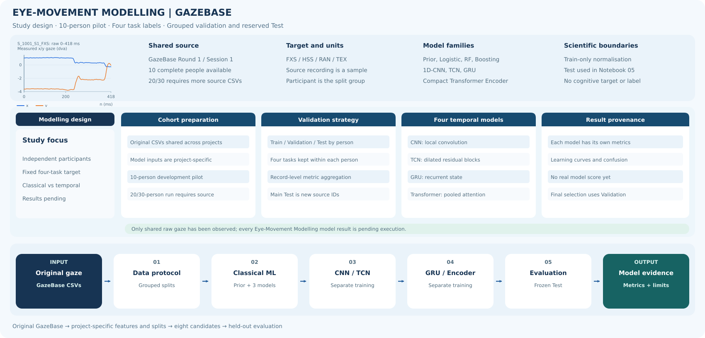

# Eye-Movement Modelling & Advanced AI | GazeBase v2.0

*Figure 1. Scientific programme for independent source preparation and classical/temporal modelling. The ten-person GazeBase pilot has recorded source preparation (Notebook 01) and four classical model Validation comparisons (Notebook 02); CNN, TCN, GRU, Transformer and final held-out Test results remain pending. The small measured source excerpt is taken from an original GazeBase CSV, while conceptual model/workflow elements are schematic.*

**Aim:** Compare record-level engineered gaze features and four compact temporal neural architectures for the **four-class GazeBase recording-protocol target** (FXS, HSS, RAN, TEX). **Notebooks 01 and 02 have recorded pilot execution**; neural model training and final Test evaluation are pending. Neither reading comprehension nor clinical/neurocognitive status is predicted.

**Independence:** Reuse the already available **original GazeBase Round 1 / Session 1 CSV files**, but create all Eye-Movement Modelling splits, features, temporal windows, models and outputs independently in `eye_movement_modelling/output/`. No processed Eye-Tracking Foundations result is mixed into the new modelling cohort.

The first run is an explicit **ten-person pilot**. Increasing the cohort to **20 or 30 complete people** requires additional original GazeBase CSVs, deciding the final participant count **before** inspecting a main Test, and re-executing all five notebooks with the same scientific definitions. Read the [full methods and evidence plan](RESEARCH_METHODS_AND_EVIDENCE.md).

## 1. Dataset and Experimental Protocol

| Item | Implemented definition and boundary |
| --- | --- |
| Dataset | [GazeBase v2.0](https://doi.org/10.6084/m9.figshare.12912257), Round **1**, Session **1**, source CSVs from [`data/raw/gazebase/`](../data/README.md) |
| Recorded pilot scope | GazeBase Round 1 / Session 1: **10 participants, 40 source recordings, 40 record feature rows and 960 temporal windows**. Notebook 02 fitted four classical candidates on 24 Train records and evaluated 8 Validation records from 2 independent people; no Test model scores have been observed |
| Planned extended scope | 20 or 30 complete people, if additional original CSVs are obtained and checked; do not silently assume they are present |
| Prediction target | Recording protocol: **FXS**, **HSS**, **RAN**, **TEX**. Four known classes; **not cognitive diagnosis** |
| Predictors: classical | Recording validity, x/y dispersion, step displacement, velocity quantiles, positive pupil coverage/summary where available |
| Predictors: temporal | Fixed 256-sample windows; source-valid contiguous segments only; relative x/y and their first differences (four channels) |
| Window sampling | Up to 24 evenly distributed, **non-overlapping** windows per source record; all windows inherit the parent record Task |
| Group separation | All task records/windows for one person stay in exactly one Train, Validation or Test partition |
| Pilot (10 people) | Seed **17**, participant-disjoint Train/Validation/Test; Test is **exploratory pilot diagnostic**, not definitive unseen-person evidence |
| Main (≥20 people) | Highest complete source IDs not in the first ten-person pilot reserved for Test; Training/Validation use remaining people |
| Train-only operations | Temporal channel normalisation and classical feature imputation/scaling fitted only on Training people |
| Selection and evaluation | Validation record-level Macro F1, then Balanced Accuracy, then fixed model priority. Frozen Test opened in Notebook 05 only |
| Source limitation | Different task stimuli and recording protocols may dominate task recognition; high task accuracy would not imply cognition |

**Do not change only the cohort-size setting after inspecting the main Test and present the new Test as untouched evidence.** Decide the final cohort before the main evaluation; rerun the full producer-to-consumer chain whenever it changes.

## 2. Experimental Programme

These five notebooks form one task-recognition experiment. **Notebooks 01 and 02 have recorded original-data outputs.** Notebooks 03–05 are implemented but lack original-data model/evaluation results.

| Notebook | Main experiment and visible model-level evidence | Owned current output files |
| --- | --- | --- |
| [01 — Data and Experimental Protocol](code/notebooks/01_data_and_experimental_protocol.ipynb) | Select original CSVs, participant-disjoint groups, feature table, temporal windows and Train-only normalisation | `01_source_inventory.csv`, `01_split_assignments.csv`, `01_record_features.csv`, `01_sequence_windows.npz`, `01_sequence_normalisation.csv`, `01_protocol.csv`, source plot |
| [02 — Statistical and Classical ML](code/notebooks/02_statistical_and_classical_ml.ipynb) | Separate sections for class prior, Logistic Regression, Random Forest and Gradient Boosting; each with Validation confusion matrix | `02_validation_metrics.csv`, four fitted `02_*.joblib` files, independent predictions/plots, comparison |
| [03 — CNN and TCN](code/notebooks/03_cnn_and_tcn_models.ipynb) | Separate CNN and TCN architecture, training, learning curves, record-level Validation metrics and confusion matrices | `03_cnn.pt`, `03_tcn.pt`, histories/predictions/plots, `03_neural_validation_metrics.csv` |
| [04 — GRU and Transformer](code/notebooks/04_gru_and_transformer_models.ipynb) | Separate GRU and Transformer architecture, training curves, model complexity, Validation and confusion matrices | `04_gru.pt`, `04_transformer.pt`, histories/predictions/plots, `04_neural_validation_metrics.csv` |
| [05 — Robustness and Final Evaluation](code/notebooks/05_robustness_and_final_evaluation.ipynb) | Validation-selected model, frozen Test evaluation, individual-person errors, Validation-only input perturbation and comparisons | `05_model_selection.csv`, `05_test_predictions.csv`, `05_test_metrics.csv`, `05_groupwise_test_metrics.csv`, `05_robustness_validation.csv`, comparison plots |

A separate editable figure accompanies each notebook in [`images/`](images/), matching the approved five-band project style. The [overall diagram](images/study_overview.svg) distinguishes executed pilot preparation and classical Validation evidence from planned neural modelling and Test evaluation. The notebooks display separate scientific results for every candidate, rather than combining all neural models into one cell.

## 3. Main Results

**Observed ten-person pilot:** Notebook 01 processed 40 original recordings into 40 feature rows and 960 temporal windows of shape `(960, 256, 4)`, with 6/2/2 Train/Validation/Test participants (24/8/8 recordings). Notebook 02 evaluated four classical candidates on the same **eight Validation recordings from two people**. The class prior scored **Accuracy 0.25, Macro F1 0.10, Balanced Accuracy 0.25**. Logistic Regression, Random Forest and Gradient Boosting each scored **1.00 on all three metrics** (8/8 correct). These are **exploratory participant-disjoint Validation results**, not independent population estimates, external validation or final Test results.

The Eye-Movement Modelling Python modules and notebook structure have been authored. A synthetic test suite checks source identities, participant separation, train-only normalisation, record-level window aggregation, static notebook syntax and key output contracts; such tests do **not** demonstrate CNN/TCN/GRU/Transformer performance on GazeBase.

The recorded Notebook 01 and 02 outputs establish the pilot data contract and classical Validation evidence. Notebook 02 saves four fitted models, predictions, confusion matrices and a comparative table, but **not a final model choice**. Inspect high source step speeds and the small-sample/stimulus confounding before interpreting perfect Validation scores. Neural candidates (03–04) and frozen Test evaluation (05) remain unexecuted.

## 4. Running and Reviewing the Study

**Colab source-acquisition preflight (implemented, not yet executed):**
Notebook 01 contains a separate **Section 01A** that can validate an initial
**20-person source-only trial** (source IDs 1001–1020, four Round 1 / Session 1
tasks each). It uses the maintained official Figshare ZIP (file 27039812),
checks the published checksum, retries alternative official Figshare endpoints\nand uses a source-equivalent Hugging Face mirror only if necessary (the same\npublished MD5 is always required). It extracts only missing CSVs into the
Git-ignored local `data/raw/gazebase/` directory, and caches the bounded
subset in the user's mounted Google Drive. The preflight writes
`01_source_acquisition_preflight.csv` under this project's `output/`. Its
source audit does **not** retrain classifiers, alter the existing ten-person
Train/Validation/Test groups, examine Test scores or constitute the planned
100-person experiment. The full official compressed archive is approximately
6.7 GB; Colab network, disk and Drive capacity must be checked during actual
execution. An HTTP 200 response with zero bytes is treated as a failed download, not\na completed source file. If Colab access is blocked, the official ZIP can\nbe supplied at `/content/gazebase_source_download/GazeBase_v2_0.zip`; the\nchecksum is still verified before extraction. New original data are not\npushed into GitHub. Existing tracked
ten-person source files and Foundations analysis remain unchanged.

1. Open the [first notebook](code/notebooks/01_data_and_experimental_protocol.ipynb) in Colab or VS Code connected to Colab. Use the standard repository checkout cell and the maintained `setup_colab("eye_movement_modelling")` helper.
2. **Initial pilot:** leave `MAX_PARTICIPANTS = 10` in Notebook 01. Its source discovery reads the common `data/raw/gazebase/` directory; it does not redownload or overwrite the original CSVs.
3. Run Notebook 01 fully and inspect the recorded IDs, split groups, feature coverage, temporal input shape, source diagram and generated output ZIP. Only then proceed to [Notebook 02](code/notebooks/02_statistical_and_classical_ml.ipynb), then [03](code/notebooks/03_cnn_and_tcn_models.ipynb), [04](code/notebooks/04_gru_and_transformer_models.ipynb) and [05](code/notebooks/05_robustness_and_final_evaluation.ipynb).
4. Each stage reads **explicit named current outputs** and can restore a matching, manually transferred ZIP through the existing Colab `ensure_stage_inputs` helper. Training is never a hidden side effect of opening a report.
5. **Later main run:** obtain and validate additional GazeBase source CSVs, set `MAX_PARTICIPANTS` to **20 or 30** in Notebook 01 and rerun **all five notebooks in order**; confirm that reserved Test people are not among the initial ten people. Do not use main Test feedback to change this choice.
6. Keep training and validation output tables, model weights and ZIP transfers outside Git by default. Colab must have `numpy`, `pandas`, `matplotlib`, `scikit-learn`, `torch` and `joblib` installed as listed in [`requirements.txt`](../requirements.txt).

**Runtime:** Small models, a maximum of eight epochs and a bound of 24 windows per record are initial resource choices, not measured speed claims. Notebook 05 reads saved checkpoints; it does not retrain them. If new data change the source selection, old model checkpoints must not be reused.

## 5. Files and Saved Outputs

| Location | Purpose |
| --- | --- |
| [`code/notebooks/`](code/notebooks/) | Five authored Jupyter notebooks, each with structured Markdown and independent result cells |
| [`code/src/`](code/src/) | Study-specific data preparation, classical learners, temporal architectures, training and record-level metrics |
| [`images/study_overview.svg`](images/study_overview.svg) | Editable study-wide five-band modelling diagram |
| [`images/`](images/) | Five notebook-specific editable scientific SVGs |
| `output/` | Current Eye-Movement Modelling feature CSVs, window NPZ, checkpoints, metrics and plots; **local, Git-ignored** |
| [`data/raw/gazebase/`](../data/README.md) | Shared upstream **original** source CSVs (read only) |
| [`README.md`](README.md) | Study overview and navigation |
| [`RESEARCH_METHODS_AND_EVIDENCE.md`](RESEARCH_METHODS_AND_EVIDENCE.md) | Detailed training, split, metric and interpretation plan |
| [`tests/test_s2_contracts.py`](../tests/test_s2_contracts.py) | Synthetic contracts, not original-data reproduction |

A per-study output directory prevents overwriting Eye-Tracking Foundations's `eye_tracking_foundations/output/`. All generated outputs are ignored by Git, and the repository's existing 50-MB Git blob policy is retained. Model weights are not automatically published.

## 6. Interpretation and Scope

**Partially executed pilot.** Source preparation and classical Validation modelling are recorded; neural-model training and the final participant-disjoint Test evaluation remain outstanding. The Test has only two people in this pilot. High task-recognition performance is not evidence of cognitive understanding or generalisation to new participants, sessions, stimuli or hardware.

The following remain limitations even after a successful run: task identity is confounded with stimulus protocol; Test participant counts are very small in the pilot; the first complete source IDs are not a representative sample; gaze speeds and pupil fields may reflect measurement artefacts; and a model's Validation/held-out Test score does **not** establish neural, clinical or cognitive diagnosis.

**GazeBase attribution:** [Griffith, Lohr, Abdulin and Komogortsev, *Scientific Data* (2021)](https://doi.org/10.1038/s41597-021-00959-y); [dataset](https://doi.org/10.6084/m9.figshare.12912257), [CC BY 4.0](https://creativecommons.org/licenses/by/4.0/). The dataset is separate from the repository's MIT-licensed code.
