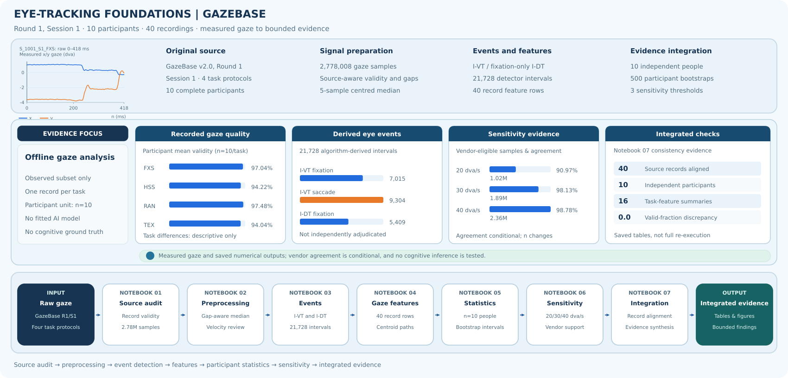

# Eye-Tracking Foundations & Signal Analysis | GazeBase v2.0

*Figure 1. Complete eye-tracking analysis workflow for GazeBase Round 1, Session 1: source audit (01), gap-aware preprocessing (02), I-VT/I-DT event detection (03), record-level gaze features (04), participant-level descriptive statistics (05), I-VT threshold sensitivity (06) and integrated evidence checks (07). The source trace is an excerpt of recorded GazeBase gaze; the counts and percentages are taken from saved notebook outputs, not a fitted cognitive prediction model.*

This executed, **offline exploratory study** examines how selected GazeBase eye-tracking records can be quality-audited, processed without bridging invalid gaze gaps, transformed into provisional eye-movement events, and summarised with participant-aware uncertainty and explicit provenance. It is a methodological study rather than a supervised classification experiment.

**Recorded finding:** The seven notebooks processed **2,778,008 source samples** from **40 task recordings by 10 participants**, generated **21,728 algorithm-derived event intervals**, and reconciled 40 record identities across the saved analytical outputs. The I-VT sensitivity experiment shows substantial changes in class assignments and eligible vendor-reference denominators between 20, 30 and 40 dva/s.

**Detailed scientific account:** [Research Methods and Evidence](RESEARCH_METHODS_AND_EVIDENCE.md). **Execution guidance:** [Running and Reviewing the Study](#4-running-and-reviewing-the-study).

## 1. Dataset and Experimental Protocol

| Component | Implemented study definition |
| --- | --- |
| Original source | [GazeBase dataset](https://doi.org/10.6084/m9.figshare.12912257), described by [Griffith et al. (2021)](https://doi.org/10.1038/s41597-021-00959-y); recorded files use the `GazeBase_v2_0` archive layout |
| Selected subset | Round **1**, Session **1**, source subjects **1001–1010**; 10 complete participants, 40 recordings and 2,778,008 sample rows |
| Task protocols | **FXS** (fixations), **HSS** (horizontal saccades), **RAN** (random saccades) and **TEX** (reading); one selected recording of each task per participant |
| Recorded fields | Original `n` timestamps (ms); horizontal/vertical gaze `x`/`y` (degrees of visual angle); source validity `val`; optional uncalibrated pupil area `dP`; EyeLink parser labels `lab` |
| Quality and preparation | Per-record validity and timing audit; centred five-sample median confined to contiguous valid runs with a **5-ms** adjacency limit |
| Event definitions | Baseline **I-VT 30 dva/s**, 80-ms minimum fixation and 6-ms minimum saccade; fixation-only **I-DT 1-dva dispersion**, 80-ms minimum |
| Analytical unit | A **participant** (n=10) is the independent resampling unit; gaze samples, events and task records are not independent people |
| Descriptive uncertainty | Four per-record metrics aggregated by participant/task; **500 participant bootstrap draws**, seed **17**, reported as exploratory percentile intervals |
| Sensitivity comparison | Fixed, descriptive **20 / 30 / 40 dva/s** I-VT thresholds; EyeLink comparison only on recognised and jointly evaluable sample labels |
| Predictive target / data split | **None**. No Training/Validation/Test partition, supervised cognitive target or fitted AI model exists in this study |

The source selection is an ordered, bounded subset, not a random or population-representative cohort. Source participant keys are preserved through the pipeline; short internal participant identifiers (`001`–`010`) correspond to source subjects `1001`–`1010`. The [scientific methods document](RESEARCH_METHODS_AND_EVIDENCE.md) explains the representation, label rules, thresholds and denominator definitions.

## 2. Experimental Programme

The seven notebooks form one analytical sequence, from source acquisition to integrated evidence.

| Notebook | Scientific role | Named current outputs |
| --- | --- | --- |
| [01 — Source Audit and Gaze Quality](code/notebooks/01_source_audit_and_gaze_quality.ipynb) | Select complete records, preserve sample identities and quantify validity | `01_source_manifest.csv`, `01_gaze_samples.csv`, `01_quality_by_record.csv`, quality plot |
| [02 — Gap-Aware Preprocessing](code/notebooks/02_gap_aware_gaze_preprocessing.ipynb) | Smooth within valid runs, derive velocity and examine extreme samples | `02_preprocessed_samples.csv`, `02_preprocessing_summary.csv`, peak-review table and plots |
| [03 — I-VT/I-DT Event Detection](code/notebooks/03_ivt_idt_event_detection.ipynb) | Label samples, derive event intervals and compare with EyeLink parser labels | `03_sample_labels.csv`, `03_events.csv`, `03_vendor_agreement.csv`, class summary |
| [04 — Gaze Features and Scanpaths](code/notebooks/04_gaze_features_and_scanpaths.ipynb) | Compute 40 record-level features and a detector-derived centroid path | `04_features_by_record.csv`, `04_feature_dictionary.csv`, scanpath plot |
| [05 — Participant-Balanced Statistics](code/notebooks/05_participant_balanced_statistics.ipynb) | Reconcile source quality, calculate 16 task-feature statistics and exploratory intervals | `05_participant_features.csv`, `05_descriptive_statistics.csv`, statistics plot |
| [06 — Detector Sensitivity and Vendor Reference](code/notebooks/06_detector_sensitivity_and_vendor_reference.ipynb) | Evaluate three fixed I-VT thresholds and their changing eligible comparison denominators | `06_sensitivity.csv`, `06_sensitivity_summary.csv`, `06_reference_support.csv`, sensitivity plot |
| [07 — Integrated Evidence and Reproducibility](code/notebooks/07_integrated_evidence_and_reproducibility.ipynb) | Reconcile ten compact producer tables; synthesise findings without reprocessing gaze | `07_source_alignment.csv`, `07_evidence_summary.csv`, `07_study_overview.png` |

The [study-wide figure](images/study_overview.svg) connects the full sequence. All seven individual scientific diagrams remain editable in [`images/`](images/); the scientific implementation lives in [`code/src/`](code/src/). Each notebook overwrites its own named current outputs on rerun, and later notebooks consume the explicit producer files. Outputs should not be mixed across different source subsets or scientific settings.

## 3. Main Results

### Source integrity, derived events and evidence integration

| Recorded evidence | Selected GazeBase Round 1 / Session 1 finding |
| --- | --- |
| Gaze records and rows | **10 participants**, **40 task recordings**, **2,778,008 source rows** |
| Record-valid gaze range | **67.35–100%**; average of 40 per-record fractions **95.69%** |
| Offline preprocessing | **40 records and all source rows retained**; processed sample CSV **623.4 MiB** |
| I-VT-derived intervals | **7,015 fixations**, **9,304 saccades** |
| Fixation-only I-DT-derived intervals | **5,409 fixations**; I-DT does not classify saccades |
| Feature and participant summaries | **40 feature rows**, **40 participant–task rows**, **16 task–feature summaries** |
| Integration and source continuity | **40 records reconciled**, maximum saved Notebook 01/04 valid-fraction discrepancy **0.0** |

The extreme computed velocities include **27,819.1** and **24,946.5 dva/s**. The three highest record maxima were inspected against source validity and adjacent timestamps but remain physiologically unresolved; the study did not retrospectively remove observations or adjust detector thresholds to produce favourable results.

### Participant-level descriptive gaze quality

| Task | Participant mean valid gaze | Exploratory 2.5th–97.5th bootstrap percentiles | Independent participants |
| --- | ---: | ---: | ---: |
| FXS | 97.04% | 95.97–97.97% | 10 |
| HSS | 94.22% | 86.39–99.25% | 10 |
| RAN | 97.48% | 94.74–99.22% | 10 |
| TEX | 94.04% | 88.96–97.98% | 10 |

These are **descriptive**, participant-resampled intervals. No paired task-difference test or confirmatory cognitive hypothesis evaluation was performed. See [Notebook 05](code/notebooks/05_participant_balanced_statistics.ipynb) and its [scientific diagram](images/05_participant_balanced_statistics.svg).

### I-VT sensitivity and conditional vendor agreement

| I-VT threshold | Mean fixation fraction | Mean unknown fraction | Eligible vendor comparison samples | Mean conditional agreement across records |
| ---: | ---: | ---: | ---: | ---: |
| 20 dva/s | 28.53% | 62.24% | 1,015,044 | 90.97% |
| 30 dva/s | 61.23% | 30.57% | 1,888,902 | 98.13% |
| 40 dva/s | 78.65% | 13.78% | 2,357,954 | 98.78% |

The last column averages **record-level conditional comparisons**; the eligible samples differ across thresholds. It is neither a fixed-support accuracy comparison nor evidence for selecting 40 dva/s. The saved 30-dva/s reference values matched Notebook 03 for all 40 recordings. See [Notebook 06](code/notebooks/06_detector_sensitivity_and_vendor_reference.ipynb) and its [denominator-aware figure](images/06_detector_sensitivity_and_vendor_reference.svg).

## 4. Running and Reviewing the Study

### Reviewing recorded evidence

Read the [study overview](images/study_overview.svg), the [detailed methods and results](RESEARCH_METHODS_AND_EVIDENCE.md), then inspect the executed [Notebook 05](code/notebooks/05_participant_balanced_statistics.ipynb), [Notebook 06](code/notebooks/06_detector_sensitivity_and_vendor_reference.ipynb) and [Notebook 07](code/notebooks/07_integrated_evidence_and_reproducibility.ipynb) for their numeric displays and plots. The [24 derived tables and figures](output/) support inspection of the recorded analyses; the three large sample-level tables are regenerated by Notebooks 01–03.

### Re-running the analysis

Install the [repository dependencies](../requirements.txt) in a compatible Python environment, consult the [data guide](../data/README.md), and run [Notebooks 01–07](code/notebooks/) in order. Each notebook reads the required numbered inputs and writes its own outputs; regenerate missing sample-level tables using their producing notebooks.

Notebook 02 requires Notebook 01's saved source manifest, quality table and approximately **512-MiB** sample CSV. Notebook 03 consumes the saved **623.4-MiB** prepared sample file. Notebook 04 consumes prepared samples and detected events. Notebook 05 consumes compact record-quality and feature tables; Notebook 06 consumes prepared samples and the Notebook 03 vendor table; Notebook 07 consumes ten compact tables and does **not** require the large gaze sample tables.

When a producer's cohort, validity rules or detector configuration changes, regenerate all affected downstream named outputs. Markdown-only and SVG-only presentation edits do **not** require experimental re-execution.

## 5. Files and Saved Outputs

| Location | Role and availability |
| --- | --- |
| [`code/notebooks/`](code/notebooks/) | Seven executed Jupyter notebooks with recorded outputs and section-specific diagrams |
| [`code/src/`](code/src/) | Source reader, streaming preprocessing, event detectors, features, statistics and evidence checks |
| [`images/study_overview.svg`](images/study_overview.svg) | Complete editable seven-notebook figure used at the top of this README |
| [`images/`](images/) | Seven individual editable five-band scientific diagrams |
| [`output/`](output/) | 24 derived tables and figures; sample-level tables are generated by Notebooks 01–03 |
| [`data/raw/gazebase/`](../data/README.md) | GazeBase source-file layout and access conditions; includes a selected original source subset |
| [`RESEARCH_METHODS_AND_EVIDENCE.md`](RESEARCH_METHODS_AND_EVIDENCE.md) | Full scientific protocol, observed results, provenance and limitations |
| [`tests/`](../tests/) | Synthetic software/data-contract checks, not original-data replication |

The original [GazeBase publication](https://doi.org/10.1038/s41597-021-00959-y) explicitly reports a [CC BY 4.0](https://creativecommons.org/licenses/by/4.0/) dataset licence. This repository contains a selected 40-file subset of the GazeBase v2.0 source archive; the data are **not re-licensed as MIT code**. Reuse requires source credit, a licence link and acknowledgement of the subset selection.

## 6. Interpretation and Scope

The study demonstrates a **recorded, source-identified offline analytical workflow** and consistency of the specified saved tables across seven notebooks. It provides observations about gaze validity, provisional event labels, derived features, participant-level descriptive uncertainty and how fixed I-VT settings change classified-sample and vendor-comparison support.

The findings **do not** establish reading comprehension, attention status, causal neurocognitive mechanisms, a validated eye-event detector, real-time gaze processing or generalisation to a wider population. The sample contains only ten ordered participants, and the source EyeLink annotations are instrument/parser references rather than independently adjudicated event ground truth. Extremely large calculated speed estimates remain unexplained and affect detector-dependent interpretation.

The seven-notebook sequence is complete for its **bounded exploratory scope**; further physiological investigation, a separately specified independent dataset, expert event review or a controlled cognitive study would be new or targeted follow-up work rather than results already obtained here. Refer to [Research Methods and Evidence](RESEARCH_METHODS_AND_EVIDENCE.md) for the full scientific discussion.

**Original source attribution:** Griffith, H., Lohr, D., Abdulin, E. and Komogortsev, O. (2021), [GazeBase, *Scientific Data*](https://doi.org/10.1038/s41597-021-00959-y); [GazeBase data (Figshare)](https://doi.org/10.6084/m9.figshare.12912257), [CC BY 4.0](https://creativecommons.org/licenses/by/4.0/). The study uses a selected Round 1 / Session 1 subset.
