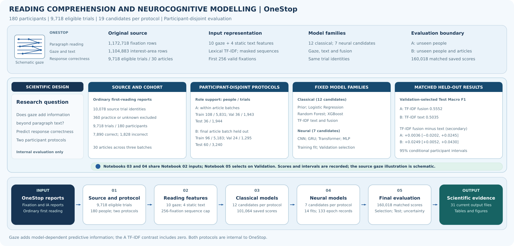

# Reading Comprehension & Neurocognitive Modelling | OneStop

*Figure 1. Five-stage OneStop workflow: source and protocol (01), reading behaviour and features (02), classical and lexical modelling (03), sequential neural modelling (04), and matched held-out evaluation (05). The source gaze illustration is schematic; the cohort, model counts and evaluation results are derived from the saved study outputs.*

**Aim:** Examine whether paragraph-phase eye movements add predictive information about a subsequent reading-comprehension response beyond the presented text. The five notebooks analyse **9,718 eligible ordinary-reading trials from 180 participants and 30 articles**, comparing 19 candidates in each of two participant-disjoint protocols.

**Main finding:** Validation-selected TF-IDF fusion achieves Test Macro F1 **0.5552** in Protocol A (36 held-out participants); TF-IDF text achieves **0.5035** in Protocol B (60 held-out participants and a separate article batch). The paired TF-IDF fusion-minus-text difference is +0.0036 (95% interval −0.0202 to +0.0245) in A and +0.0249 (+0.0052 to +0.0430) in B. Added gaze is model- and protocol-dependent; the results do not establish a general fusion advantage.

**Independence:** This study uses OneStop paragraph-reading data and response labels, with its own cohorts, roles and outputs. It does not use GazeBase task recordings, ZuCo EEG–gaze features or MPIIGaze eye images.

**Detailed scientific account:** [Research Methods and Evidence](RESEARCH_METHODS_AND_EVIDENCE.md). **Execution guidance:** [Running and Reviewing the Study](#4-running-and-reviewing-the-study).

## 1. Dataset and Experimental Protocol

| Item | Implemented definition and boundary |
| --- | --- |
| Source | [OneStop ordinary reading](https://osf.io/zn9sq/), [dataset documentation](https://lacclab.github.io/OneStop-Eye-Movements/variables) |
| Published corpus | 360 participants across reading regimes, approximately 152 hours; 9,718 regular ordinary-reading trials (source-reported) |
| Selected cohort | **180 participants, 9,718 eligible trials, 30 articles**; 360 excluded report identities |
| Input period | Paragraph fixation and interest-area reports only; ten gaze and four static paragraph predictors, lexical TF-IDF or masked fixation sequences |
| Eligibility | Matched first-reading trials without question preview or practice; valid A–D response and usable fixation support |
| Prediction unit | Participant × reading trial; retain article, paragraph, question and difficulty identities |
| Target | Source `is_correct`: 1 = correct, 0 = incorrect |
| Protocol A | Participant-disjoint Training/Validation/Test, approximately 60/20/20 within each article batch |
| Protocol B | Final article batch and its participants held out; remaining batches supply disjoint Training and Validation participants |
| Selection | Validation Macro F1; fixed 0.5 threshold; model-name tie-break |
| Model families | Training prevalence, nine scalar variants, two TF-IDF variants and seven neural variants |
| Primary metric | Test Macro F1; secondary accuracy, balanced accuracy, AUROC, incorrect-class precision/recall/AUPRC and Brier score |
| Descriptive uncertainty | 1,000 paired participant bootstrap draws, seed 17; intervals conditional on fixed predictions |

Answer choices, selected answers, response-phase gaze, feedback, session-level accuracy, question-specific critical/distractor spans and participant/text identity codes are not predictors. Both protocols are internal to OneStop.

## 2. Experimental Programme

The five notebooks form one executed ordinary-reading study. Both modelling stages use the same trial identities and participant roles; the final notebook evaluates saved scores without further model fitting.

| Notebook | Scientific role and observed evidence | Named current outputs |
| --- | --- | --- |
| [01 — Dataset and Protocol](code/notebooks/01_onestop_dataset_and_protocol.ipynb) | Source acquisition, eligibility and participant splits; **9,718 trials** | Six files: source inventory, exclusions, trial index, splits, support counts, cohort plot |
| [02 — Reading Behaviour and Statistics](code/notebooks/02_reading_behaviour_and_statistics.ipynb) | Pre-answer feature extraction, 193 truncated sequences and ten exploratory mixed-effects fits | Five files: feature and association tables, two plots; local NPZ and paragraph-text table |
| [03 — Classical ML and Text Baselines](code/notebooks/03_classical_ml_and_text_baselines.ipynb) | Training prevalence, scalar and lexical comparators; **101,064 scores** | Four files: prediction scores, Validation metrics, permutation importance and comparison plot |
| [04 — Sequential and Multimodal Models](code/notebooks/04_sequential_and_multimodal_models.ipynb) | CNN, GRU, Transformer and MLP; 14 fits and **58,954 scores** | Five files: scores, epoch histories, selected configurations, Validation metrics and curves |
| [05 — Generalisation and Final Evaluation](code/notebooks/05_generalisation_and_final_evaluation.ipynb) | Matched evaluation of **160,018 scores**; participant/difficulty summaries, bootstrap and calibration | Eleven files: eight CSV tables and three plots |

Notebooks 03 and 04 share the trial features and participant assignments from Notebooks 01–02; they independently produce candidate scores for Notebook 05. The [study-wide workflow](images/study_overview.svg) and five notebook-specific editable scientific diagrams in [`images/`](images/) illustrate the design.

## 3. Main Results

### Source and cohort preparation

Notebook 01 reconciled 10,078 report trial identities and retained 9,718 eligible trials from 180 participants and 30 articles; 360 trials were excluded as `practice_or_unknown`. The retained cohort contains 7,890 correct responses (81.19%) and 1,828 incorrect responses (18.81%).

| Protocol | Training (people / trials) | Validation (people / trials) | Test (people / trials) |
| --- | ---: | ---: | ---: |
| A — Unseen people | 108 / 5,831 | 36 / 1,943 | 36 / 1,944 |
| B — Unseen batch | 96 / 5,183 | 24 / 1,295 | 60 / 3,240 |

Saved trial identities and participant assignments reproduce all class-support counts, with disjoint participants within each protocol and disjoint development/Test articles in Protocol B. See the [cohort plot](output/01_cohort_support.png), [exclusions](output/01_trial_exclusions.csv) and [split support](output/01_split_support.csv).

### Reading behaviour and representations

Notebook 02 retains all 9,718 trial identities with ten gaze and four static text predictors; the recorded sequence shape is `(9718, 256, 4)` and 193 sequences (1.99%) are truncated. On Protocol A Training (5,831 trials, 108 participants, 162 paragraphs), all ten separate exploratory mixed-effects fits report convergence. Backward word-index transition rate has the largest positive posterior mean (0.137 log odds per SD; approximate 95% posterior interval 0.068 to 0.206). See the [feature table](output/02_trial_features.csv), [participant summaries](output/02_training_behaviour.csv), [association estimates](output/02_training_associations.csv) and [association plot](output/02_reading_associations.png). The estimates are exploratory, not causal or confirmatory.

### Classical and neural modelling

Notebook 03 recorded 101,064 matched Validation and Test scores across 12 classical candidates per protocol. Validation Macro F1 is highest for TF-IDF fusion in Protocol A (0.5571) and TF-IDF text in Protocol B (0.5702), compared with prevalence references of 0.4472 and 0.4487. Adding gaze to the TF-IDF comparator changes Macro F1 by +0.0088 in A and −0.0088 in B. The added value of gaze is not consistent across model families. See the [Validation metrics](output/03_validation_metrics.csv), [comparison plot](output/03_validation_comparison.png) and [permutation importance](output/03_validation_feature_importance.csv). Protocol B Validation is within the development article batches; the distinct batch holdout is assessed in Notebook 05.

Notebook 04 records 14 neural fits and 58,954 unique, aligned prediction rows. The highest neural Validation Macro F1 is GRU gaze in A (0.5251) and Transformer fusion in B (0.5458), below the corresponding classical leaders. The neural training histories contain 133 epoch records, with training lasting 4–15 epochs. See the [neural Validation metrics](output/04_validation_metrics.csv), [learning curves](output/04_validation_curves.png) and [model configurations](output/04_model_configurations.csv). Both score tables now supply 160,018 scores for 19 candidates per protocol. Neural checkpoints are selected by Validation Macro F1.

### Matched held-out evaluation

| Metric | A: TF-IDF fusion | B: TF-IDF text |
| --- | ---: | ---: |
| Validation Macro F1 | 0.5571 | 0.5702 |
| Test people / trials | 36 / 1,944 | 60 / 3,240 |
| Test Macro F1 | **0.5552** | **0.5035** |
| 95% participant interval | 0.5277–0.5786 | 0.4863–0.5211 |
| Accuracy | 0.6214 | 0.6389 |
| Balanced accuracy | 0.6155 | 0.5116 |
| AUROC | 0.6572 | 0.5389 |
| Incorrect AUPRC | 0.3007 | 0.2049 |
| Incorrect precision | 0.2806 | 0.2032 |
| Incorrect recall | 0.6058 | 0.3058 |
| Brier score | 0.2273 | 0.2218 |

TF-IDF fusion minus matched TF-IDF text is +0.0036 (95% paired participant interval −0.0202 to +0.0245) in A and +0.0249 (+0.0052 to +0.0430) in B. The B fusion candidate is a secondary Test comparator, not a replacement for the Validation-selected text model. Random Forest fusion underperforms its text counterpart in both protocols. The added value of gaze is therefore model- and protocol-dependent, not universal. The selected scores exhibit limited discrimination in B and poor probability calibration in both protocols.

See [Notebook 05](code/notebooks/05_generalisation_and_final_evaluation.ipynb), its [scientific diagram](images/05_generalisation_and_final_evaluation.svg), the [held-out comparison plot](output/05_test_comparison.png), the [frozen selection](output/05_selected_models.csv), [Test metrics](output/05_test_metrics.csv), [participant intervals](output/05_participant_intervals.csv), [paired contrasts](output/05_paired_modality_intervals.csv), [confusion matrices](output/05_selected_confusion.png) and [calibration diagnostics](output/05_score_calibration.png). The reported values are taken from the current saved metric and interval tables; the primary candidates remain fixed by Validation.

## 4. Running and Reviewing the Study

### Reviewing saved evidence

The five notebooks and **31 derived output files** document the study from source preparation to final evaluation. Start with [Notebook 05](code/notebooks/05_generalisation_and_final_evaluation.ipynb), [selected models](output/05_selected_models.csv) and [final Test metrics](output/05_test_metrics.csv). Reviewing the evidence requires neither source reports nor model training. Notebook 05 can also run on CPU from the saved trial index, participant assignments, feature table and classical and neural score tables.

### Re-running the analysis

1. Consult the [data guide](../data/README.md) and install the [study requirements](requirements.txt). The notebooks use the shared `setup_colab("reading_comprehension_modelling")` helper.
2. Run [Notebook 01](code/notebooks/01_onestop_dataset_and_protocol.ipynb) on CPU to acquire or reuse the official ordinary-reading reports and produce the cohort and protocol tables. Allow sufficient space for both archives and approximately 5.45 GB of extracted CSVs.
3. Run [Notebook 02](code/notebooks/02_reading_behaviour_and_statistics.ipynb) on CPU to produce the scalar feature table, exploratory statistics and local paragraph-text and fixation-sequence caches.
4. Run [Notebook 03](code/notebooks/03_classical_ml_and_text_baselines.ipynb) on CPU and [Notebook 04](code/notebooks/04_sequential_and_multimodal_models.ipynb) with GPU recommended. Both use the same cohort and roles. Notebook 03 requires the local paragraph-text cache, and Notebook 04 requires the aligned NPZ sequence cache.
5. Run [Notebook 05](code/notebooks/05_generalisation_and_final_evaluation.ipynb) on CPU when both score tables are available. No fitting, raw reports or local text/sequence arrays are needed at this stage.

Each notebook writes its derived results to `output/`. Notebook 02 generates the paragraph-text and fixation-sequence inputs required by the modelling stages. Changes to the cohort or fitting procedure require regeneration of the affected downstream results.

## 5. Files and Saved Outputs

| Location | Responsibility |
| --- | --- |
| [`code/notebooks/`](code/notebooks/) | Five executed research notebooks with structured explanations and saved results |
| [`code/src/`](code/src/) | Source IO, features, statistical models, prediction models and final evaluation |
| [`code/tests/`](code/tests/) | Synthetic cohort, feature and prediction-contract tests |
| [`images/study_overview.svg`](images/study_overview.svg) | Editable study-wide five-band figure used at the top of this README |
| [`images/`](images/) | Five notebook-specific scientific SVGs and the study overview |
| [`output/`](output/) | 31 derived stage outputs: six (01), five (02), four (03), five (04), eleven (05) |
| [`requirements.txt`](requirements.txt) | Study dependencies; exact historical package versions are not fully pinned |
| `data/raw/onestop/ordinary/` (repository-local) | Original OneStop paragraph reports; acquire in Notebook 01 |
| `data/processed/onestop/` (repository-local) | Sequence NPZ and paragraph text generated by Notebook 02 |
| [`RESEARCH_METHODS_AND_EVIDENCE.md`](RESEARCH_METHODS_AND_EVIDENCE.md) | Full scientific methods and evidence boundaries |

Run the synthetic checks from the repository root with `python -m unittest discover -s reading_comprehension_modelling/code/tests -v`.

## 6. Interpretation and Scope

The study shows exploratory gaze–correctness associations and limited, model-dependent incremental information from gaze. The fixed sequential encoders do not demonstrate a systematic advantage over the classical and lexical candidates. The selected Protocol B model has limited discrimination and both selected models have poor score calibration.

Answer correctness is an observed behavioural outcome for a particular question, not a direct measurement of understanding, attention or clinical cognition. The ordinary-reading restriction removes the explicit question-preview condition from the principal experiment but does not eliminate stimulus, difficulty or participant-related confounding.

Protocol A may share articles and questions between roles. Protocol B holds out one article batch together with its participants, so changes in text and reader population are not separable; one batch is not an external validation corpus. Bootstrap intervals are conditional on the fitted predictions and do not account for article clustering or training variability; paired comparisons are secondary and not multiplicity-adjusted. This completed internal evaluation is not external validation or a full independent reproduction. Refer to [Research Methods and Evidence](RESEARCH_METHODS_AND_EVIDENCE.md#9-discussion-limitations-and-future-work) for the scientific boundaries.

**Source attribution:** Berzak et al., [OneStop dataset paper, Scientific Data (2025)](https://doi.org/10.1038/s41597-025-06272-2); [OneStop release and variables](https://lacclab.github.io/OneStop-Eye-Movements/variables); Shubi et al., [Fine-Grained Prediction of Reading Comprehension from Eye Movements, EMNLP 2024](https://aclanthology.org/2024.emnlp-main.198/). The eye-tracking data are provided under [CC BY 4.0](https://creativecommons.org/licenses/by/4.0/); the underlying OneStopQA text and auxiliary annotations are subject to [CC BY-SA 4.0](https://creativecommons.org/licenses/by-sa/4.0/). Repository software licensing does not supersede those terms.
