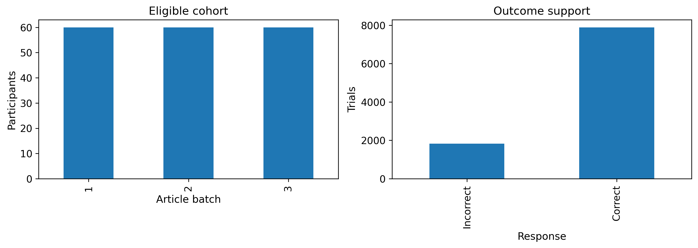
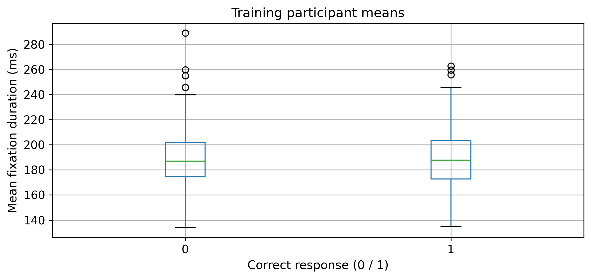
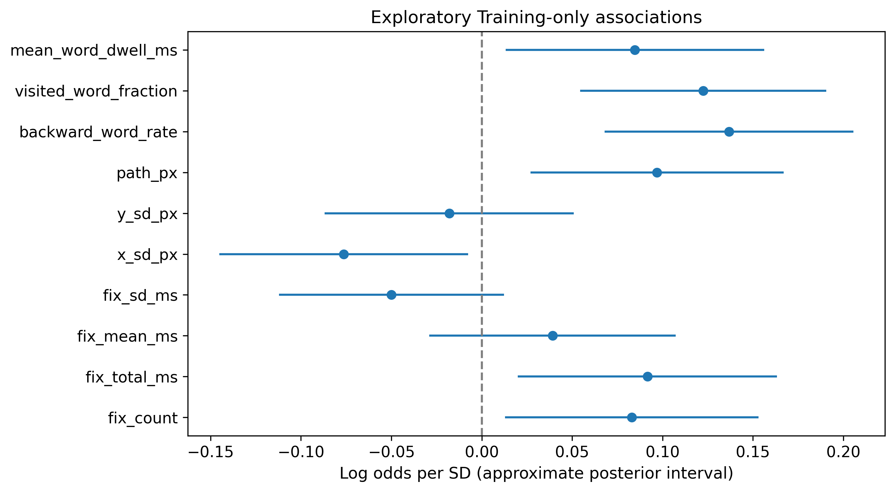
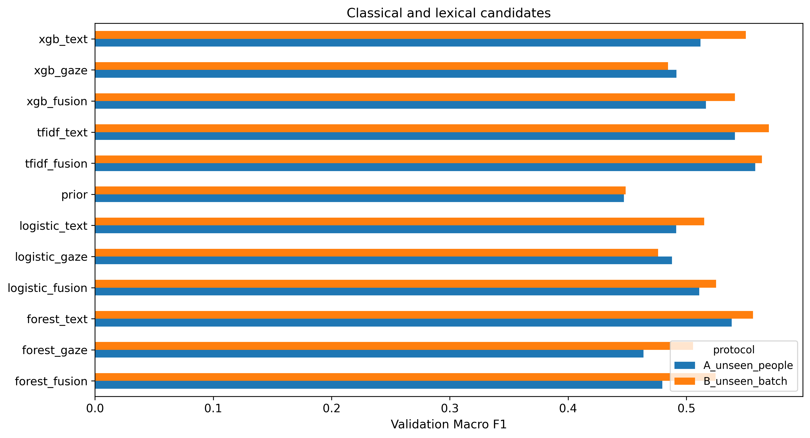
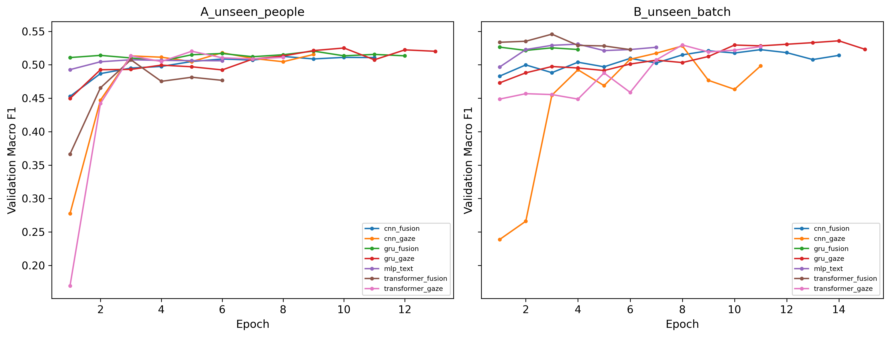
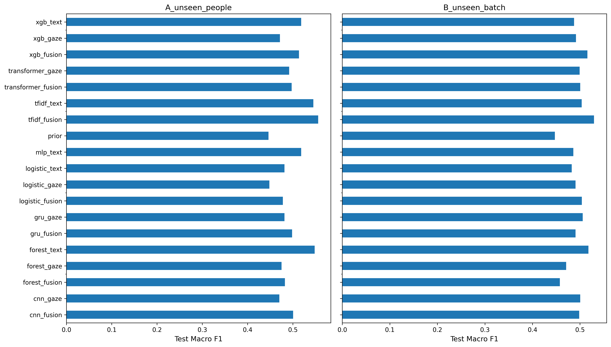
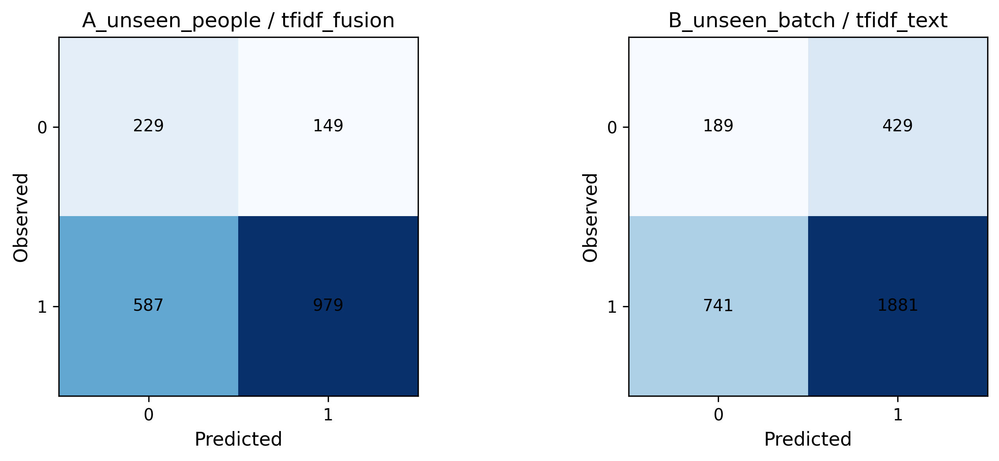
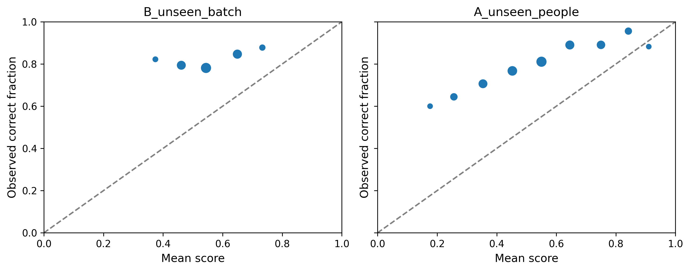

# Reading Comprehension & Neurocognitive Modelling | OneStop: Research Methods and Evidence

**Study:** Independent OneStop paragraph-reading application within Eye-Tracking & Neurocognitive Intelligence. **Target:** correctness of a subsequent comprehension response. Five executed notebooks analyse 9,718 eligible trials from 180 participants, with matched internal evaluation across 19 candidates in each of two protocols. See the [study README](README.md) and [study-wide workflow](images/study_overview.svg).

## 1. Research Objective and Scope

The main question is whether paragraph-phase eye movements improve prediction of a subsequent correct or incorrect response relative to text-only and Training-prevalence comparators. Three associated questions concern descriptive gaze–correctness relationships, the value of ordered fixation sequences, and generalisation to held-out people and articles.

The predictor observes the presented paragraph and gaze up to the end of reading, before the question/answer period. It does not receive the subsequent question text, answer options, selected answer, answer positions, feedback, question-specific span annotations or overall session outcomes. The experiment is therefore a paragraph-conditioned prediction of the recorded response to the assigned question, not a question-conditioned answer-selection model.

The study is scientifically independent of GazeBase, ZuCo and MPIIGaze. It does not infer latent cognitive ability, diagnose a disorder or model EEG.

## 2. Data Sources, Cohort and Target Definitions

### 2.1 Original source and access

OneStop is described in Berzak et al. (2025), [Scientific Data](https://doi.org/10.1038/s41597-025-06272-2). The published corpus comprises 360 English L1 participants, about 152 hours of eye tracking and multiple reading regimes. Source documentation distinguishes ordinary reading, information seeking and repeated reading. Ordinary reading includes 9,718 regular trials according to the publisher. The recorded project cohort also contains 9,718 eligible trials after report reconciliation (see Section 6.1); the matching count does not replace the implemented eligibility checks.

Use the official [ordinary-reading OSF component](https://osf.io/zn9sq/) and [report schema](https://lacclab.github.io/OneStop-Eye-Movements/variables). The publisher download script identifies the fixation archive as `ne4az` and the interest-area archive as `xkgfz`. The local adapter downloads and extracts the two report CSVs or reuses the corresponding local files. The reports are detected as tab- or comma-separated; required documented fields are checked before use.

### 2.2 Trial identity and eligibility

One sample corresponds to one participant reading one paragraph and answering its assigned question. The pair `participant_id, trial_index` identifies the source trial; article ID is qualified by article batch, paragraph by article and question by paragraph. These identities support matching and grouped evaluation only.

Both reports must agree on the trial metadata. The implemented cohort retains matched ordinary first-reading, non-practice trials, valid answers A–D, consistent `is_correct` labels and at least one finite positive-duration fixation with finite start time and coordinates. The source's correctness definition is answer A; missing selected answers are excluded even if an annotation is present. Exclusions are counted once using ordered, mutually exclusive reasons.

The source documentation reports missing trials/answers, some typographical and display-layout issues, and participant-ID qualifications in its [known issues](https://lacclab.github.io/OneStop-Eye-Movements/known_issues.html). These do not justify silently correcting source data or treating the reported corpus size as an assertion about available rows.

### 2.3 Outcome and information boundary

The binary label is source `is_correct` (0 incorrect, 1 correct). Selected answer is inspected only to establish eligibility and label consistency; it is not exported into modelling tables. Question identity is retained for provenance, not used as a model feature. No participant identifier, article identifier, trial position, question identity or post-answer field enters a prediction model.

## 3. Data Preparation and Representations

### 3.1 Report reconciliation

[Notebook 01](code/notebooks/01_onestop_dataset_and_protocol.ipynb) produces the cohort and fixed participant assignments. [Notebook 02](code/notebooks/02_reading_behaviour_and_statistics.ipynb) checks the current source cohort against the saved trial index before feature extraction. The source adapter and feature module are [onestop_io.py](code/src/onestop_io.py) and [reading_features.py](code/src/reading_features.py). Original reports are not tracked.

### 3.2 Trial-level representations

| Family | Model inputs and interpretation |
| --- | --- |
| Fixation timing | Count, total fixation duration, mean and SD of duration; milliseconds, not total elapsed reading time |
| Spatial | SD of horizontal/vertical fixation coordinates and sum of Euclidean steps between valid fixations in screen pixels |
| Reading transitions | Proportion of backward word-index transitions among finite nonzero changes; not independently classified regressive saccades |
| Interest areas | Fraction of areas with nonzero reported fixation count and mean word dwell time (ms) |
| Static paragraph | Whitespace-token count, mean token length, punctuation fraction and Advanced-versus-Elementary version |
| Lexical baseline | Paragraph unigram/bigram TF-IDF, vocabulary fitted on Training only |

Interest-area IDs and fixation word indices are used for the transition and coverage summaries. Invalid numeric values are treated as missing; missing scalar model features are imputed on Training only. The source word frequency and GPT-2 surprisal annotations are summarised descriptively when the IA count matches paragraph token count; they are not model predictors because segmentation and report support may differ between trials. No dwell-weighted lexical features enter the text-only baseline.

### 3.3 Ordered fixation sequences

Valid fixations are sorted by source start time and represented by duration, x, y and word-area index. Unmapped indices use −1. At most the first 256 valid fixations are retained per trial, with a Boolean mask and explicit truncation indicator; padding is excluded from sequence scaling and pooling. Trial IDs are stored in the local NPZ and checked against the feature table. Scalar features summarise the full valid fixation sequence rather than the truncated input.

## 4. Experimental Design and Evaluation

### 4.1 Fixed participant protocols

| Protocol | Training and Validation | Outer Test |
| --- | --- | --- |
| A — Unseen people | Approximately 60% / 20% of eligible people within each source article batch, seed 17 | Approximately 20% of people in each batch; no participant overlap |
| B — Unseen batch | Disjoint Training and Validation people in the first two ordered batches (Validation approximately 20% within each) | All eligible participants and articles from the final ordered batch |

Splits use participant identity and batch, not labels for balancing or performance. Every trial of a participant shares one role per protocol. Both outcome classes must be present in each role. Protocol B also requires article disjointness between development and Test. The two protocols are separate analyses; they can share source people across their different roles and must not be pooled.

### 4.2 Fitting and selection

Preprocessing, TF-IDF vocabulary, class weights and model fitting are Training-only. Neural checkpoint selection uses Validation Macro F1, with earliest best epoch retained. Classical configurations are fixed. All scores use threshold 0.5. Notebook 05 fixes a primary candidate per protocol using Validation Macro F1, with alphabetical tie-breaking, before calculating Test metrics. Other Test results are descriptive secondary comparisons and do not change the selected candidate.

### 4.3 Metrics

Macro F1 over labels 0 and 1 is primary. Report accuracy, balanced accuracy, AUROC, incorrect-response AUPRC using 1 − score, incorrect-class precision/recall and Brier score. Report participant counts and trial support alongside aggregate scores. Undefined single-class AUROC, AUPRC and balanced accuracy remain missing; fixed-label Macro F1 remains defined with zero for undefined class-specific F1. Class weighting can distort probability calibration, so model outputs are treated as scores.

## 5. Methods, Models and Configurations

### 5.1 Exploratory statistical analysis

[reading_statistics.py](code/src/reading_statistics.py) fits separate approximate Bayesian logistic mixed-effects models on Protocol A Training data. Each model uses one standardised gaze feature and difficulty as fixed effects, with crossed participant and paragraph random intercepts. Variational posterior means, SDs, approximate 95% intervals and optimiser status are saved. Feature-wise complete cases and repeated tests limit interpretation; these are exploratory associations, not causal or confirmatory findings.

### 5.2 Classical predictors

| Candidate | Configuration |
| --- | --- |
| Prior | Unweighted Training prevalence of correct responses |
| Logistic Regression | C = 1, maximum 1,000 iterations |
| Random Forest | 200 trees, minimum leaf size 5 |
| XGBoost | 150 trees, depth 3, learning rate 0.05 |
| TF-IDF Logistic Regression | Unigram/bigram, minimum document frequency 2, maximum 5,000 features, C = 1 |

Each scalar estimator is compared on gaze-only, text-only and combined input allowlists. TF-IDF is compared with static paragraph features alone and with added gaze features. Median imputation, standardisation and inverse-frequency sample weighting are fitted on Training only. Scalar-model permutation importance uses Validation Macro F1 decrease (three repeats, seed 17), without treating importance as a causal effect.

### 5.3 Sequence models and fusion

[reading_models.py](code/src/reading_models.py) defines three compact gaze encoders: masked 1D CNN (two convolutional layers, 32 channels, kernels 5 and 3), GRU (hidden size 32) and two-layer Transformer encoder (embedding size 32, four heads, feed-forward size 64, learned positions). Valid-position mean pooling produces a fixed representation. The fusion variants concatenate the gaze representation with Training-standardised static paragraph features; a text-only MLP supplies a neural comparator.

All neural candidates use a 32-unit hidden prediction head, dropout 0.1, AdamW (learning rate 0.001, weight decay 0.0001), batch 64, maximum 15 epochs and patience three. The positive-class loss weight is Training negative/positive support. Seed 17 is used for initialisation and data loading. GPU is recommended; the recorded neural execution used a Tesla T4 (environment details in Section 8). CUDA results are not claimed to be bitwise deterministic.

## 6. Results and Comparative Analysis

### 6.1 Source and cohort preparation (Notebook 01)

The two ordinary-reading source reports provide the following selected report dimensions and file sizes.

| Source report | Rows | Selected columns | File size (bytes) |
| --- | ---: | ---: | ---: |
| Fixations | 1,172,718 | 18 | 2,997,905,127 |
| Interest areas | 1,104,883 | 20 | 2,455,810,901 |

Of 10,078 distinct trial identities in the report union, 9,718 were eligible and 360 were assigned to `practice_or_unknown`. No other exclusion category was recorded. The eligible trials represent 180 participants, 30 articles and three article batches (60 participants per batch). Correct responses account for 7,890 trials (81.19%) and incorrect responses for 1,828 (18.81%).

| Protocol | Role | Participants | Trials | Incorrect | Correct | Articles |
| --- | --- | ---: | ---: | ---: | ---: | ---: |
| A | Training | 108 | 5,831 | 1,079 | 4,752 | 30 |
| A | Validation | 36 | 1,943 | 371 | 1,572 | 30 |
| A | Test | 36 | 1,944 | 378 | 1,566 | 30 |
| B | Training | 96 | 5,183 | 969 | 4,214 | 20 |
| B | Validation | 24 | 1,295 | 241 | 1,054 | 20 |
| B | Test | 60 | 3,240 | 618 | 2,622 | 10 |

The trial index and participant assignments establish all 12 class-specific support rows. The trial IDs are unique; each participant has one role per protocol. All roles contain both classes. Protocol B holds out batch 3 with zero article overlap with development. Protocol A shares all 30 articles across roles. These checks establish the saved partition structure, not model-level leakage prevention or predictive validity.

*Figure 1. Eligible participants per article batch (left) and observed response counts (right). These are cohort descriptors, not model performance.*

Evidence: [source inventory](output/01_source_inventory.csv), [exclusion counts](output/01_trial_exclusions.csv), [trial index](output/01_trial_index.csv), [participant splits](output/01_participant_splits.csv) and [split support](output/01_split_support.csv).

### 6.2 Reading behaviour, features and associations (Notebook 02)

Notebook 02 recorded 9,718 feature rows, matching every identity and label in the Notebook 01 trial index. All ten gaze and four static text predictors have finite values in the saved table. The recorded sequence shape is `(9718, 256, 4)`, with 193 truncated trials (1.99%); the numerical arrays themselves remain local. Truncation flags agree with the full-sequence fixation counts exceeding 256. The full-cohort descriptive table is not used for model fitting or selection.

Protocol A Training contains 5,831 trials from 108 participants and 162 paragraphs. All 108 people contributed to both response groups. Mean fixation duration averaged over participants was 189.95 ms for incorrect responses and 189.73 ms for correct responses; the overlapping distributions are descriptive and do not establish equivalence.

*Figure 2. Protocol A Training participant means, grouped by incorrect (0) and correct (1) responses.*

| Feature | Log odds per SD | Approximate 95% posterior interval |
| --- | ---: | ---: |
| Fixation count | 0.083 | 0.013 to 0.153 |
| Total fixation duration | 0.092 | 0.020 to 0.163 |
| Mean fixation duration | 0.039 | -0.029 to 0.107 |
| Fixation duration SD | -0.050 | -0.112 to 0.012 |
| Horizontal coordinate dispersion | -0.076 | -0.145 to -0.007 |
| Vertical coordinate dispersion | -0.018 | -0.087 to 0.051 |
| Scanpath length | 0.097 | 0.027 to 0.167 |
| Backward word-index transition rate | 0.137 | 0.068 to 0.206 |
| Visited-word fraction | 0.123 | 0.055 to 0.191 |
| Mean word dwell time | 0.085 | 0.013 to 0.156 |

All ten separate variational fits report successful optimisation and the same Training support. The saved interval endpoints agree with the recorded posterior mean ± 1.96 posterior SD. Six intervals are wholly positive, one wholly negative and three span zero. These approximate posterior summaries are not multiplicity-adjusted confirmatory tests; each feature is fitted separately with difficulty and crossed random intercepts. They do not establish causal effects or out-of-sample predictive value.

*Figure 3. Approximate log-odds posterior means and intervals per standard deviation of each gaze feature. The dashed line marks zero.*

Evidence: [trial features](output/02_trial_features.csv), [participant-balanced summaries](output/02_training_behaviour.csv) and [mixed-effects estimates](output/02_training_associations.csv).

### 6.3 Classical and lexical Validation results (Notebook 03)

The candidate list contains 12 classical and lexical procedures (prior, nine scalar variants and two TF-IDF variants) and seven neural procedures (three gaze-only, three fusion and one text-only MLP). Notebook 03 recorded 101,064 unique scores across 12 classical candidates per protocol, with complete Validation and Test trial coverage and valid score ranges. Only Validation performance is calculated in Notebook 03.

| Classical candidate | Protocol A Validation Macro F1 | Protocol B Validation Macro F1 |
| --- | ---: | ---: |
| Prior | 0.4472 | 0.4487 |
| Logistic Regression, gaze | 0.4879 | 0.4760 |
| Logistic Regression, text | 0.4914 | 0.5151 |
| Logistic Regression, fusion | 0.5110 | 0.5251 |
| Random Forest, gaze | 0.4637 | 0.5057 |
| Random Forest, text | 0.5383 | 0.5564 |
| Random Forest, fusion | 0.4796 | 0.5246 |
| XGBoost, gaze | 0.4916 | 0.4844 |
| XGBoost, text | 0.5118 | 0.5503 |
| XGBoost, fusion | 0.5165 | 0.5411 |
| TF-IDF text | 0.5411 | 0.5698 |
| TF-IDF fusion | 0.5582 | 0.5638 |

The highest classical Validation Macro F1 is TF-IDF fusion in A (balanced accuracy 0.6140, AUROC 0.6525, incorrect recall 0.5849) and TF-IDF text in B (balanced accuracy 0.6262, AUROC 0.6583, incorrect recall 0.5892). The prevalence references have accuracy 0.8091 and 0.8139 but zero incorrect recall. The matched fusion-minus-text Macro F1 differences are +0.0196/-0.0587/+0.0046/+0.0171 in A and +0.0100/-0.0317/-0.0092/-0.0060 in B for Logistic Regression, Random Forest, XGBoost and TF-IDF respectively. Fusion improves on gaze-only across all six scalar comparisons, but added gaze beyond text is not consistently beneficial. These are descriptive Validation differences, not uncertainty-adjusted Test contrasts. Both Validation partitions share development articles with Training, so the B Validation scores do not quantify unseen-article generalisation.

*Figure 4. Validation Macro F1 for fixed classical and lexical candidates across the two participant protocols.*

The 168 unique permutation-importance rows contain finite means and non-negative repeat SDs. Examples include `fix_count` for A logistic fusion (mean decrease 0.0519) and `mean_word_chars` for B logistic fusion (0.0594). These are model- and partition-specific three-repeat summaries, not causal effects or confidence intervals. 

Evidence: [classical scores](output/03_classical_predictions.csv), [Validation metrics](output/03_validation_metrics.csv) and [feature importance](output/03_validation_feature_importance.csv). Notebook 05 selects from the complete classical and neural candidate set on Validation before evaluating the reserved Test partitions.

### 6.4 Neural learning and Validation (Notebook 04)

[Notebook 04](code/notebooks/04_sequential_and_multimodal_models.ipynb) evaluates 14 candidate–protocol fits using fixation arrays of shape `(9718, 256, 4)`. The score table contains 58,954 entries with complete, role-matched Validation and Test coverage for every candidate. The following Macro F1 values describe Validation at the selected checkpoints.

| Neural candidate | Protocol A Validation Macro F1 | Protocol B Validation Macro F1 |
| --- | ---: | ---: |
| MLP text | 0.5075 | 0.5308 |
| CNN gaze | 0.5162 | 0.5261 |
| CNN fusion | 0.5111 | 0.5174 |
| GRU gaze | 0.5251 | 0.5358 |
| GRU fusion | 0.5204 | 0.5263 |
| Transformer gaze | 0.5202 | 0.5296 |
| Transformer fusion | 0.5075 | 0.5458 |

The recorded neural leaders are GRU gaze in A and Transformer fusion in B, both below the respective classical Validation leaders. Fusion improves over the corresponding gaze-only encoder only for the B Transformer in these Validation comparisons. Neural text inputs are static paragraph features rather than lexical TF-IDF, so the classical-versus-neural comparison does not isolate architecture alone. These are descriptive Validation results; the frozen selection and Test assessment are reported below. The 130 training-history rows and 14 configuration records agree with the fixed split sizes, Training-derived class weights, training settings and earliest maximum Validation Macro F1 for each fit. Epoch counts range from 4 to 15; 13 configurations stopped before the cap and B GRU gaze reached it. A GRU gaze selected epoch 10 of 13; B Transformer fusion selected epoch 3 of 6. The curves preserve actual epoch lengths without extrapolation.

*Figure 5. Validation Macro F1 by recorded epoch for the seven neural candidates in each protocol.*

Evidence: [neural scores](output/04_neural_predictions.csv), [training history](output/04_training_history.csv), [configurations](output/04_model_configurations.csv) and [Validation metrics](output/04_validation_metrics.csv). Together the classical and neural score tables contain 160,018 scores for the 19 fixed candidates per protocol.

### 6.5 Matched held-out evaluation (Notebooks 03–05)

The fixed 19-candidate set is evaluated in each protocol using 160,018 saved scores. Validation Macro F1 selects TF-IDF fusion for A and TF-IDF text for B. The primary Test results are:

| Metric | Protocol A: TF-IDF fusion | Protocol B: TF-IDF text |
| --- | ---: | ---: |
| Validation Macro F1 | 0.5582 | 0.5698 |
| Test people | 36 | 60 |
| Test trials | 1,944 | 3,240 |
| Accuracy | 0.6224 | 0.6389 |
| Macro F1 | 0.5560 | 0.5035 |
| Balanced accuracy | 0.6161 | 0.5116 |
| AUROC | 0.6573 | 0.5386 |
| Incorrect AUPRC | 0.3002 | 0.2050 |
| Incorrect precision | 0.2813 | 0.2032 |
| Incorrect recall | 0.6058 | 0.3058 |
| Brier score | 0.2272 | 0.2220 |
| 95% participant interval | 0.5276–0.5805 | 0.4863–0.5211 |

The prevalence comparator has Test accuracy 0.8056/0.8093, Macro F1 0.4462/0.4473 and zero incorrect recall (A/B). Higher accuracy alone is thus misleading. The selected A candidate retains its Validation performance approximately; the selected B candidate drops by 0.0664 Macro F1, with balanced accuracy and AUROC near 0.5. The protocols differ in both people and article batches; this is not an isolated text-shift estimate.

| Candidate | A Test Macro F1 | B Test Macro F1 |
| --- | ---: | ---: |
| Prior | 0.4462 | 0.4473 |
| Logistic gaze | 0.4481 | 0.4906 |
| Logistic text | 0.4816 | 0.4826 |
| Logistic fusion | 0.4780 | 0.5039 |
| Random Forest gaze | 0.4751 | 0.4708 |
| Random Forest text | 0.5481 | 0.5177 |
| Random Forest fusion | 0.4823 | 0.4577 |
| XGBoost gaze | 0.4713 | 0.4914 |
| XGBoost text | 0.5184 | 0.4875 |
| XGBoost fusion | 0.5135 | 0.5157 |
| TF-IDF text | 0.5452 | 0.5035 |
| TF-IDF fusion | 0.5560 | 0.5296 |
| MLP text | 0.5182 | 0.4859 |
| CNN gaze | 0.4702 | 0.5005 |
| CNN fusion | 0.5006 | 0.4984 |
| GRU gaze | 0.4814 | 0.5058 |
| GRU fusion | 0.4982 | 0.4907 |
| Transformer gaze | 0.4917 | 0.4992 |
| Transformer fusion | 0.4974 | 0.5006 |

*Figure 6. Test Macro F1 of all fixed candidates. Only the Validation-selected candidates constitute primary results; the B TF-IDF fusion Test leader (0.5296) remains a secondary comparison.*

The best neural Test candidate is MLP text in A (0.5182) and GRU gaze in B (0.5058), neither exceeding the highest classical Test score. These secondary maxima do not establish a sequence-specific benefit: neural models use static text features whereas lexical comparators use TF-IDF, and no neural paired modality intervals are implemented. The fixed experiment does not isolate the effect of temporal ordering from differences in model representation.

Evidence: [final Validation metrics](output/05_validation_metrics.csv), [selected models](output/05_selected_models.csv) and [Test metrics](output/05_test_metrics.csv).

## 7. Robustness, Uncertainty and Additional Analyses

### 7.1 Participant variation and difficulty

Participant metrics and difficulty strata describe variation in the held-out cohort. Protocol B changes both participant group and article batch; a difference between protocols is not an isolated unseen-text effect. The source difficulty manipulation may be associated with layout, wording and question difficulty.

| Selected-model summary | A | B |
| --- | ---: | ---: |
| Participant Macro F1 minimum | 0.3448 | 0.3721 |
| Participant Macro F1 median | 0.5261 | 0.4893 |
| Participant Macro F1 maximum | 0.6842 | 0.7146 |
| Advanced Macro F1 | 0.5606 | 0.4904 |
| Elementary Macro F1 | 0.5489 | 0.4996 |
| Advanced incorrect recall | 0.6650 | 0.4109 |
| Elementary incorrect recall | 0.5414 | 0.1847 |

Each difficulty stratum contains 972 trials in A and 1,620 in B. The observed differences do not establish causal effects or individual cognitive ability. Of 378 incorrect A responses, 229 are correctly identified; of 618 incorrect B responses, 189 are identified. The remaining correct-response classification counts are 981/1,566 and 1,881/2,622 respectively.

*Figure 7. Observed rows and predicted columns, with 0 denoting incorrect and 1 correct.*

Evidence: [participant metrics](output/05_participant_metrics.csv) and [difficulty metrics](output/05_difficulty_metrics.csv).

### 7.2 Conditional uncertainty and modality contrasts

[reading_evaluation.py](code/src/reading_evaluation.py) resamples participant-level confusion counts jointly across candidate scores (1,000 draws, seed 17), reporting descriptive percentile intervals for pooled Macro F1. Fusion-versus-text and fusion-versus-gaze contrasts are matched within scalar model families; TF-IDF fusion versus TF-IDF text is also included. The fitted models are not retrained and the bootstrap does not resample articles. These intervals do not estimate full training, article-population or external uncertainty.

| Fusion minus text | A difference (95% interval) | B difference (95% interval) |
| --- | ---: | ---: |
| Logistic | −0.0035 (−0.0393, 0.0294) | +0.0213 (0.0052, 0.0364) |
| Random Forest | −0.0658 (−0.1077, −0.0251) | −0.0599 (−0.0833, −0.0375) |
| XGBoost | −0.0049 (−0.0350, 0.0235) | +0.0282 (0.0066, 0.0482) |
| TF-IDF | +0.0108 (−0.0127, 0.0313) | +0.0261 (0.0068, 0.0432) |

Relative to gaze-only scalar baselines, A logistic and XGBoost fusion and B XGBoost fusion have wholly positive intervals; the other three intervals include zero. These secondary, unadjusted conditional contrasts support model-dependent added value rather than a universal benefit of gaze. The B TF-IDF contrast does not change the Validation decision. No causal or confirmatory inference is claimed.

The 38 participant intervals and 14 paired contrasts are available in the saved tables. See [participant intervals](output/05_participant_intervals.csv) and [paired modality intervals](output/05_paired_modality_intervals.csv).

### 7.3 Calibration and interpretation

Fixed ten-bin score summaries compare mean score and observed correct-response fraction; Brier score is recorded. No probability recalibration or Test-driven threshold optimisation is performed. The selected-model Brier scores (0.2272/0.2220) are worse than those of the Training-prevalence reference (0.1567/0.1544). Observed correctness exceeds the mean score in eight of nine occupied A bins and all five occupied B bins. This indicates underestimation of correctness over most score ranges, consistent with the use of class weighting, and limits probability interpretation.

*Figure 8. Mean score versus observed correctness in occupied fixed bins. Marker area reflects bin support; the diagonal denotes equality. Panels are identified by protocol.*

Evidence: [calibration bins](output/05_calibration_bins.csv). Permutation importance and mixed-effects estimates have different interpretations and do not establish that changes in gaze cause changes in comprehension.

## 8. Current Outputs and Reproducibility

The five notebooks provide 31 named derived files and two local reconstruction caches. The final evaluation uses the saved predictions and does not require raw reports or new model fitting.

| Producer | Named current output files after execution |
| --- | --- |
| Notebook 01 | `01_source_inventory.csv`, `01_trial_exclusions.csv`, `01_trial_index.csv`, `01_participant_splits.csv`, `01_split_support.csv`, `01_cohort_support.png` |
| Notebook 02 | `02_trial_features.csv`, `02_training_behaviour.csv`, `02_training_associations.csv`, `02_reading_behaviour.png`, `02_reading_associations.png`; local `02_fixation_sequences.npz` and `02_paragraph_text.csv` |
| Notebook 03 | `03_classical_predictions.csv`, `03_validation_metrics.csv`, `03_validation_feature_importance.csv`, `03_validation_comparison.png` |
| Notebook 04 | `04_neural_predictions.csv`, `04_training_history.csv`, `04_model_configurations.csv`, `04_validation_metrics.csv`, `04_validation_curves.png` |
| Notebook 05 | `05_validation_metrics.csv`, `05_selected_models.csv`, `05_test_metrics.csv`, `05_participant_metrics.csv`, `05_difficulty_metrics.csv`, `05_calibration_bins.csv`, `05_participant_intervals.csv`, `05_paired_modality_intervals.csv`, `05_test_comparison.png`, `05_selected_confusion.png`, `05_score_calibration.png` |

The [requirements](requirements.txt) specify study dependencies. The stored notebook executions record Python 3.13.16; neural training uses PyTorch 2.14.1+cu130, CUDA 13.0 and an NVIDIA Tesla T4. Exact historical versions of all packages are not fully pinned.

The current trial index, feature rows, split support, Validation and Test metrics, participant and difficulty summaries, calibration bins and all bootstrap intervals are consistent with the saved scores and associated tables. Metric and resampling recalculation establishes numerical consistency, not independent reproduction of feature extraction, statistical fitting or model training. The final Test tables were regenerated from fixed saved predictions after an earlier evaluation-input mismatch; no candidates, partitions or selection rules changed. This is the same held-out evaluation, not a fresh independent Test.

The [synthetic tests](code/tests/test_reading_pipeline.py) cover software and data contracts, not original-data scientific validity. Original reports and reconstruction caches remain under ignored data directories. The local arrays and trained model weights are not distributed as independently validated model artefacts. See the [study execution guide](README.md#4-running-and-reviewing-the-study).

## 9. Discussion, Limitations and Future Work

This study asks a bounded behavioural prediction question. Answer correctness depends on the assigned question, text, participant knowledge and other factors in addition to gaze. It cannot be equated with general comprehension ability, critical thinking, attention state or clinical status.

The source dataset includes multiple reading regimes, but the principal experiment is ordinary first reading. The single held-out batch analysis is internal, with participant/text confounding. Fixation reports are vendor-derived rather than independently adjudicated eye events; backward word-index changes are a proxy rather than validated regressions. Text-based feature summaries do not exhaust all available linguistic information. Sequence truncation may affect longer trials. Training-only associations are approximate and are not causal.

Within the ordinary-reading cohort, gaze features exhibit exploratory associations with correctness; added gaze improves some matched text predictors but not consistently; the fixed sequential encoders do not demonstrate a systematic advantage over classical or lexical comparators; and the selected predictor in the unseen-participant/article protocol has limited discrimination. These results do not establish that gaze improves comprehension, that temporal order alone improves prediction, or that the models generalise to a different dataset. Fixed splits, a single training seed, one held-out article batch, unadjusted secondary contrasts and absent external validation constrain the findings. The fixed selection protocol does not support post-Test optimisation.

Potential later extensions include explicitly question-conditioned modelling with a separate information boundary, source-aligned lexical annotations, reading-goal and repeated-reading studies, independent text/person datasets and a separately justified EEG–gaze study. These are not current results.

**References and licensing:** [OneStop paper](https://doi.org/10.1038/s41597-025-06272-2); [official release](https://lacclab.github.io/OneStop-Eye-Movements/); [data](https://osf.io/2prdq/); [Shubi et al. (2024)](https://aclanthology.org/2024.emnlp-main.198/). Eye-tracking data use CC BY 4.0; underlying OneStopQA materials and auxiliary annotations use CC BY-SA 4.0. The local paragraph-text cache is not published. Derived data remain subject to applicable source terms.
