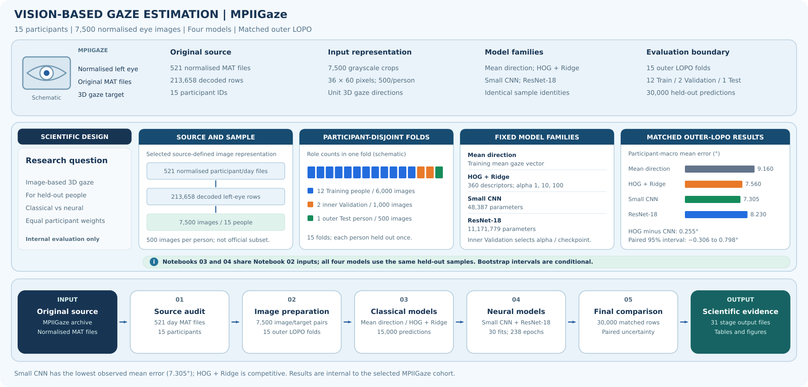

# Vision-Based Gaze Estimation | MPIIGaze

*Figure 1. Five-stage MPIIGaze workflow: source audit (01), normalised eye images and participant folds (02), classical baselines (03), CNN and transfer learning (04), and matched cross-person evaluation (05). The eye and fold illustrations are schematic; cohort counts and angular errors come from the saved study outputs.*

**Aim:** Compare classical image descriptors and compact neural networks for **3D gaze-direction estimation in held-out participants**. The five notebooks use a study-defined MPIIGaze subset of **7,500 normalised left-eye images from 15 participants**, with 15 outer leave-one-person-out (LOPO) folds and 30,000 matched held-out predictions across four models.

**Main finding:** Small CNN has the lowest observed participant-macro mean angular error (**7.3048°**), followed by HOG + Ridge (**7.5596°**), ResNet-18 (8.2304°) and mean direction (9.1601°). The paired difference between HOG + Ridge and Small CNN is 0.2549°, with a descriptive 95% interval of −0.3064° to 0.7984°. Their difference is uncertain.

**Independence:** This image-based study has its own source data, targets, participant roles and modelling outputs. It does not use GazeBase gaze traces or ZuCo EEG–gaze features from the other studies.

**Detailed scientific account:** [Research Methods and Evidence](RESEARCH_METHODS_AND_EVIDENCE.md). **Execution guidance:** [Running and Reviewing the Study](#4-running-and-reviewing-the-study).

## 1. Dataset and Experimental Protocol

| Item | Implemented definition and boundary |
| --- | --- |
| Dataset | [MPIIGaze](https://www.collaborative-ai.org/research/datasets/MPIIGaze/), [DaRUS distribution](https://doi.org/10.18419/darus-3230); publication reports 213,659 collected images and 15 participants |
| Source coverage | 521 normalised participant/day MAT files after archive companion exclusion; 213,658 decoded left-eye rows |
| Selected cohort | **15 participants (p00–p14)**; 500 images per person, 7,500 images in total; seed 17, within-person reservoir sampling |
| Input | Grayscale normalised left-eye crop, **36 × 60 pixels**; no head pose or participant ID as a predictor |
| Target | Source-linked **3D unit gaze direction** in the normalised representation; physical gaze-axis convention independently unconfirmed |
| Prediction and evaluation units | One eye image is one prediction; the participant is the held-out grouping and resampling unit |
| Participant-disjoint protocol | **15 outer LOPO folds**; each has 12 Training / 2 inner Validation / 1 outer Test participants (6,000 / 1,000 / 500 images) |
| Model families | Training-derived mean direction, HOG + Ridge, Small CNN and ImageNet-initialised ResNet-18 |
| Model selection | Training-only fitting and scaling; Ridge alpha and neural checkpoints selected using inner Validation, not the corresponding outer Test person |
| Primary metric | Participant-macro mean angular error in degrees; pooled median, SD and RMSE are secondary summaries |
| Descriptive uncertainty | 5,000 paired participant-summary bootstrap resamples, seed 17; intervals conditional on the fitted predictions |
| Image-statistic analysis | Cohort tertiles of mean pixel intensity and pixel SD, formed without prediction errors |

The selected 7,500 images are **not the official MPIIGaze Evaluation Subset**. The decoded row count differs by one from the published image count; the reason and the provider's differing annotated-subset counts remain unresolved. Numerical vector alignment does not independently establish the physical gaze-axis convention.

## 2. Experimental Programme

The five notebooks form **one executed gaze-estimation study**. Both modelling stages use the same sample identities and participant roles; the final notebook compares their predictions without further model fitting.

| Notebook | Scientific role and observed evidence | Named current outputs |
| --- | --- | --- |
| [01 — Source Audit and Protocol](code/notebooks/01_mpiigaze_source_audit_and_protocol.ipynb) | Inventory archive paths and participant/day files; inspect 15 MAT headers and publisher lists; define LOPO | Six files: file inventory, participant support, MAT schema, list inventory, protocol and source plot |
| [02 — Eye Images, Geometry and Quality](code/notebooks/02_eye_images_geometry_and_quality.ipynb) | Decode 213,658 source rows; retain **7,500 images**, unit targets and 15 fixed folds | Five files: sample index, fold assignments, source counts, cache settings and quality plot; local NPZ |
| [03 — Classical Baselines](code/notebooks/03_classical_gaze_estimation_baselines.ipynb) | Fit mean direction and HOG + Ridge within 15 folds; select Ridge alpha on inner Validation; produce **15,000** held-out predictions | Five files: inner metrics, configurations, Validation plot, outer predictions and participant metrics |
| [04 — CNN and Transfer Learning](code/notebooks/04_cnn_and_transfer_learning.ipynb) | Fit two neural models in all 15 folds; 30 fits, 238 epochs; produce **15,000** held-out predictions | Seven files: training history, selected Validation metrics, checkpoint metadata, configurations, curves, outer predictions and participant metrics; local weights |
| [05 — Cross-Person Evaluation and Robustness](code/notebooks/05_cross_person_evaluation_and_robustness.ipynb) | Reconcile **30,000** predictions; report model and person means, paired uncertainty, image strata and complexity | Eight files: model metrics, participant metrics, paired differences, stratum metrics, complexity and three plots |

The [study-wide workflow](images/study_overview.svg) presents the complete sequence. Five individual editable scientific diagrams accompany their respective notebooks in [`images/`](images/). Each notebook writes its named current outputs; Notebooks 03 and 04 share the inputs from Notebook 02 and both supply Notebook 05.

## 3. Main Results

### Source and image preparation

| Recorded evidence | MPIIGaze study finding |
| --- | --- |
| Archive file paths | 430,180 total; 215,386 operating-system companions |
| Normalised participant/day MAT files | 521 across 15 people (7–69 per person) |
| Representative MAT headers | 15 files; 30 top-level variable records |
| Publisher list inventory | 45 participant lists and one ReadMe |
| Decoded and selected images | 213,658 left-eye rows; **7,500 unique selected samples** |
| Outer-fold coverage | 15 folds; every person held out once |
| Pixel intensity and SD ranges | 83.87–216.38 and 66.67–86.94 |

Source-file counts do not equal image counts. See [Notebook 01](code/notebooks/01_mpiigaze_source_audit_and_protocol.ipynb) and [Notebook 02](code/notebooks/02_eye_images_geometry_and_quality.ipynb), the [source inventory](output/01_source_inventory.png), [sample index](output/02_sample_index.csv) and [fold assignments](output/02_fold_assignments.csv).

### Classical and neural modelling

HOG produces **360 image descriptors** per crop. Ridge alpha 100 gives the lowest inner-Validation error among the tested values (1, 10, 100) in every fold. The neural run comprises 30 model/fold fits, with **238 recorded epochs** on Tesla T4. Small CNN uses 48,387 parameters and ResNet-18 uses 11,171,779. Two fits stop at epoch seven; the other 28 reach epoch eight. The [learning curves](output/04_validation_curves.png) show 15 contributing folds per model through epoch seven and 14 at epoch eight.

### Matched outer-LOPO comparison

| Model | Mean inner-Validation error (°) | Participant-macro outer-Test mean (°) | Pooled median (°) | Descriptive 95% interval (°) |
| --- | ---: | ---: | ---: | ---: |
| Mean direction | 9.0481 | 9.1601 | 8.9879 | 8.8089–9.5587 |
| HOG + Ridge | 7.6961 | 7.5596 | 7.0152 | 7.0451–8.0824 |
| **Small CNN** | 6.7633 | **7.3048** | 6.8695 | 6.7381–7.8610 |
| ResNet-18 | 8.1554 | 8.2304 | 7.7005 | 7.7978–8.6473 |

Inner Validation summarises model-selection configurations, whereas outer Test summarises held-out participants. The latter contains the same 7,500 samples for every model. Because each person supplies 500 images, the participant-macro and pooled mean errors coincide.

Small CNN reduces observed mean error by **20.25%** relative to mean direction; HOG + Ridge reduces it by **17.47%**. The HOG-minus-CNN interval includes zero, which supports neither definite superiority nor equivalence. The smallest participant mean among the four models belongs to Small CNN for eight people, HOG + Ridge for six and mean direction for one. No model performs best for every participant.

Small CNN has lower descriptive error than HOG + Ridge in all six pixel-statistic strata. These comparisons do not establish causal effects of illumination or contrast. Parameter counts do not establish measured speed or memory use.

See [Notebook 05](code/notebooks/05_cross_person_evaluation_and_robustness.ipynb), its [scientific diagram](images/05_cross_person_evaluation_and_robustness.svg), the [model metrics](output/05_model_metrics.csv), [participant comparison](output/05_participant_comparison.png), [paired differences](output/05_paired_differences.csv) and [image-statistic strata](output/05_image_stratum_metrics.csv). The full methods, uncertainty and limitations appear in the [scientific document](RESEARCH_METHODS_AND_EVIDENCE.md).

## 4. Running and Reviewing the Study

### Reviewing saved evidence

All five notebooks have stored executions and the **31 current output files** are tracked. Start with [Notebook 05](code/notebooks/05_cross_person_evaluation_and_robustness.ipynb) and the [final model metrics](output/05_model_metrics.csv). Reviewing the results does not require original images or training. Notebook 05 can also be executed on CPU from the committed sample index, fold assignments, prediction tables, configuration tables and neural Validation metrics.

### Re-running the analysis

1. Use the [Getting Started guide](../GETTING_STARTED.md) and [data/source guidance](../data/README.md) with VS Code connected to Colab. The study uses the shared `setup_colab("vision_based_gaze_estimation")` helper and [study dependencies](requirements.txt).
2. Run [Notebook 01](code/notebooks/01_mpiigaze_source_audit_and_protocol.ipynb) to acquire or reuse the official source in the runtime, inventory it and record the protocol. Allow space for the approximately 2.1–2.2 GB archive and extraction. Dataset access is subject to the source's non-commercial research terms.
3. Run [Notebook 02](code/notebooks/02_eye_images_geometry_and_quality.ipynb) to decode the indexed eye rows and create the sample and fold tables and local NPZ cache.
4. Run [Notebook 03](code/notebooks/03_classical_gaze_estimation_baselines.ipynb) and [Notebook 04](code/notebooks/04_cnn_and_transfer_learning.ipynb) in full outer-LOPO mode (`RUN_OUTER_TEST = True`). Both reuse the exact Notebook 02 images and targets; if the cache is absent it is recovered from indexed original MAT rows. GPU is recommended for Notebook 04; pretrained ResNet weights may require a separate download.
5. Run [Notebook 05](code/notebooks/05_cross_person_evaluation_and_robustness.ipynb) when both complete prediction and configuration tables are available. It performs comparison and analysis, not new fitting.

Stage ZIPs provide optional transfer of the numbered results from Colab to the study's `output/` directory. Original data, image arrays and model weights remain local. A change to the cohort, labels, preprocessing or fitting procedure requires regenerating the affected downstream outputs; presentation-only edits do not require another experimental run.

## 5. Files and Saved Outputs

| Location | Role and availability |
| --- | --- |
| [`code/notebooks/`](code/notebooks/) | Five executed notebooks with structured explanations and saved results |
| [`code/src/`](code/src/) | MPIIGaze retrieval, eye-image decoding, vector geometry, grouped evaluation and model implementations |
| [`images/study_overview.svg`](images/study_overview.svg) | Editable study-wide five-band figure used at the top of this README |
| [`images/`](images/) | Five notebook-specific scientific SVGs and the study overview |
| [`output/`](output/) | 31 committed stage outputs: six (01), five (02), five (03), seven (04), eight (05) |
| [`requirements.txt`](requirements.txt) | Python study dependencies; exact historical versions are not fully pinned |
| [`data/raw/mpiigaze/`](../data/README.md) | Official source access and local layout; original archive and images remain outside Git |
| `data/processed/mpiigaze/` | Local `02_normalised_eye_cache.npz` and neural checkpoint weights; regenerate from source if needed |
| [`RESEARCH_METHODS_AND_EVIDENCE.md`](RESEARCH_METHODS_AND_EVIDENCE.md) | Scientific methods, detailed results and limitations |
| [`tests/test_vision_gaze_pipeline.py`](../tests/test_vision_gaze_pipeline.py) | Synthetic software and data-contract tests, not independent original-data reproduction |

The source dataset has its own [CC BY-NC-SA 4.0](https://creativecommons.org/licenses/by-nc-sa/4.0/) terms; the repository's [software licence](../LICENSE) does not replace them.

## 6. Interpretation and Scope

The study provides an executed image-based gaze-direction comparison on a bounded 15-person MPIIGaze cohort. A compact CNN and the HOG + Ridge comparator both improve observed mean error over the Training-derived reference; their paired difference is uncertain. The 30,000 prediction rows describe repeated measurements of 15 people, not independent participants.

The physical gaze-axis convention and one-row source-count discrepancy remain unresolved. Earlier development observations from this cohort and overlapping LOPO training sets limit interpretation of the participant bootstrap. Results do not establish external generalisation, official benchmark equivalence, calibrated screen-point accuracy or clinical performance.

Independent source-axis confirmation, a larger or external cohort, controlled image perturbations and resource measurements are possible follow-up studies. Refer to [Research Methods and Evidence](RESEARCH_METHODS_AND_EVIDENCE.md#9-discussion-limitations-and-future-work) for the scientific boundaries.

**Source attribution:** Zhang, X., Sugano, Y., Fritz, M. and Bulling, A., [*MPIIGaze: Real-World Dataset and Deep Appearance-Based Gaze Estimation*, IEEE TPAMI](https://doi.org/10.1109/TPAMI.2017.2778103); [MPIIGaze dataset](https://www.collaborative-ai.org/research/datasets/MPIIGaze/) and [DaRUS archive](https://doi.org/10.18419/darus-3230), [CC BY-NC-SA 4.0](https://creativecommons.org/licenses/by-nc-sa/4.0/).
