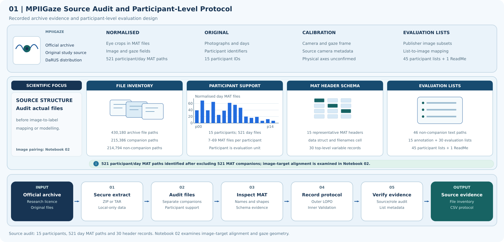
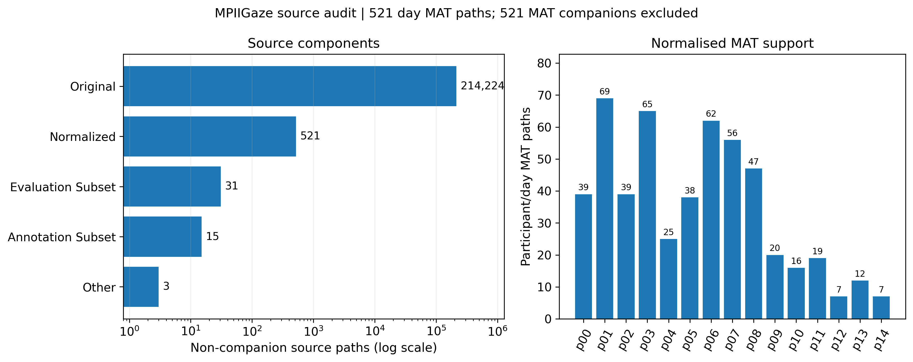
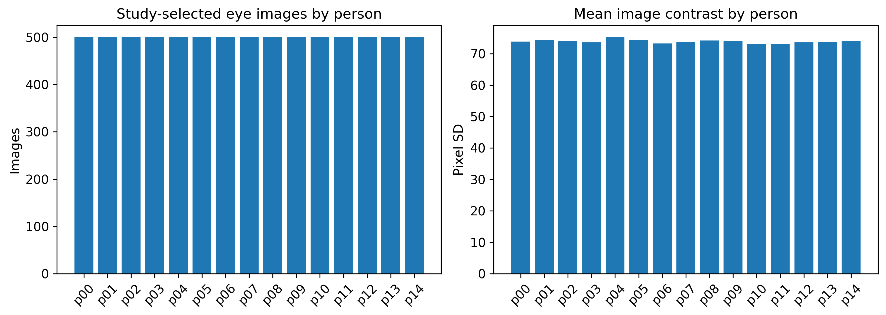
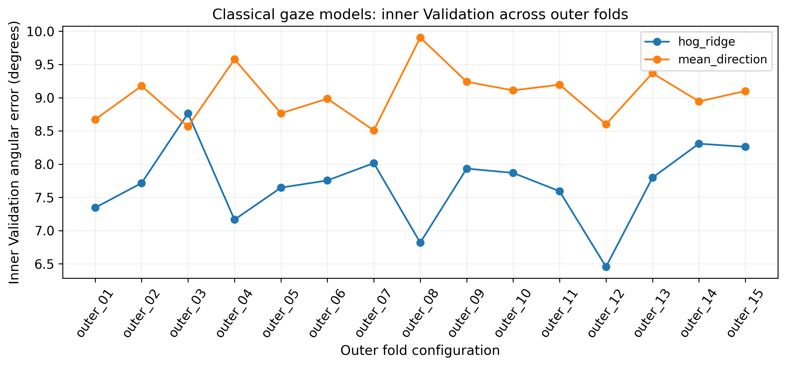
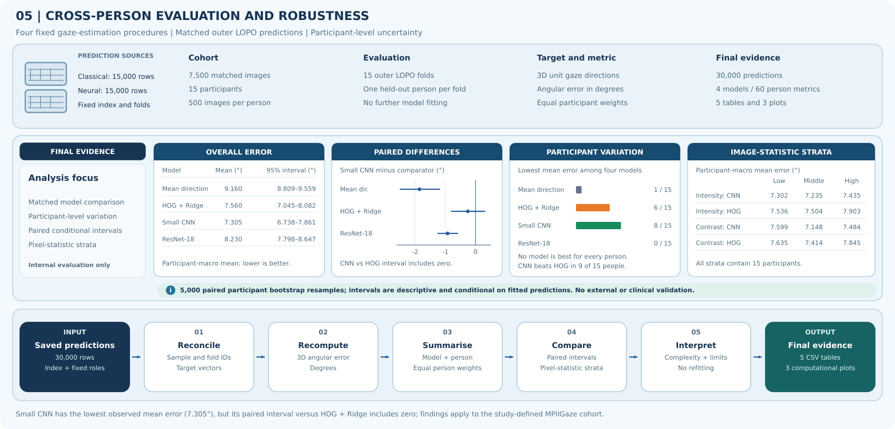

# Vision-Based Gaze Estimation

**Status:** All five notebooks have been executed on the study-defined MPIIGaze cohort (7,500 images, 15 participants, 15 outer LOPO folds). Four fixed models yielded 30,000 matched held-out predictions. Small CNN had the lowest observed participant-macro mean error (7.3048°); HOG + Ridge was close (7.5596°), with a paired interval spanning zero. This is a completed internal exploratory evaluation, not an external benchmark.

This independent study investigates whether camera-derived eye images can estimate **3D gaze direction for previously unseen participants**, using evidence-based image geometry, classical baselines and compact deep models. Its inputs, coordinate frames and evaluation procedures are **not interchangeable** with the GazeBase recordings or ZuCo EEG–gaze features in other studies.

**Scientific document:** [Research Methods and Evidence](RESEARCH_METHODS_AND_EVIDENCE.md).

*Figure 1. Original-data acquisition, source metadata, participant provenance and the evaluation design. The diagram includes recorded archive metadata, not model performance.*

## 1. Dataset and Experimental Protocol

| Aspect | Executed protocol and interpretation |
| --- | --- |
| Source | [MPIIGaze official dataset](https://www.collaborative-ai.org/research/datasets/MPIIGaze/), [archival distribution](https://doi.org/10.18419/darus-3230); public description: 15 people, 213,659 collected frames; study-defined subset of 7,500 indexed left-eye images inspected in Notebook 02 |
| Permissions | CC BY-NC-SA 4.0 reported by official providers. Original images/annotations stay outside Git; reuse remains subject to the provider's conditions |
| Predictors | **Normalised grayscale left-eye crops (36 × 60 pixels)**; 500 examples per participant, 7,500 total. Head pose is excluded; physical gaze-axis convention requires independent confirmation |
| Target | Source-linked **3D unit gaze direction** in the normalised representation; physical axis convention not independently confirmed |
| Prediction unit | One source-labelled image or eye sample; person/session/day IDs retained for grouping, not an unintended predictor |
| Evaluation unit | **Participant**; deterministic outer leave-one-person-out (LOPO) folds with **two distinct inner-Validation people** per fold, 15 observed participants. Notebooks 03 and 04 have completed full outer LOPO using the same fixed roles |
| Main metric | Mean/median **3D angular error in degrees**; per-person dispersion; 2D pixel error only if an appropriate separate geometry protocol is approved |

The official description distinguishes Data, Evaluation Subset and Annotation Subset. The executed source audit and decoder establish the study's actual file and sample counts; the provider's annotated-subset definitions and one-row difference from the published image count remain unresolved. This study does not reproduce the official Evaluation Subset.

## 2. Experimental Programme

These are **five complementary executed notebooks**, not five independent studies. Notebooks 01–02 establish the source and sample contracts; 03–04 produce the fixed outer-LOPO predictions; 05 reconciles the predictions and analyses participant-level results without fitting models. The notebooks use shared Colab setup, plotting and stage-specific exports.

| Stage | Notebook | Responsibility | Recorded outputs |
| --- | --- | --- | --- |
| 01 | [Source audit and protocol](code/notebooks/01_mpiigaze_source_audit_and_protocol.ipynb) | Implemented original-data access, safe archive extraction, participant/day and MAT schema audit, evaluation-list inspection and recorded protocol | **Source audit outputs:** `01_file_inventory.csv`, `01_participant_support.csv`, `01_mat_schema.csv`, `01_evaluation_list_inventory.csv`, `01_protocol.csv` and `01_source_inventory.png` |
| 02 | [Eye images, geometry and quality](code/notebooks/02_eye_images_geometry_and_quality.ipynb) | Implemented normalised-image/3D label decoder, initial 500-per-person source sampling, local-only image cache, participant LOPO/inner folds and pixel-quality plots | `02_sample_index.csv`, `02_fold_assignments.csv`, `02_source_sample_counts.csv`, `02_cache_location.csv`, `02_image_quality.png`; ignored local NPZ |
| 03 | [Classical baselines](code/notebooks/03_classical_gaze_estimation_baselines.ipynb) | Implemented Train-only mean direction and HOG + Ridge with nested inner-Validation alpha selection; full outer LOPO executed | `03_inner_validation_metrics.csv`, `03_run_configuration.csv`, `03_baseline_comparison.png`; `03_baseline_outer_predictions.csv` and `03_baseline_fold_metrics.csv` |
| 04 | [CNN and transfer learning](code/notebooks/04_cnn_and_transfer_learning.ipynb) | Small CNN and ImageNet-initialised ResNet-18; Train/inner-Validation checkpointing, full outer LOPO executed | `04_training_history.csv`, `04_inner_validation_metrics.csv`, `04_model_checkpoints.csv`, `04_run_configuration.csv`, `04_validation_curves.png`; local-only checkpoints, `04_neural_outer_predictions.csv`, `04_neural_outer_metrics.csv` |
| 05 | [Cross-person evaluation and robustness](code/notebooks/05_cross_person_evaluation_and_robustness.ipynb) | Executed matched prediction reconciliation, participant-level performance, paired uncertainty and image-statistic strata | `05_model_metrics.csv`, `05_participant_metrics.csv`, `05_paired_differences.csv`, `05_image_stratum_metrics.csv`, `05_model_complexity.csv` and three figures |

**Dependency order:** 01 → 02 → (03 and 04 use the **same sample index and fold assignments**) → 05, after both complete outer prediction tables are generated. Each outer LOPO person is excluded from fitting and inner model selection. The recorded full-LOPO configurations select Ridge alpha or neural checkpoints using inner Validation only. Neither model selection nor retrospective retuning may use the outer Test.

## 3. Main Results

**Source-audit results (Notebook 01):**

| Evidence | Recorded count |
|---|---:|
| Archive file paths | 430,180 |
| Operating-system companion paths | 215,386 |
| Non-companion paths | 214,794 |
| Participants with normalised MAT paths | 15 |
| Normalised MAT candidate paths | 1,042 |
| Participant/day MAT paths after companion exclusion | 521 |
| MAT paths per participant | 7–69 |
| Representative MATLAB v5 headers | 15 |
| Top-level variable records | 30 |
| Participant-list text files / documentation | 45 / 1 |

*Figure 2. Recorded non-companion file counts on a logarithmic axis and normalised MAT paths per participant. Source-file counts are not image sample counts.*

See the [participant support](output/01_participant_support.csv), [MAT headers](output/01_mat_schema.csv) and [list inventory](output/01_evaluation_list_inventory.csv). **Image-preparation results (Notebook 02):**

| Evidence | Recorded value |
|---|---:|
| Normalised MAT paths reconciled | 521 |
| Decoded left-eye rows | 213,658 |
| Selected images / unique sample IDs | 7,500 / 7,500 |
| Participants / images per participant | 15 / 500 |
| Image dimensions (height × width) | 36 × 60 |
| Outer folds | 15 |
| Training / Validation / Test people per fold | 12 / 2 / 1 |
| Training / Validation / Test images per fold | 6,000 / 1,000 / 500 |
| Mean pixel intensity range | 83.87–216.38 |
| Pixel SD range | 66.67–86.94 |
| Participant mean pixel SD range | 73.01–75.27 |

*Figure 3. Recorded balanced sample counts and descriptive pixel contrast for the selected eye images.*

All saved sample IDs are unique and target vectors have unit norm within numerical tolerance. The decoded source row count is one below the author-reported image count (213,659); the cause is unresolved. The source coordinate-axis convention is not independently confirmed. The selected sample is not the official benchmark. See the [sample index](output/02_sample_index.csv), [source counts](output/02_source_sample_counts.csv) and [fold roles](output/02_fold_assignments.csv). **Classical development results (Notebook 03):**

| Model | Mean fold error (°) | Median (°) | Minimum (°) | Maximum (°) |
|---|---:|---:|---:|---:|
| Mean direction | 9.0481 | 9.1004 | 8.5092 | 9.9054 |
| HOG + Ridge | 7.6961 | 7.7551 | 6.4557 | 8.7646 |

*Figure 4. Classical development results; the horizontal axis identifies outer-fold configurations, not scored outer-Test participants.*

Alpha 100 was the best tested Ridge setting in all 15 configurations. HOG + Ridge reduced mean fold error by 1.3519° (14.94%) and had lower error in 14/15 configurations; outer_03 was the exception. See the [candidate metrics](output/03_inner_validation_metrics.csv) and [configuration](output/03_run_configuration.csv). Fold results share participants and are not independent observations.

**Full outer-LOPO results (Notebooks 03–05):**

| Model | Participant-macro mean (°) | Pooled median (°) | Pooled RMSE (°) | Descriptive 95% interval (°) |
|---|---:|---:|---:|---:|
| Mean direction | 9.1601 | 8.9879 | 10.0070 | 8.8089 to 9.5587 |
| HOG + Ridge | 7.5596 | 7.0152 | 8.6314 | 7.0451 to 8.0824 |
| Small CNN | 7.3048 | 6.8695 | 8.2493 | 6.7381 to 7.8610 |
| ResNet-18 | 8.2304 | 7.7005 | 9.3255 | 7.7978 to 8.6473 |

*Figure 5. Matched participant-level evaluation, descriptive paired intervals and pixel-statistic strata on the 15-person cohort.*

Small CNN had the lowest observed participant-macro mean (7.3048°), 1.8553° below mean direction (20.25% relative reduction) and 0.2549° below HOG + Ridge. The HOG-minus-CNN paired interval (−0.3064° to 0.7984°) includes zero; the results do not establish a clear advantage of Small CNN over HOG + Ridge or equivalence between them. Small CNN has lower error than HOG + Ridge for nine of 15 people. Across all four procedures, the lowest participant mean belongs to Small CNN for eight people, HOG + Ridge for six and mean direction for one; ResNet-18 is lowest for none. These are descriptive results on the fixed cohort, not a retrospective model-selection rule.

The neural run comprised 30 fits and 238 epochs on Tesla T4. Small CNN has 48,387 parameters compared with 11,171,779 for ImageNet-initialised ResNet-18; this is not a measured speed or memory comparison. The [learning curves](output/04_validation_curves.png) show 15 contributing folds per model through epoch seven and 14 at epoch eight. Classical and neural predictions cover the same 7,500 images once per model.

The 95% percentile intervals use 5,000 paired resamples of the 15 participant mean errors with seed 17. Every model uses the same resampled participant indices. The intervals are conditional on fitted predictions; overlapping LOPO training sets, between-run optimisation variability and uncertainty from refitting are not represented. No formal significance tests or multiplicity-adjusted claims are made. Image-statistic strata contain all 15 participants, and Small CNN has lower descriptive error than HOG + Ridge in all six strata; these are not causal illumination or contrast effects.

**Inspect the final evidence:** [model metrics](output/05_model_metrics.csv) · [participant metrics](output/05_participant_metrics.csv) · [paired differences](output/05_paired_differences.csv) · [image strata](output/05_image_stratum_metrics.csv) · [model complexity](output/05_model_complexity.csv) · [participant comparison](output/05_participant_comparison.png) · [error distributions](output/05_error_distribution.png) · [uncertainty figure](output/05_participant_uncertainty.png).

The [classical predictions](output/03_baseline_outer_predictions.csv) and [neural predictions](output/04_neural_outer_predictions.csv) support the independent numerical checks. All 30,000 angular errors, participant and stratum summaries, paired differences and bootstrap intervals were checked against saved evidence. Model weights and original image arrays were not independently rerun.

## 4. Running and Reviewing the Study

### Reviewing saved evidence

Read the [methods and source requirements](RESEARCH_METHODS_AND_EVIDENCE.md) and inspect the saved results before deciding whether to rerun. Notebook 05 can be rerun from the committed CSVs alone, without raw images, GPU or further model fitting. The notebooks use the repository's existing Colab checkout and `setup_colab("vision_based_gaze_estimation")` helper.

### Running the analysis from the source

1. Connect VS Code to a Google Colab runtime and open [Notebook 01](code/notebooks/01_mpiigaze_source_audit_and_protocol.ipynb). Run all cells in order. The official dataset is for non-commercial scientific research under CC BY-NC-SA 4.0.
2. Section 02 automatically reuses extracted MPIIGaze participant MAT files or a cached archive in the remote runtime. If neither is available, it downloads the [publisher archive](https://www.collaborative-ai.org/research/datasets/MPIIGaze/) directly into the remote checkout; the [DaRUS public archive](https://doi.org/10.18419/darus-3230) is the alternative official source. No manual raw-data download or upload on the user's computer is required. Allow sufficient runtime disk space for both the compressed archive (approximately 2.1–2.2 GB) and extraction.
3. The notebook validates the archive structure and stops with a diagnostic if neither official acquisition succeeds. It does not continue with missing data.
4. Sections 03–09 produce observed source inventories, bounded MATLAB-header metadata, the proposed protocol and a source-file chart. Download only the resulting Stage-01 ZIP via VS Code Colab Contents and extract it into this study's `output/` directory.
5. Run [Notebook 02](code/notebooks/02_eye_images_geometry_and_quality.ipynb) with the Stage-01 output files available (in the same remote checkout or synchronised from Git). It automatically recovers missing raw data and reconciles normalised MAT paths and sizes against the recorded inventory. Inspect actual image/label identities, gaze geometry and participant folds before accepting downstream data.
6. Run [Notebook 03](code/notebooks/03_classical_gaze_estimation_baselines.ipynb) and [Notebook 04](code/notebooks/04_cnn_and_transfer_learning.ipynb) in their current full outer-LOPO mode (`RUN_OUTER_TEST = True`). Use the fixed Stage-02 index and folds, the same candidate grid and neural settings. A missing cache is rebuilt from exact indexed source rows. Notebook 04 uses all outer folds; GPU is recommended. Pretrained ResNet weights may require a separate download. Preserve the fixed procedures and do not tune on Test results.
7. Every stage packages its current `NN_*` files as a ZIP for manual Colab download. The original image cache and neural weights stay under ignored `data/processed/mpiigaze/` and do not travel in the ZIP. Run Notebook 05 after both final prediction tables and their configuration tables are saved in the study output directory. It recomputes matched angular errors without fitting models or reading raw images.

The approved architecture uses standard Python and Google Colab. [requirements.txt](requirements.txt) lists the study dependencies; exact historical package versions are not fully pinned here.

## 5. Files and Saved Outputs

| Location | Responsibility |
| --- | --- |
| [`code/notebooks/`](code/notebooks/) | Notebooks 01–05 executed with recorded outputs |
| [`code/src/`](code/src/) | [Source retrieval/inspection](code/src/mpiigaze_io.py), [normalised-image reader](code/src/mpiigaze_data.py), [3D geometry](code/src/gaze_geometry.py), [grouped evaluation](code/src/gaze_evaluation.py) and [classical/CNN models](code/src/gaze_models.py) |
| [`images/`](images/) | Five editable five-band diagrams for [source audit](images/01_mpiigaze_source_audit_and_protocol.svg), [3D gaze/image preparation](images/02_eye_images_geometry_and_quality.svg), [classical baselines](images/03_classical_gaze_estimation_baselines.svg), [CNN modelling](images/04_cnn_and_transfer_learning.svg) and [final evaluation](images/05_cross_person_evaluation_and_robustness.svg); diagrams describe methods and recorded evidence for Notebooks 01–05 |
| [`requirements.txt`](requirements.txt) | Study dependencies; exact historical versions not fully pinned |
| `data/raw/mpiigaze/` (remote Colab checkout) | Automatically acquired original source files; ignored by Git and excluded from stage ZIPs |
| `output/` (study root) | 31 recorded outputs: six (01), five (02), five (03), seven (04) and eight (05) |
| [`RESEARCH_METHODS_AND_EVIDENCE.md`](RESEARCH_METHODS_AND_EVIDENCE.md) | Scientific question, data contracts, executed evaluation, results and limitations |

## 6. Interpretation and Scope

The study establishes a reproducible analysis of saved, matched held-out predictions from a bounded image-based gaze-estimation cohort. A compact CNN and HOG + Ridge both show lower observed mean error than the training-derived mean direction, but their paired difference is uncertain. With 15 people and overlapping LOPO fitting sets, neither repeated images nor the 30,000 predictions represent independent participants. The selected models and settings were not retuned on the recorded outer-Test results; earlier development on this cohort limits claims of a wholly untouched population. The unresolved physical gaze-axis convention and source-count discrepancy limit geometric interpretation. The study does not establish external generalisation, official benchmark equivalence, calibrated screen gaze or clinical readiness.

Face-based gaze estimation, gaze-point calibration, cross-dataset robustness and compact Transformers are possible **future extensions**, not current outcomes. The [source study](https://doi.org/10.1109/TPAMI.2017.2778103) should be cited for the original MPIIGaze dataset and its methods. Dataset access remains subject to CC BY-NC-SA 4.0 terms.
