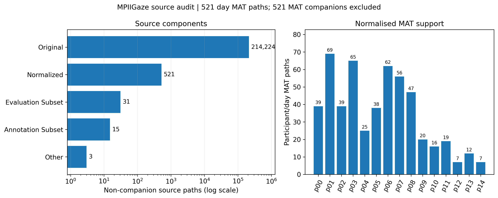
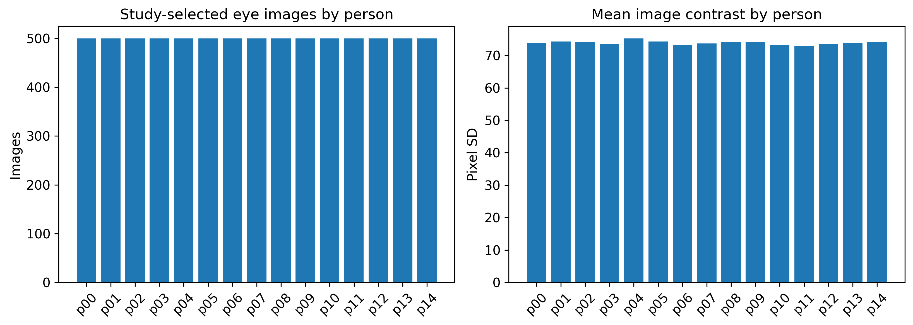
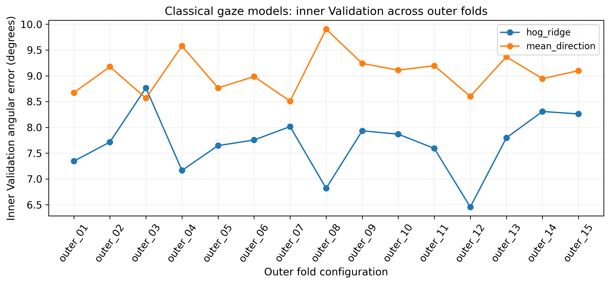
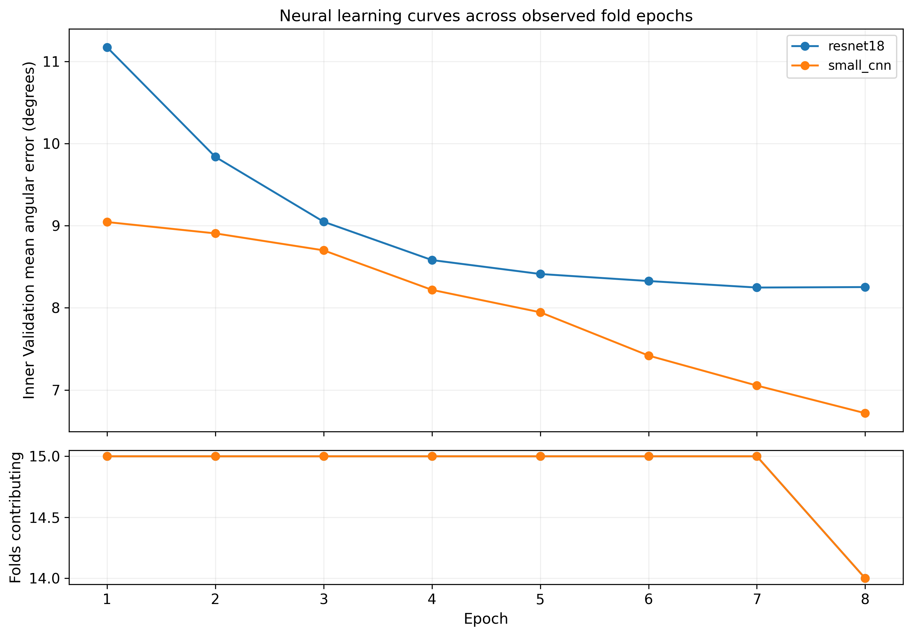
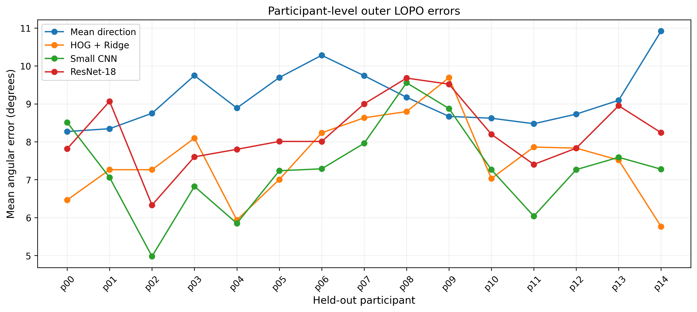
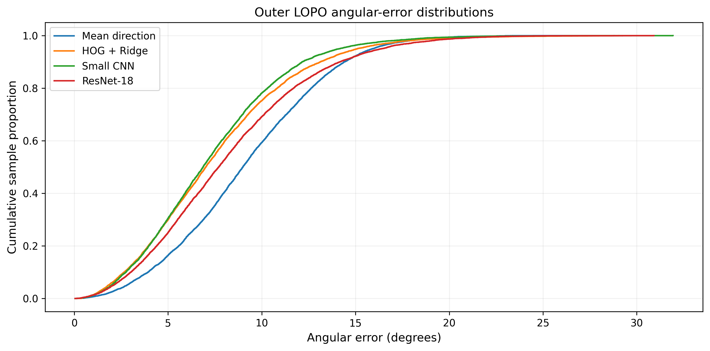
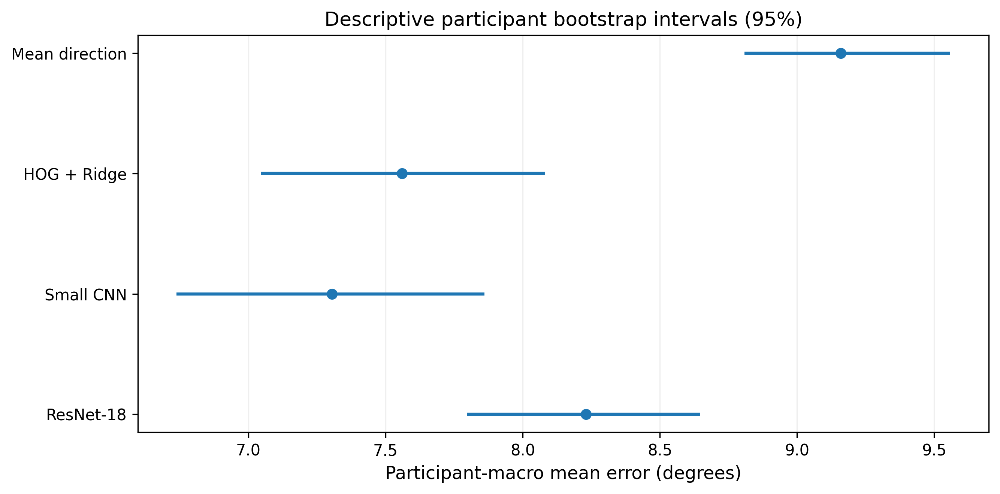

# Vision-Based Gaze Estimation | MPIIGaze: Research Methods and Evidence

**Study:** Vision-Based Gaze Estimation, within Eye-Tracking & Neurocognitive Intelligence. **Target:** 3D gaze direction from normalised left-eye images. **Scope:** 7,500 selected MPIIGaze images, 15 participants, 15 outer LOPO folds and four fixed gaze-estimation procedures. The five notebooks yield 30,000 matched held-out predictions. Small CNN has the lowest observed participant-macro mean error (**7.3048°**); the paired difference versus HOG + Ridge remains uncertain. See the [study README](README.md), [study-wide workflow](images/study_overview.svg) and [execution guidance](README.md#4-running-and-reviewing-the-study).

## 1. Research Objective and Scope

The main question is whether image-based gaze estimators can predict 3D directions for held-out people with lower angular error than a Training-derived mean-gaze reference. The study compares HOG + Ridge, a compact CNN and ImageNet-initialised ResNet-18 on the same image identities and participant folds.

The five linked notebooks address original source structure (01), matched image and gaze representation (02), classical models (03), neural models (04), and final participant-level comparison and descriptive robustness (05). The predictions concern normalised 3D gaze directions, not screen-calibrated gaze points. Eye-event segmentation, EEG fusion, reading comprehension, personalised calibration and Vision Transformers are outside the experiment. No processed data or model results are transferred from the other studies.

## 2. Data Sources, Cohort and Target Definitions

### 2.1 Original source and access

The source is [MPIIGaze](https://www.collaborative-ai.org/research/datasets/MPIIGaze/) and its [DaRUS distribution](https://doi.org/10.18419/darus-3230). The original publication reports 15 participants and 213,659 collected full-face images. The archive distinguishes Data, Evaluation Subset and Annotation Subset. The study uses the normalised participant/day MATLAB component and a separate sampled left-eye cohort, not the official Evaluation Subset.

The source is offered under [CC BY-NC-SA 4.0](https://creativecommons.org/licenses/by-nc-sa/4.0/). Original images and annotations remain outside Git; use the [source access guide](../data/README.md). Published source counts and archive-derived counts are distinct. Differing annotated-subset quantities in the provider's descriptions remain unresolved.

### 2.2 Cohort and analytical units

| Scope dimension | Observed value |
| --- | ---: |
| Participants | 15 (p00–p14) |
| Normalised participant/day MAT files | 521 |
| Decoded left-eye rows | 213,658 |
| Sampled left-eye images | 7,500 |
| Images per participant | 500 |
| MAT files represented in sampled cohort | 510 |
| Outer LOPO folds | 15 |

Each image has one 3D gaze target. Images are nested within participant and day. The participant is the held-out and uncertainty unit; the 30,000 model/image prediction records do not represent 30,000 people.

### 2.3 Input and target definitions

The model input is a normalised grayscale left-eye crop of 36 × 60 pixels. The decoder uses source eye-image and gaze fields, supporting angle (radian) or three-vector targets and converting them to 3D unit directions. Participant, eye, path and source-row identifiers preserve provenance and grouping; they are not predictors. Head pose is not a model input. The physical gaze-axis convention is independently unconfirmed, and no 2D screen point is substituted for the 3D representation.

## 3. Data Preparation and Representations

### 3.1 Source acquisition and file inventory

[Notebook 01](code/notebooks/01_mpiigaze_source_audit_and_protocol.ipynb) reuses an extracted source or cached archive; otherwise it acquires the publisher or DaRUS archive and safely extracts the ZIP/TAR entries. The [source adapter](code/src/mpiigaze_io.py) inventories relative paths, file sizes, participant/day support, representative MAT headers and publisher lists. Operating-system companion files are distinguished from source containers before decoding. Header and file counts do not establish image-level label correspondence.

### 3.2 Image and target pairing

[Notebook 02](code/notebooks/02_eye_images_geometry_and_quality.ipynb) and [mpiigaze_data.py](code/src/mpiigaze_data.py) load normalised MATLAB `data.<eye>.image` and `data.<eye>.gaze` fields. They reconcile normalised MAT paths and byte sizes against Notebook 01, require matching image/target row counts, reject unsupported representations and retain original participant/file/eye/row identities.

Deterministic within-person reservoir sampling (seed 17; cap 500) gives 500 selected rows for every participant without selecting on gaze values. The cache holds an image array of shape `(7500, 36, 60)`, gaze targets of shape `(7500, 3)` and ordered sample IDs. The cache is local to `data/processed/mpiigaze/`. If absent, it is restored using the exact indexed source rows, rather than resampling or changing the participant roles.

### 3.3 Representation and quality summaries

Image pixels are scaled to [0,1] for HOG and neural models. HOG produces a 7,500 × 360 descriptor matrix. Its standardiser is fitted on the Training images separately in each fold. The neural input has shape `(N, 1, 36, 60)` and uses no stochastic augmentation. Mean pixel intensity and pixel SD are descriptive image statistics; neither independently measures illumination or calibration accuracy.

The [geometry helper](code/src/gaze_geometry.py) computes the angle between finite, nonzero 3D vectors in degrees. Synthetic numerical tests and saved prediction recalculation support the calculation, not the physical interpretation of source axes.

## 4. Experimental Design and Evaluation

### 4.1 Participant-disjoint outer and inner roles

The [fold utility](code/src/gaze_evaluation.py) generates leave-one-person-out folds from the parsed eligible participant IDs, with two distinct inner Validation people per fold (seed 17). Each image of a participant belongs to exactly one role within that fold.

| Role per outer fold | Participants | Images | Function |
| --- | ---: | ---: | --- |
| Training | 12 | 6,000 | Fit the reference, scaling and model parameters |
| Inner Validation | 2 | 1,000 | Select Ridge alpha or neural checkpoint |
| Outer Test | 1 | 500 | Score the fitted procedure on the held-out person |

Across 15 folds every participant serves as outer Test exactly once. Both model notebooks use the same indexed images and fold roles. Ridge fits and neural checkpoints use only Training and inner Validation as appropriate; there is no refit on the combined Training and Validation people before Test.

### 4.2 Primary metric and matched comparison

For target direction **g** and predicted direction **p**, angular error is the inverse cosine of their norm-normalised, clipped dot product, converted to degrees. Lower error is better. The primary metric is the mean of the 15 participant-specific image-mean angular errors. Pooled means equal participant-macro means here because every participant contributes 500 images. Pooled median, sample SD and RMSE and the SD of participant means are descriptive secondary metrics.

### 4.3 Interpretation of Test and uncertainty

The 15 outer Test people are disjoint from their respective fold's fitting and selection people. Earlier development used observations from this same cohort (including an initial two-fold neural run), so the overall cohort is not a wholly untouched confirmatory sample. Training sets overlap across folds. The final four-model comparison is descriptive and is not used to replace the fixed candidates or select a new procedure retrospectively. Section 7 describes the participant-level resampling.

## 5. Methods, Models and Configurations

| Notebook | Method or candidate | Implemented configuration and role |
| --- | --- | --- |
| 01–02 | Source audit and sample construction | Normalised MATLAB fields; 500 images per participant; sampling and fold seed 17 |
| 03 | Mean direction | Normalise the mean Training gaze vector; constant prediction within a fold |
| 03 | HOG + Ridge | Six orientation bins; 6 × 6-pixel cells; one cell/block; 360 descriptors; Training-fitted StandardScaler and multi-output Ridge; alpha grid 1, 10, 100 |
| 04 | Small CNN | Conv2d channels 16/32/64; kernels 5/3/3; ReLU, max pooling after first two blocks, adaptive average pooling (2,3); 64-unit dense layer and 3-vector output; 48,387 parameters |
| 04 | ResNet-18 | ImageNet initialisation; mean pretrained RGB filters for single-channel input; 3-vector output head; 11,171,779 parameters |
| 04 | Neural fitting and checkpoint choice | AdamW; learning rates 0.001 (Small CNN) and 0.0001 (ResNet-18); weight decay 0.0001; batch 128; at most eight epochs; patience three; fold seeds 17–31 |
| 05 | Matched analysis | No fitting; participant-macro means, paired bootstrap, image-statistic strata and complexity |

Both networks use mean cosine-direction loss (1 minus the predicted/target unit-vector dot product). The checkpoint with minimum inner-Validation mean angular error is retained for each model/fold. Ridge output vectors and neural predictions are normalised before scoring. The final neural run uses CUDA on Tesla T4; parameter counts and epoch histories are recorded, not measured wall-clock time, memory or latency.

Model implementations are in [gaze_models.py](code/src/gaze_models.py), supported by [gaze_geometry.py](code/src/gaze_geometry.py) and [gaze_evaluation.py](code/src/gaze_evaluation.py). The architectures differ in capacity, initialisation and learning rate, so the comparison does not isolate any one factor.

## 6. Results and Comparative Analysis

### 6.1 Source and image preparation (Notebooks 01–02)

The executed [Notebook 01](code/notebooks/01_mpiigaze_source_audit_and_protocol.ipynb) recorded 430,180 archive file paths, of which 215,386 are operating-system companions and 214,794 are non-companion paths.

| Non-companion source component | File paths |
|---|---:|
| Original | 214,224 |
| Normalized | 521 |
| Evaluation Subset | 31 |
| Annotation Subset | 15 |
| Other | 3 |
| Total | 214,794 |

The [participant support table](output/01_participant_support.csv) identifies all 15 participants (p00–p14). Of 1,042 candidate normalised MAT paths, 521 are companion paths and 521 are participant/day MAT paths, with 7–69 per participant. The [MAT header table](output/01_mat_schema.csv) records 30 variables across 15 representative MATLAB v5 files: a `data` struct and a `filenames` cell array in each file. The [list inventory](output/01_evaluation_list_inventory.csv) includes 15 annotation lists, 30 evaluation lists and one ReadMe. These are path and header counts, not verified image–gaze pairs. See the [source inventory plot](output/01_source_inventory.png).

The decoder processed 213,658 left-eye source rows and retained 7,500 grayscale images (36 × 60 pixels), 500 per participant. The decoded count differs by one from the published image count of 213,659; its cause is unresolved. The [sample index](output/02_sample_index.csv) contains 7,500 unique IDs spanning 510 selected source MAT files. All saved gaze vectors have unit norms within numerical tolerance, and the image intensity and contrast statistics are finite. Mean intensity ranges from 83.87 to 216.38; pixel SD ranges from 66.67 to 86.94. Participant mean pixel SD ranges from 73.01 to 75.27 (see [quality plot](output/02_image_quality.png)). These are descriptive pixel statistics rather than independent image-quality labels.

The [fold table](output/02_fold_assignments.csv) contains 225 participant-role records: 15 folds with all 15 participants represented exactly once in each fold, 12 Training, two inner Validation and one Test person. Each fold contains 6,000, 1,000 and 500 images respectively. Every participant serves as outer Test once. No cross-role participant overlap was found. The local NPZ is not published; the cache loader reconciles ordered sample IDs and target directions with the index. The source physical axis convention is not independently confirmed.

*Figure 1. Non-companion source component counts on a logarithmic axis and normalised MAT file counts by participant.*

*Figure 2. Selected sample counts and mean pixel SD per participant.*

### 6.2 Classical inner-Validation results (Notebook 03)

The HOG feature matrix is 7,500 × 360. The saved [inner-Validation metrics](output/03_inner_validation_metrics.csv) contain 60 candidate/fold records and the [configuration table](output/03_run_configuration.csv) contains 30 selected model/fold records. All 15 folds contain two inner Validation participants. The selected procedure is scored on the corresponding outer Test person.

| Model | Mean fold error (°) | Median (°) | Minimum (°) | Maximum (°) |
|---|---:|---:|---:|---:|
| Mean direction | 9.0481 | 9.1004 | 8.5092 | 9.9054 |
| HOG + Ridge | 7.6961 | 7.7551 | 6.4557 | 8.7646 |

The selected Ridge alpha is 100 in every fold, the upper boundary of the tested grid (1, 10, 100). Mean fold errors for these candidates are 7.7326°, 7.7289° and 7.6961° respectively. The image-based comparator reduced mean fold error by 1.3519° (14.94%) and outperformed the reference in 14 of 15 configurations; outer_03 had errors of 8.7646° versus 8.5672°. The [comparison plot](output/03_baseline_comparison.png) preserves this exception. Mean-direction scores were recalculated from the published sample targets and fold roles, agreeing with the saved values within 0.000005°. HOG/Ridge fits have not been independently repeated because the image cache is local.

These are descriptive inner-Validation results across overlapping participant configurations, not independent fold replicates.

*Figure 3. Inner-Validation error for the two classical procedures across the 15 outer-fold configurations, not outer-Test participant error.*

### 6.3 Neural learning and inner Validation (Notebook 04)

The 30 neural fits ran for 238 epochs on CUDA (Tesla T4). Small CNN in outer_07 and ResNet-18 in outer_12 stopped at epoch seven after their best epoch four; the other 28 fits reached epoch eight. Each of the 30 selected epochs corresponds to its minimum recorded inner-Validation error. Mean selected inner-Validation errors are 6.7633° and 8.1554°, respectively. See the [training history](output/04_training_history.csv), [selected metrics](output/04_inner_validation_metrics.csv), [configuration](output/04_run_configuration.csv) and [checkpoint metadata](output/04_model_checkpoints.csv).

*Figure 4. Mean inner-Validation error across observed epochs. Each model has 15 contributing folds at epochs 1–7 and 14 at epoch eight.*

The final-epoch mean can represent a different set of folds because of early stopping. The average of selected checkpoints is distinct from the mean at any particular epoch.

### 6.4 Matched outer-LOPO results (Notebooks 03–05)

Each model produces 7,500 outer-Test predictions, one for each indexed image. Both the [classical](output/03_baseline_outer_predictions.csv) and [neural](output/04_neural_outer_predictions.csv) tables contain 15,000 rows. Notebook 05 reconciles all 30,000 predictions with the fixed sample and role tables.

| Model | Participant-macro mean (°) | SD of participant means (°) | Pooled median (°) | Pooled SD (°) | Pooled RMSE (°) | Descriptive 95% interval (°) |
|---|---:|---:|---:|---:|---:|---:|
| Mean direction | 9.1601 | 0.7654 | 8.9879 | 4.0293 | 10.0070 | 8.8089 to 9.5587 |
| HOG + Ridge | 7.5596 | 1.0673 | 7.0152 | 4.1660 | 8.6314 | 7.0451 to 8.0824 |
| Small CNN | 7.3048 | 1.1635 | 6.8695 | 3.8331 | 8.2493 | 6.7381 to 7.8610 |
| ResNet-18 | 8.2304 | 0.8813 | 7.7005 | 4.3851 | 9.3255 | 7.7978 to 8.6473 |

| Model | Median participant mean (°) | Minimum participant mean (°) | Maximum participant mean (°) |
| --- | ---: | ---: | ---: |
| Mean direction | 8.8903 | 8.2702 | 10.9189 |
| HOG + Ridge | 7.5180 | 5.7664 | 9.6914 |
| Small CNN | 7.2657 | 4.9781 | 9.5559 |
| ResNet-18 | 8.0091 | 6.3302 | 9.6792 |

HOG + Ridge lowers the reference's participant-macro mean by 1.6005° (17.47%) and has lower error for 14 of 15 people. The exception is p09, where errors are 9.6914° and 8.6698° respectively. Small CNN lowers the reference mean by 1.8553° (20.25%); it also has lower mean error than ResNet-18 by 0.9256°. Its 0.2549° advantage over HOG + Ridge is small, with a paired interval spanning zero. The four-model comparison does not establish a universally superior procedure.

The [model metrics](output/05_model_metrics.csv), [classical participant metrics](output/03_baseline_fold_metrics.csv) and [neural participant metrics](output/04_neural_outer_metrics.csv) provide the current numerical evidence. Independent recalculation of angular errors from saved target and predicted vectors agrees with the recorded errors within 0.000002°; the mean-direction reference also agrees with Training-derived means. This is a numerical check of predictions, not independent model fitting or physical source-label validation.

## 7. Robustness, Uncertainty and Additional Analyses

### 7.1 Participant variation and error distributions

The [participant-level metrics](output/05_participant_metrics.csv) record mean and median error for every model and held-out person (60 rows, each with 500 samples). The [participant comparison](output/05_participant_comparison.png) shows that error varies with the person: the smallest and largest participant means for Small CNN are 4.9781° (p02) and 9.5559° (p08); those of HOG + Ridge are 5.7664° (p14) and 9.6914° (p09). The [cumulative error curves](output/05_error_distribution.png) show pooled image-error distributions, not independent-participant sampling distributions.

Small CNN has the lowest participant mean among all four models for eight people, HOG + Ridge for six, mean direction for one and ResNet-18 for none. In their pairwise comparison, Small CNN has lower error than HOG + Ridge for nine people.

*Figure 5. Mean angular error for each model and held-out participant.*

*Figure 6. Cumulative angular-error distributions for the 7,500 images per model; these are not independent-person sampling distributions.*

### 7.2 Paired participant-level uncertainty

The 95% percentile intervals use 5,000 paired resamples of the 15 participant mean errors with seed 17. Every model uses the same resampled participant indices. The intervals are conditional on fitted predictions; overlapping LOPO training sets, between-run optimisation variability and uncertainty from refitting are not represented. No formal significance tests or multiplicity-adjusted claims are made.

| Model A | Model B | Mean A − B (°) | People with A lower (of 15) | Descriptive 95% paired interval (°) |
|---|---|---:|---:|---:|
| Mean direction | HOG + Ridge | 1.6005 | 1 | 0.9620 to 2.3090 |
| Mean direction | Small CNN | 1.8553 | 3 | 1.1876 to 2.4912 |
| Mean direction | ResNet-18 | 0.9297 | 3 | 0.3869 to 1.4793 |
| HOG + Ridge | Small CNN | 0.2549 | 6 | -0.3064 to 0.7984 |
| HOG + Ridge | ResNet-18 | -0.6707 | 9 | -1.1688 to -0.1776 |
| Small CNN | ResNet-18 | -0.9256 | 14 | -1.2452 to -0.5942 |

Negative values indicate lower error for model A. HOG + Ridge versus Small CNN includes zero; the other paired intervals exclude zero within this conditional analysis. These intervals do not prove general superiority or statistical significance, and an interval including zero does not prove equivalence. See the [paired table](output/05_paired_differences.csv) and [model-level interval plot](output/05_participant_uncertainty.png).

*Figure 7. Descriptive 95% participant-bootstrap intervals for participant-macro mean angular error, conditional on fitted predictions.*

### 7.3 Image-statistic robustness

Cohort tertiles are defined from the indexed pixel statistics without reference to prediction error. Intensity cut points are approximately 128.519 and 129.380 (2,501/2,499/2,500 images); pixel-SD cut points are 73.633 and 73.975 (2,500 images per group). All six strata contain all 15 participants, although images per person may differ. Means give equal weight to participant means within a stratum. Small CNN has lower descriptive error than HOG + Ridge in all six strata. The changes across strata are not monotonic, and the overlapping group populations and narrow middle ranges preclude causal claims about illumination or contrast.

| Image statistic | Model | Low (°) | Middle (°) | High (°) |
|---|---|---:|---:|---:|
| Mean intensity | Mean direction | 9.3901 | 9.2712 | 9.1390 |
| Mean intensity | HOG + Ridge | 7.5364 | 7.5038 | 7.9032 |
| Mean intensity | Small CNN | 7.3023 | 7.2349 | 7.4351 |
| Mean intensity | ResNet-18 | 8.3388 | 8.2876 | 8.7540 |
| Pixel SD | Mean direction | 9.3263 | 9.0893 | 9.1072 |
| Pixel SD | HOG + Ridge | 7.6351 | 7.4138 | 7.8447 |
| Pixel SD | Small CNN | 7.5987 | 7.1478 | 7.4845 |
| Pixel SD | ResNet-18 | 8.2358 | 8.1442 | 8.2974 |

The [stratum table](output/05_image_stratum_metrics.csv) retains the actual interval labels, image counts and participant support. Pixel statistics do not measure calibrated illumination, gaze-axis validity, head pose or clinical image quality. Correlated samples, differences in target direction and participant-specific image distributions may contribute to the observed patterns. No controlled perturbation, external dataset or measured head-pose robustness experiment was performed.

### 7.4 Model complexity

The [complexity table](output/05_model_complexity.csv) records 360 HOG descriptors and neural parameter counts of 48,387 (Small CNN) and 11,171,779 (ResNet-18). Small CNN has approximately one 231st of the parameter count and lower observed mean error than ResNet-18; it does not follow that its actual inference time, memory consumption or deployment behaviour is superior. These quantities were not measured.

## 8. Current Outputs and Reproducibility

The five notebooks and 31 derived outputs belong to the same study-defined 15-person cohort. Original images, the image cache and fitted neural weights are required for reconstruction; the saved results can be inspected independently. The saved predictions and derived tables can be inspected without those local artefacts.

| Producing notebook | Named current files and consumers |
| --- | --- |
| 01 | `01_file_inventory.csv`, `01_participant_support.csv`, `01_mat_schema.csv`, `01_evaluation_list_inventory.csv`, `01_protocol.csv`, `01_source_inventory.png` (recorded source-audit outputs); source reconciliation for Notebook 02 |
| 02 | `02_sample_index.csv`, `02_fold_assignments.csv`, `02_source_sample_counts.csv`, `02_cache_location.csv`, `02_image_quality.png`; local ignored `02_normalised_eye_cache.npz` used by Notebooks 03–04 |
| 03 | `03_inner_validation_metrics.csv`, `03_run_configuration.csv`, `03_baseline_comparison.png`; full outer LOPO: `03_baseline_outer_predictions.csv`, `03_baseline_fold_metrics.csv` |
| 04 | `04_training_history.csv`, `04_inner_validation_metrics.csv`, `04_model_checkpoints.csv`, `04_run_configuration.csv`, `04_validation_curves.png` and ignored checkpoint weights; full outer LOPO: `04_neural_outer_predictions.csv`, `04_neural_outer_metrics.csv` |
| 05 | `05_model_metrics.csv`, `05_participant_metrics.csv`, `05_paired_differences.csv`, `05_image_stratum_metrics.csv`, `05_model_complexity.csv`, `05_participant_comparison.png`, `05_error_distribution.png`, `05_participant_uncertainty.png` |

The angular errors in all 30,000 saved prediction rows, together with the 60 participant summaries, four model summaries, six paired differences and 24 image-stratum summaries, were independently recalculated. The ten model and paired bootstrap intervals were reproduced using the recorded NumPy seed and participant order. Original image arrays and neural weights were not independently reloaded or retrained. These are checks of recorded analytical evidence, not reproduction of the source-to-model training sequence.

The [study dependencies](requirements.txt) and shared [notebook utilities](../python_modules/core/) describe the environment; exact historical versions are not fully pinned. Reproducing Notebooks 01–04 requires the original MPIIGaze source and image cache (GPU recommended for 04). Notebook 05 uses the saved CSVs. Each stage writes its named outputs; changes to source selection, target mapping, folds or models require regeneration of affected results.

The [README](README.md) contains the study-wide diagram; the five individual figures remain in [`images/`](images/) and accompany their notebooks. The [synthetic pipeline tests](../tests/test_vision_gaze_pipeline.py) check software contracts rather than reproducing the original-data training.

## 9. Discussion, Limitations and Future Work

The study shows that both image-based classical and neural representations reduce observed mean angular error compared with the Training-derived reference on the selected MPIIGaze cohort. Small CNN has the lowest observed mean, while HOG + Ridge remains competitive and performs better for some people. The paired interval spanning zero does not establish a definite advantage or equivalence. The model families differ in architecture, initialisation and learning rate; the comparison cannot identify which factor caused the observed differences.

| Source of limitation | Consequence for interpretation |
| --- | --- |
| **Cohort:** 15 participants, 500 selected images per person; study-defined sample rather than official Evaluation Subset | Internal held-out estimates do not establish population-wide or official benchmark performance |
| **Source coverage:** decoded count 213,658 versus published count 213,659; annotated-subset count definitions unresolved | The row counts may refer to different source representations; no claim of exact benchmark reproduction |
| **Gaze geometry:** independently unconfirmed physical axis convention | Numerical vector consistency does not establish physical gaze accuracy or calibrated screen-point estimates |
| **Evaluation:** earlier development on the same cohort; overlapping LOPO Training sets | Not a wholly untouched confirmatory population; participant bootstrap intervals are conditional, not full retraining uncertainty |
| **Image strata:** pixel mean and SD rather than controlled acquisition changes | No causal illumination, contrast, head-pose or clinical quality claim |
| **Complexity and reproducibility:** no measured latency or peak memory; original image arrays and checkpoint weights not independently re-executed | Parameter counts and numerical reconciliation do not establish deployment efficiency or independent model reproduction |

Useful follow-up work would confirm the physical source-axis convention, evaluate a larger or independent cohort under compatible geometry, introduce controlled image perturbations and measure actual resource use. Screen-point calibration, head-pose predictors, face-based models, Transformers and clinical or neurocognitive outcomes remain separate research directions, not findings from the present study.

**Source attribution:** Zhang, X., Sugano, Y., Fritz, M. and Bulling, A., [*MPIIGaze: Real-World Dataset and Deep Appearance-Based Gaze Estimation*, IEEE TPAMI](https://doi.org/10.1109/TPAMI.2017.2778103); [MPIIGaze dataset](https://www.collaborative-ai.org/research/datasets/MPIIGaze/) and [DaRUS archive](https://doi.org/10.18419/darus-3230), [CC BY-NC-SA 4.0](https://creativecommons.org/licenses/by-nc-sa/4.0/). The dataset's licence is separate from the [repository software licence](../LICENSE).
